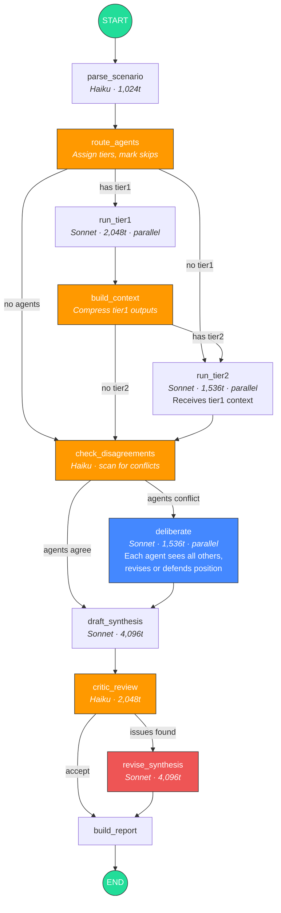

# Financial Market Simulation — Multi-Agent Framework

An AI-powered multi-agent system that simulates how financial markets react to macroeconomic, monetary, and fiscal policy changes. Built on the Anthropic Claude API with a **LangGraph** state-machine pipeline, tiered execution, selective agent activation, model tiering, and two-pass synthesis.

## Architecture

The orchestrator is a **LangGraph `StateGraph`** with 11 nodes and 4 conditional decision points. Each node does one job, reads from shared state, and returns a partial update.



### 4 Decision Points

| Decision Node | Question | Paths |
|--------------|----------|-------|
| **route_agents** | Are there tier1 agents for this policy type? | `run_tier1` / `run_tier2` / `check_disagreements` |
| **build_context** | Are there tier2 agents to run? | `run_tier2` / `check_disagreements` |
| **check_disagreements** | Do agents contradict each other on direction? | `deliberate` / `draft_synthesis` |
| **critic_review** | Did the critic find contradictions + gaps, or lower confidence? | `revise_synthesis` / `build_report` |

### Agent Interaction Model

The system has **three levels** of inter-agent communication:

1. **Tier1 → Tier2 context passing**: Upstream agents (central bank, fiscal) produce signals that downstream agents (equities, forex) receive as input. The fixed income agent *knows* the central bank's rate path conclusion instead of guessing independently.

2. **Deliberation round** (conditional): After all agents run, Haiku scans for material directional conflicts (e.g., one agent says "risk-on" while another says "risk-off"). If conflicts exist, every agent sees every other agent's full analysis and can revise its position or defend it with domain-specific reasoning. This runs in parallel.

3. **Synthesis + critic**: The synthesis merges all (potentially revised) analyses. The critic catches anything the agents themselves didn't resolve.

The deliberation round only fires when agents actually disagree — if everyone is aligned, the graph skips it and saves the API calls.

### Why LangGraph?

- **Decision logic is in the graph**, not hidden inside functions. You see all 4 branch points at the architecture level.
- **Agent interaction is a graph node**, not a side effect. Deliberation is an explicit step that can be traced and debugged.
- **Self-correcting**: Two feedback mechanisms — agent deliberation (before synthesis) and critic revision (after synthesis).
- **Skip paths save tokens**: Aligned agents skip deliberation. Regulatory scenarios skip tier1. Clean drafts skip revision.
- **Extensible**: Adding a node means one `add_node` + one `add_edge`.

## Optimizations

### 1. Tiered Execution with Context Passing
Upstream agents (central bank, fiscal policy, commodities) run first and produce primary signals. Their outputs are compressed and passed as context to downstream agents (fixed income, equities, forex, sentiment), so downstream agents build on real upstream conclusions instead of guessing independently.

### 2. Selective Agent Activation
After parsing the scenario, the orchestrator classifies it by policy type and activates only the relevant agents. A regulatory scenario runs 4 agents; a monetary scenario runs 6; a mixed scenario runs all 7. This saves 20-40% of API calls without losing quality.

| Policy Type  | Agents Run | Skipped            |
|-------------|------------|--------------------|
| monetary    | 6          | fiscal_policy      |
| fiscal      | 5          | forex, commodities |
| trade       | 6          | (none)             |
| regulatory  | 4          | central_bank, forex, commodities |
| supply_shock| 6          | fiscal_policy      |
| mixed       | 7          | (none)             |

### 3. Model Tiering
Scenario parsing and the critic pass use Haiku (fast, cheap). Agent analysis and draft synthesis use Sonnet (full reasoning). Token budgets are right-sized per call type.

| Call Type           | Model  | Max Tokens | When it runs |
|--------------------|--------|------------|--------------|
| Scenario parse     | Haiku  | 1,024      | Always       |
| Disagreement check | Haiku  | 8          | Always (yes/no response) |
| Tier 1 agents      | Sonnet | 2,048      | If tier1 agents assigned |
| Tier 2 agents      | Sonnet | 1,536      | If tier2 agents assigned |
| Deliberation round | Sonnet | 1,536      | Only if agents conflict |
| Draft synthesis    | Sonnet | 4,096      | Always       |
| Critic pass        | Haiku  | 2,048      | Always       |
| Revision pass      | Sonnet | 4,096      | Only if critic finds issues |

### 4. Agent Deliberation (conditional)
After all agents run independently, Haiku scans for material directional conflicts. If agents contradict each other (e.g., risk-on vs risk-off), each agent enters a deliberation round where it sees all other agents' full analyses and can revise its position or defend it. This runs in parallel and only fires when needed.

### 5. Two-Pass Synthesis with Critic
The draft synthesis merges all analyses into a unified report. The critic pass checks for contradictions, missing causal links, and unsupported claims. If the critic finds serious issues, the graph routes through a revision pass before building the final report.

### Additional: Structured Output via Tool Use
All LLM calls that expect JSON use Anthropic's `tool_use` feature instead of prompt-based JSON generation. This guarantees valid structured output and eliminates parse failures. System prompts are cached via `cache_control` for 90% savings on repeated calls.

## Agents

| Agent | Tier | Domain | Key Outputs |
|-------|------|--------|-------------|
| Central Bank | 1 | Monetary policy, rates, QE/QT | Rate path, liquidity conditions |
| Fiscal Policy | 1 | Gov spending, taxes, deficits | Demand impact, debt trajectory |
| Commodities & Inflation | 1 | Prices, CPI/PPI | Inflation path, commodity moves |
| Equity Market | 2 | Stock sectors, valuations | Sector rotation, P/E shifts |
| Fixed Income | 2 | Bonds, yield curve, spreads | Yield moves, curve shape |
| Forex | 2 | Exchange rates, capital flows | Currency direction, carry trade |
| Sentiment & Behavioral | 2 | Psychology, risk appetite | Risk-on/off, positioning |

## Setup

```bash
# 1. Clone and enter the project
git clone <repo-url>
cd financial-market-sim

# 2. Create virtual environment
python -m venv venv
source venv/bin/activate  # Windows: venv\Scripts\activate

# 3. Install dependencies (includes langgraph, anthropic, streamlit, rich)
pip install -r requirements.txt

# 4. Set your API key
cp .env.example .env
# Edit .env and add your Anthropic API key
```

## Usage

### CLI Mode

```bash
# Activate virtual environment
source venv/bin/activate

# Interactive mode (REPL — type scenarios, get reports)
python main.py

# Single scenario
python main.py --scenario "The Fed cuts rates by 50bps unexpectedly"

# Compare two scenarios side-by-side
python main.py --compare \
  --scenario-a "Fed raises rates 25bps" \
  --scenario-b "Fed raises rates 100bps"

# Override model or economy
python main.py --scenario "ECB begins QT" --economy EU --model claude-sonnet-4-20250514
```

### Web UI (Streamlit)

```bash
streamlit run app.py
```

Opens a browser dashboard where you can:
- Enter scenarios and see full simulation reports
- Compare two scenarios side-by-side
- View individual agent analyses with confidence levels
- Download reports as Markdown

### Python API

```python
from orchestrator import Orchestrator

orch = Orchestrator()

# Single simulation
report = orch.run("What happens if the Fed raises rates by 100bps unexpectedly?")
print(report.to_markdown())

# Compare two scenarios
comparison = orch.compare(
    "Fed raises rates 25bps",
    "Fed raises rates 100bps",
)
print(comparison)
```

## Configuration

Edit `config.py` or set environment variables:

| Variable | Default | Description |
|----------|---------|-------------|
| `ANTHROPIC_API_KEY` | — | Your Anthropic API key (required) |
| `MODEL_NAME` | `claude-sonnet-4-20250514` | Main model for agent analysis and synthesis |
| `MODEL_FAST` | `claude-haiku-4-5-20251001` | Fast model for parsing and critic pass |
| `BASE_ECONOMY` | `US` | Default economy for simulations |
| `MAX_RETRIES` | `3` | API retry attempts |

## Example Scenarios

- *"The Fed raises interest rates by 100bps unexpectedly while inflation is at 6%"*
- *"Congress passes a $2 trillion infrastructure stimulus funded by new corporate taxes"*
- *"China devalues the yuan by 10% in response to trade tariffs"*
- *"The ECB begins quantitative tightening while the US cuts rates"*
- *"Oil prices spike to $150/barrel due to Middle East supply disruption"*

## Project Structure

```
financial-market-sim/
├── config.py              # API keys, model config, routing rules, token budgets
├── orchestrator.py        # LangGraph StateGraph pipeline (8 nodes)
├── main.py                # CLI entry point (Rich terminal UI)
├── app.py                 # Streamlit web UI
├── requirements.txt       # Python dependencies
├── .env                   # API key (not committed)
├── .env.example           # Template for .env
├── agents/
│   ├── base.py            # BaseAgent with tool_use and tier support
│   ├── central_bank.py    # Monetary policy specialist (Tier 1)
│   ├── fiscal_policy.py   # Government spending specialist (Tier 1)
│   ├── commodities.py     # Commodities & inflation specialist (Tier 1)
│   ├── equity_market.py   # Stock market specialist (Tier 2)
│   ├── fixed_income.py    # Bond market specialist (Tier 2)
│   ├── forex.py           # Currency specialist (Tier 2)
│   └── sentiment.py       # Market psychology specialist (Tier 2)
├── models/
│   ├── scenario.py        # Pydantic model for parsed scenarios
│   └── report.py          # Pydantic models for agent output and reports
└── utils/
    └── llm_client.py      # Anthropic API wrapper (caching, tool_use, model tiering)
```

## License

MIT
