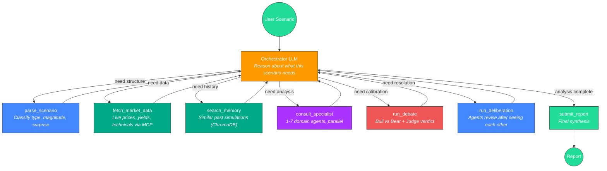

# Financial Market Simulation — Multi-Agent Framework

An AI-powered multi-agent system that simulates how financial markets react to macroeconomic, monetary, and fiscal policy changes. Built on the Anthropic Claude API with a **ReAct-style agentic orchestrator** that dynamically decides its analysis strategy, specialist domain agents, structured adversarial debate, vector memory (ChromaDB), live market data via MCP, and user preference steering.

## Architecture

The orchestrator is a **ReAct agent loop** — instead of following a fixed pipeline, the orchestrator LLM reasons about each scenario and dynamically decides which tools to use, which specialists to consult, and when to synthesize.



### How the Agent Loop Works

1. The orchestrator receives the scenario and available tools
2. It **reasons** about what this specific scenario requires
3. It **calls tools** — parse, fetch data, consult agents, debate, etc.
4. Tool results feed back into the orchestrator's context
5. It **reasons again** — do I need more analysis, or am I ready to synthesize?
6. Loop continues until it calls `submit_report` or hits the iteration cap (25)

### Adaptive Behavior

The orchestrator adapts its strategy based on scenario complexity:

| Scenario Type | Typical Strategy | Tool Calls |
|--------------|-----------------|------------|
| Simple/clear (e.g. "Fed raises 25bp") | Parse → 2-3 key agents → report | 3-4 |
| Moderate (e.g. "fiscal stimulus + tax reform") | Parse → market data → 4-5 agents in tiers → report | 5-7 |
| Complex/ambiguous (e.g. "trade war + currency devaluation + supply shock") | Parse → data → memory → all agents in tiers → deliberation → debate → report | 8-12 |

### Why Agentic Instead of a Fixed Pipeline?

- **Scenario-aware**: A simple rate change doesn't need 7 agents, debate, and deliberation. The orchestrator skips what's unnecessary.
- **Dynamic ordering**: The LLM decides which agents should inform which — not a hardcoded routing table.
- **User-steerable**: Preferences like "depth=deep" or "focus=equity_market" change the orchestrator's strategy, not just parameters.
- **Self-correcting**: If agent analyses conflict, the orchestrator can choose to run deliberation or debate — or neither if the conflict is minor.
- **Extensible**: Adding a new capability means adding a new tool definition — the orchestrator discovers when to use it.

## 7 Orchestrator Tools

| Tool | Purpose | When Used |
|------|---------|-----------|
| `parse_scenario` | Classify scenario (type, magnitude, surprise) | First call — always |
| `fetch_market_data` | Pull live data via MCP (yields, prices, technicals) | When real-time context would help |
| `search_memory` | Find similar past simulations in ChromaDB | When historical context exists |
| `consult_specialist` | Run 1+ domain agents (parallel if multiple) | Core analysis step |
| `run_debate` | Bull/bear adversarial debate on impact magnitude | When impact is genuinely uncertain |
| `run_deliberation` | Agents review and revise each other's analyses | When agents materially disagree |
| `submit_report` | Produce final report — ends the loop | When analysis is sufficient |

## Agent Interaction Model

The system has **five levels** of inter-agent communication, all triggered dynamically:

1. **Tiered context passing**: The orchestrator can consult upstream agents first (central bank, fiscal) and pass their outputs as context to downstream agents (equities, forex). Unlike the old fixed pipeline, the orchestrator decides the tier structure per-scenario.

2. **Deliberation** (orchestrator-triggered): When the orchestrator notices agent analyses conflict, it can invoke deliberation — each agent sees all others' analyses and can revise or defend its position.

3. **Adversarial debate** (orchestrator-triggered): A Bull agent argues for maximum impact, a Bear argues for minimum. They alternate for multiple rounds. A Judge produces a calibrated verdict.

4. **Memory-informed analysis**: Past simulation outcomes are retrieved and injected into agent context, so analyses account for historical patterns.

5. **Market-data grounding**: Live market data from MCP tools grounds analyses in current conditions rather than training knowledge alone.

## Agents

| Agent | Domain | Key Outputs |
|-------|--------|-------------|
| Central Bank | Monetary policy, rates, QE/QT | Rate path, liquidity conditions |
| Fiscal Policy | Gov spending, taxes, deficits | Demand impact, debt trajectory |
| Commodities & Inflation | Prices, CPI/PPI | Inflation path, commodity moves |
| Equity Market | Stock sectors, valuations | Sector rotation, P/E shifts |
| Fixed Income | Bonds, yield curve, spreads | Yield moves, curve shape |
| Forex | Exchange rates, capital flows | Currency direction, carry trade |
| Sentiment & Behavioral | Psychology, risk appetite | Risk-on/off, positioning |

## Setup

```bash
# 1. Clone and enter the project
git clone <repo-url>
cd financial-market-sim

# 2. Create virtual environment
python -m venv venv
source venv/bin/activate  # Windows: venv\Scripts\activate

# 3. Install dependencies
pip install -r requirements.txt

# 4. Set your API key
cp .env.example .env
# Edit .env and add your Anthropic API key
```

## Usage

### CLI Mode

```bash
# Activate virtual environment
source venv/bin/activate

# Interactive mode (REPL — type scenarios, get reports)
python main.py

# Single scenario
python main.py --scenario "The Fed cuts rates by 50bps unexpectedly"

# With preferences (depth, focus domains, skip debate)
python main.py --scenario "Fed raises rates" --preferences "depth=deep,focus=equity_market,focus=forex"

# Compare two scenarios side-by-side
python main.py --compare \
  --scenario-a "Fed raises rates 25bps" \
  --scenario-b "Fed raises rates 100bps"

# Override model or economy
python main.py --scenario "ECB begins QT" --economy EU --model claude-sonnet-4-20250514
```

### User Preferences

Steer the orchestrator's analysis strategy via preferences:

```bash
# CLI
python main.py -s "scenario" -p "depth=deep,focus=equity_market,focus=forex"

# Interactive mode
scenario> prefs depth=deep,focus=equity_market
scenario> The Fed raises rates by 50bps
```

| Preference | Values | Effect |
|-----------|--------|--------|
| `depth` | quick / standard / deep | Controls how many agents and rounds the orchestrator uses |
| `focus` | Any agent domain name | Orchestrator prioritizes these domains |
| `horizon` | immediate / short / medium | Emphasizes a specific time horizon |
| `no_debate` | (flag) | Orchestrator skips the debate step |

### Web UI (Streamlit)

```bash
streamlit run app.py
```

### Python API

```python
from orchestrator import Orchestrator

orch = Orchestrator()

# Basic simulation
report = orch.run("What happens if the Fed raises rates by 100bps unexpectedly?")
print(report.to_markdown())

# With preferences
report = orch.run(
    "Fed raises rates 50bps",
    preferences={"depth": "deep", "focus_domains": ["fixed_income", "forex"]},
)

# Compare two scenarios
comparison = orch.compare(
    "Fed raises rates 25bps",
    "Fed raises rates 100bps",
)
print(comparison)
```

## Key Features

### ReAct Agent Loop
The orchestrator uses Anthropic's `tool_use` API with `tool_choice: auto` to implement a reasoning loop. The LLM sees tool results, thinks about what to do next, and calls more tools or submits the final report. This replaces the old fixed LangGraph pipeline.

### Vector Memory (ChromaDB)
Every completed simulation is stored in a ChromaDB vector store. On the next run, the orchestrator can search for similar past scenarios and include their outcomes in agent context. This enables **cross-run learning**.

### MCP Integration (Live Market Data)
The system connects to external data services via the **Model Context Protocol**. The default MCP server provides live market data via yfinance — stock prices, treasury yields, technical indicators, sector performance, and fundamentals. The orchestrator decides when to fetch market data based on scenario relevance.

### Adversarial Debate
A Bull agent argues for maximum impact, a Bear argues for minimum. A Judge arbitrates with a calibrated verdict. The orchestrator decides whether a debate adds value for each scenario.

### Structured Output via Tool Use
All LLM calls use Anthropic's `tool_use` for guaranteed valid JSON. System prompts are cached via `cache_control` for cost savings on repeated calls.

## Configuration

Edit `config.py` or set environment variables:

| Variable | Default | Description |
|----------|---------|-------------|
| `ANTHROPIC_API_KEY` | — | Your Anthropic API key (required) |
| `MODEL_NAME` | `claude-sonnet-4-20250514` | Main model for orchestrator and agents |
| `MODEL_FAST` | `claude-haiku-4-5-20251001` | Fast model for parsing |
| `BASE_ECONOMY` | `US` | Default economy for simulations |
| `MAX_ORCHESTRATOR_ITERATIONS` | `25` | Max tool-call iterations per simulation |
| `MAX_DEBATE_ROUNDS` | `2` | Number of Bull/Bear exchange cycles |
| `MEMORY_ENABLED` | `true` | Enable cross-run ChromaDB memory |
| `MEMORY_DIR` | `.memory` | Directory for ChromaDB persistence |
| `MEMORY_RETRIEVE_K` | `3` | Number of similar past scenarios to retrieve |
| `MCP_ENABLED` | `false` | Enable MCP external data integration |

## Example Scenarios

- *"The Fed raises interest rates by 100bps unexpectedly while inflation is at 6%"*
- *"Congress passes a $2 trillion infrastructure stimulus funded by new corporate taxes"*
- *"China devalues the yuan by 10% in response to trade tariffs"*
- *"The ECB begins quantitative tightening while the US cuts rates"*
- *"Oil prices spike to $150/barrel due to Middle East supply disruption"*

## Project Structure

```
financial-market-sim/
├── config.py              # API keys, model config, token budgets
├── orchestrator.py        # ReAct agentic orchestrator (tool-use loop)
├── orchestrator_legacy.py # Old LangGraph fixed pipeline (reference)
├── main.py                # CLI entry point (Rich terminal UI, preferences)
├── app.py                 # Streamlit web UI
├── requirements.txt       # Python dependencies
├── .env                   # API key (not committed)
├── .env.example           # Template for .env
├── agents/
│   ├── base.py            # BaseAgent with tool_use and deliberation
│   ├── central_bank.py    # Monetary policy specialist
│   ├── fiscal_policy.py   # Government spending specialist
│   ├── commodities.py     # Commodities & inflation specialist
│   ├── equity_market.py   # Stock market specialist
│   ├── fixed_income.py    # Bond market specialist
│   ├── forex.py           # Currency specialist
│   └── sentiment.py       # Market psychology specialist
├── memory/
│   └── store.py           # ChromaDB vector store for cross-run learning
├── mcp_tools/
│   ├── client.py          # MCP client manager (async bridge)
│   └── yfinance_server.py # Live market data MCP server (yfinance)
├── models/
│   ├── scenario.py        # Pydantic model for parsed scenarios
│   └── report.py          # Pydantic models for agent output and reports
└── utils/
    └── llm_client.py      # Anthropic API wrapper (caching, tool_use, tiering)
```

## License

MIT
