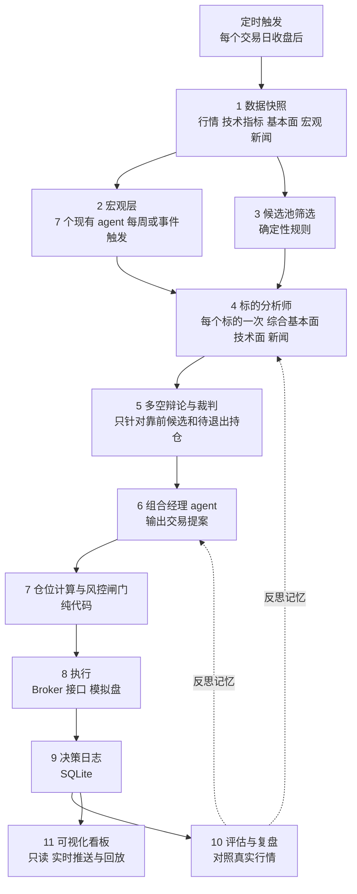

# 升级方案：从宏观情景模拟器到美股波段交易系统

日期：2026-11-16　状态：阶段 0 和阶段 1 已完成，下一步是阶段 2

## 1. 目标与已定事项

把现有的多 agent 宏观情景模拟器，升级成一个能自己产生买卖判断并执行的系统。

| 事项 | 决定 |
|---|---|
| 市场 | 美股 |
| 持仓周期 | 波段，数天到数周 |
| 执行 | 先做与券商无关的接口和本地模拟盘，券商以后再接 |
| 运行节奏 | 每个交易日收盘后运行一次，订单在下一个交易日执行 |

## 2. 设计原则

1. **LLM 只提案，代码做决定。** agent 输出结构化的观点和交易提案；仓位大小、风控、订单生成全部是确定性代码。LLM 无法绕过风控。
2. **每个决定都留档、都能打分。** 每次运行保存当时用到的数据、agent 输出、提案、风控结果、订单和成交，事后与真实行情对账。
3. **先影子、再模拟、最后实盘。** 先只出信号不下单，再跑模拟盘，达到事先写定的门槛后才考虑实盘。
4. **固定流水线，不用自由发挥的循环。** 交易流程的阶段顺序由代码决定，LLM 只在阶段内部工作。这样结果可复现、可审计，成本也可控。
5. **默认安全。** 默认模式是模拟盘；实盘需要单独的开关和密钥；任何数据异常或输出不合规都导致"不交易"。

## 3. 目标架构



第 2、4、5、6 步是 LLM，其余是代码。

### 新增目录

```
data/        行情、基本面、宏观、新闻的 provider，交易日历，时点快照
pipeline/    每日固定流水线、候选池筛选
agents/ticker/  标的分析师和组合经理
portfolio/   仓位计算
risk/        风控闸门、熔断、停止开关
execution/   Broker 接口、PaperBroker、以后的券商适配器
journal/     SQLite 决策日志和评估
dashboard/   只读数据接口和网页看板
tests/       单元测试和冒烟测试
```

## 4. 现有代码的处置

| 现有部分 | 处置 |
|---|---|
| 7 个宏观 agent（`agents/`） | 保留，作为宏观层。输入从"假设情景"改为"当前宏观快照加近期事件"，输出增加结构化字段（风险偏好、板块倾向）。 |
| `agents/base.py` 的模板 | 保留并扩展，新的标的分析师沿用同一模式。 |
| 多空辩论 | 改造。现在争论"冲击大还是小"，改为争论"这个仓位该不该开、该不该留"。 |
| ReAct 编排器（`orchestrator.py`） | 保留为"研究模式"，继续做情景分析。交易流程不走它。 |
| `utils/llm_client.py` | 重写调用方式，并做成可切换模型提供方，见阶段 0。 |
| `mcp_tools/yfinance_server.py` | 数据函数抽到 `data/` 直接调用，MCP 服务只留薄封装给研究模式用。 |
| `mcp_tools/client.py` | 已删除。关键词路由在阶段 1 去掉后，模拟器不再经过 MCP，这个客户端没有任何调用方。 |
| ChromaDB 记忆 | 修复后保留，只用于检索复盘文字。交易记录以 SQLite 为准。 |
| `orchestrator_legacy.py` | 已删除，原文件留在 git 历史里（提交 `96565d9`）。其中"批评者审稿"的做法（`_node_critic`、`_node_revise`）可在组合经理提案后复用，届时用 `git show 96565d9:orchestrator_legacy.py` 查看。 |
| Streamlit 界面（`app.py`） | 保留研究模式页面。交易看板另做，见阶段 5。 |

## 5. 分阶段计划

每个阶段的完成标准都能在交付当时直接检查。

### 阶段 0：让系统重新跑起来

现状比上次汇报的更严重：按 Claude API 文档，`.env` 里配置的 `claude-sonnet-4-20250514` 已于 2026-06-15 退役，所以现在任何一次模拟都会在第一次 LLM 调用时失败。（依据是 API 文档，没有做真实调用验证。）

工作内容：

- 模型 ID 换成当前模型，集中到一处配置，见第 8 节。
- 重写 `LLMClient` 的调用方式，原因是当前模型的接口变了：
  - 去掉 `temperature`，当前模型传非默认值会返回 400。
  - 强制 `tool_choice` 在 Opus 5.5 和 Sonnet 5.5 上返回 400，而现有代码的结构化输出全部依赖它。改用结构化输出（`client.messages.parse()` 加 Pydantic 模型）。
  - 现有的 1024 到 4096 的 `max_tokens` 预算在"思考常开"的模型上会截断输出，提高到 16000 左右，并检查 `stop_reason`。
  - 处理 `refusal` 停止原因。
  - 记录每次调用的 token 用量和费用。
- **模型提供方可切换**：调用层对外只有一个统一接口，输入提示词和 Pydantic schema，输出校验过的对象和用量。下面挂两个实现：Claude（走官方 SDK），以及 OpenAI 兼容接口（Ollama 和多数托管开源模型服务都是这种）。每个角色用哪个提供方、哪个模型都是配置项。开源模型一侧用按 schema 约束的输出，校验失败后重试。
- 升级 `anthropic` SDK（当前 0.86，上述接口需要新版本）。
- `orchestrator.py` 的主循环直接调用了 client 并传了 `temperature`，一并修改。
- 修复已确认的问题：重装 chromadb 并让初始化失败时报错而不是静默跳过；审议后丢失未参与 agent 的分析；`requirements.txt` 补 `yfinance`、`pandas`、`pytest`；`MAX_ITERATIONS` 读配置；`.memory/` 移出 git；删除空目录 `{agents,models,utils}`。
- 加 pytest 和用假 LLM 的冒烟测试。

完成标准：`python main.py -s "..."` 端到端产出报告（会花少量 API 费用）；pytest 通过；启动时打印记忆库和数据通道的真实状态；同一个结构化输出冒烟测试在 Claude 和本机 Ollama 的一个小模型上都能通过。

**完成记录（2026-11-16）**

阶段 0 已完成，按你的要求默认使用本机开源模型。验证结果：

- 单元测试 46 个通过，不需要真实模型。
- 本机 Ollama 的真实模型测试通过（主模型 `qwen2.5-coder:7b`，快速模型 `llama3.2`）。
- 端到端情景模拟跑通：7 分 24 秒，25 次模型调用，无按量费用。记忆库（11 条历史记录）和行情通道（8 个工具）都正常。
- 经过一轮独立代码评审，6 条意见全部处理。

与原计划不同的地方：

- 默认提供方是 Ollama，不是 Claude。Claude 和 OpenAI 兼容接口两条路径都已实现并有单元测试。
- Claude 路径没有用真实 API 验证过，因为那需要花钱。验证命令是 `RUN_LIVE_ANTHROPIC=1 pytest -m live`。
- `anthropic` SDK 没有升级：现有的 0.86 已经支持结构化输出。
- 编排器不再使用厂商的工具调用格式。每一步由模型返回一个结构化的"下一步动作"，这样三种提供方的行为一致。场景解析改为固定的第一步。
- Ollama 在提示词超长时默认静默截断。现在请求里带 `truncate: false`，超长时服务端直接报错。

同一天的后续修复，起因是用本机模型跑出的报告暴露了两个系统设计问题：

- **辩论双方改名。** 原来叫 bull 和 bear，但含义是"影响严重"和"影响有限"，与市场上牛熊的通常含义相反，导致报告的情景矩阵写反。现在叫"影响严重方"和"影响有限方"，合成报告时明确规定牛市情景是对风险资产更有利的情形。重跑后矩阵方向正确。
- **拦住 agent 互相照抄。** 弱模型会把别的 agent 的句子直接粘进自己的分析，多个独立视角因此变成一个。现在审议后某个字段若是照抄的，退回该 agent 自己原来的文字；最终报告里有大段相同文字的两个 agent 会列在"质量警告"里。判定标准是连续照搬 30 个词以上，或 20 个词以上且占该字段四成。两次真实运行中，没有照抄时两个 agent 最多共有 17 个词的相同片段，而被照抄的那段有 90 个词。

遗留事项：

- **分析质量不够。** 7B 的本机模型能跑通流程，但报告里有自相矛盾的结论和编造的数字。在换用更强的模型之前，输出不能当作分析结论使用。
- `.memory/` 已加入 `.gitignore`，但它之前被提交过，仍在 git 的跟踪里。提交时需要执行 `git rm -r --cached .memory`。
- `docs/` 下两份逐行代码讲解文档讲的是改造前的代码，已经过时。
- Claude 路径没有启用"模型拒答时自动换模型重试"的功能，拒答会直接报错。

### 阶段 1：数据层

- **交易日历**：用现成的交易所日历库判断哪天是交易日、哪天提前收盘。流水线每天被触发，但非交易日直接退出。后面所有提到"交易日""次日"的地方都以它为准。
- 新建 `data/`，把日线、技术指标、基本面、板块表现、收益率曲线做成普通 Python 函数，统一走一个 provider 接口。第一版用 yfinance。
- 新增宏观序列（CPI、失业率、政策利率等），来源用 FRED。
- 新增新闻和财报日历，做成可插拔接口，具体来源在本阶段内选定。
- 取公司行为数据（拆股、分红），供阶段 3 使用。
- **时点快照**：每次运行把用到的全部数据按日期存盘。评估、复盘、回放都只读快照。
- 数据质量检查：缺字段、数据过期、价格异常时，该标的不进入决策。
- 删除关键词路由；研究模式的 `fetch_market_data` 改成显式指定工具和参数。
- agent 提示词里，数据放在单独的"数据快照"段，不再冒充上游 agent 的结论。"禁止给具体数字"改为"只能引用快照里出现的数字"。

完成标准：一条命令为任意标的列表生成快照并通过校验；数据函数有基于缓存样本的单元测试；日历对节假日和提前收盘日的判断有单元测试；研究模式下货币、财政、商品三类情景都能取到正确数据。

**完成记录（2026-11-16）**

阶段 1 已完成，四条完成标准全部满足：

- 命令 `python -m data.snapshot --tickers AAPL,MSFT` 约 8 秒生成快照并存盘；有标的不可用时返回非零退出码。
- 数据层测试用当天录制的真实样本离线运行。全部测试共 143 个通过。
- 交易日历的测试覆盖周末、感恩节、圣诞节、顺延的独立日、两个提前收盘日，以及盘中、收盘前一分钟、收盘时刻、纽约深夜（UTC 已是次日）等时间点。
- 用真实数据验证了货币、财政、商品三类情景，每类都取到 21 个市场序列和 10 个宏观序列。
- 用本机模型完整跑通一次石油情景：快照取到并存盘，7 个 agent 都拿到了数据。
- 经过一轮独立代码评审：没有发现前视偏差，5 条具体问题全部修复。

做出的选择：

- **数据源**：行情、基本面、财报日期、新闻标题来自 Yahoo Finance（通过 yfinance）；宏观数据来自 FRED 的公开 CSV 接口。都免费，不需要密钥。
- **新闻**：yfinance 原有的新闻接口已经失效，改用它的搜索接口，并只保留标注了该标的的标题。相关性一般，会混入大盘新闻。新闻取不到只记警告，不影响标的可用。
- **交易日历**：用 `exchange_calendars` 库的纽交所日历。
- **研究模式不再经过 MCP**：编排器直接调用数据层。MCP 服务保留为一层薄封装，供外部 MCP 客户端使用。
- **取数是确定的**：编排器选择"取数据"时，固定取全套市场和宏观数据，另加模型点名的标的。不再按关键词猜该取什么。

数据层强制的三条规则：

- 只用已收盘的交易日。盘中运行时，当天未走完的 K 线被剔除。
- 数据有问题就拒用。价格过期、历史太短、任何一根 K 线价格缺失或非正、高低价不包含开收盘价、无成交量、复权后单日涨跌超过 50%，都会把标的标为不可用并写明原因。
- 每次取数都存盘，路径是 `data_store/snapshots/<交易日>/`。

遗留事项：

- **提示词约束不住编数字，已加代码检查。** agent 被要求只引用快照里的数字，但实测 7B 本机模型仍然会编点位和收益率。现在代码会把每个 agent 的分析和报告汇总部分里的数字，与快照、情景和该 agent 自己的指令逐一比对，找不到来源的列在报告的"质量警告"里。这个检查只报告，不改写 agent 的文字，也分不清"编的"和"自己算出来的"。要让模型不编数字，仍然需要更强的模型，或者在阶段 2 把输出改成结构化的引用。
- yfinance 是非官方接口，测试期间它的一个新闻接口就是坏的。实盘前要换成正式数据源。
- 基本面是取数当时的值。yfinance 不提供历史时点的基本面，所以回放历史时基本面不可用。
- 宏观数据按观测日期截取，没有处理"某月数据在次月才公布"的发布滞后。前瞻运行不受影响，回放历史时要注意。

### 阶段 2：信号层（影子模式，不下单）

- 定义三个结构化输出：
  - `MacroRegime`：风险偏好、板块倾向、主要风险、把握度。
  - `TickerView`：方向、把握度（0 到 1）、预期周期、失效条件、催化剂、引用的数据。
  - `TradeProposal`：标的、动作（买入、卖出、持有、减仓）、把握度、理由。
- 宏观层：7 个 agent 改为分析当前状态，每周运行一次，遇到重大事件额外运行，结果缓存复用。
- 标的层：新增一个标的分析师，每个标的调用一次，同时看基本面、技术面和新闻。先不拆成三个分析师：合在一起能权衡三类信息之间的矛盾，调用次数也只有三分之一。以后发现这一层是质量瓶颈再拆。
- 候选池：用确定性规则（流动性、价格、趋势）从白名单里筛出 10 到 30 个候选，加上全部现有持仓。
- 辩论：只对排名靠前的候选和出现退出信号的持仓进行，裁判输出校准后的把握度和失效条件。
- 组合经理 agent：综合宏观结论、各标的观点和当前持仓，输出提案列表。
- **影子持仓**：这一阶段还没有模拟盘，所以按前几天的提案记一份假想持仓（次日开盘价、固定仓位）。这样组合经理每天都能看到持仓，卖出、持有、减仓三条路径在本阶段就会被执行到。另外用预置持仓的测试用例直接验证退出路径。
- 固定流水线 `pipeline/daily.py`。
- **模型对比**：影子模式下可以让两套模型配置（例如 Claude 和一个开源模型）读同一份数据快照，各出一份信号并分别记录，留给阶段 4 打分比较。
- **交互事件记录**：每一次 agent 发言都记成一条事件，包含谁说的、回应谁、属于哪个环节、时间和内容。每个结构化输出带一句 agent 自己写的简短发言，供看板展示。阶段 5 的看板只读这些记录，所以必须从这一阶段开始记。

完成标准：每天收盘后一条命令产出信号表（JSON 和 Markdown），全部通过 schema 校验；记录单次运行费用；连续 5 个交易日运行无错误；期间至少产生过卖出或减仓提案并通过校验。

### 阶段 3：仓位、风控、模拟盘

仓位和风控：

- `portfolio/`：由把握度和波动率（ATR）算出目标仓位，止损位来自失效条件和 ATR。
- `risk/`：风控闸门，规则见第 6 节。每条被拒绝或被削减的订单都记录原因。

执行（`execution/`）：

- `Broker` 接口：查账户、查持仓、下单、撤单、查订单。
- `PaperBroker` 按日线撮合，规则如下：
  - 市价单在下一个交易日按开盘价成交。
  - 限价单在当日最高最低价覆盖限价时成交，默认当日有效。
  - 止损单一直有效，直到触发或撤销。开盘价已低于止损价时按开盘价成交，否则按止损价成交。
  - 每日处理顺序是先止损、再限价、再市价。同一天止损和止盈都可能触发时，按止损先触发处理。
  - 第一版不模拟部分成交，订单要么全成、要么不成。这是已知的简化。
  - 滑点可配置。
- 公司行为：
  - 拆股时调整持仓数量、成本价和止损价。
  - 分红记为现金流入。
  - 退市或代码变更时标记该持仓，停止对它下新单，模拟盘按最后成交价平仓。
  - 并购等其他情况标记为需人工处理。
  - 持仓记账用未复权价格加显式调整，技术指标用复权价格。

状态和恢复：

- `journal/`：SQLite 记录每次运行的快照引用、agent 输出、提案、风控结果、订单、成交和每日净值。
- `PaperBroker` 的账户、持仓、订单全部存 SQLite，每次变更立即落盘。
- 每次运行有唯一编号。流水线每个阶段的产出都落盘；中断后重跑时复用已完成阶段的产出，不重新取数，也不重复调用 LLM。
- 下单分三步：先记录意图，再提交，再确认。每张订单带唯一编号，重跑时据此去重。
- 停止开关。

回放测试用脚本化的提案，不调用真实 LLM。原因是模型"知道"历史行情，用真实 LLM 回放时它会避开亏损，熔断和亏损上限根本不会被触发，测试等于没测。脚本化场景包括：连续亏损触发熔断、单票和板块超限、当日开仓数超限、拆股、流水线中途崩溃后重跑。

完成标准：每日流水线端到端在模拟盘下单；每条风控规则都有单元测试；脚本化回放中每条风控都在设定的阈值处触发；中途杀掉进程后重跑不产生重复订单。

### 阶段 4：评估闭环

- 评估任务：给每一条 `TickerView` 打分，不只是成交的交易。观点到期后计算方向对错和相对 SPY 的超额收益；成交的交易另外记录是否触发止损和实际盈亏。
- 统计：按把握度分桶的命中率（检验把握度是否可信）；按板块、宏观状态拆分；并行跑过多套模型配置时按模型拆分；盈亏归因。
- 三个对照基准，全部是纯代码：
  - SPY 买入持有。
  - 候选池等权：衡量筛选规则本身的贡献。
  - 候选池随机选股：用同样的候选池、仓位和风控规则随机选股，模拟上千次，得到一个结果分布。LLM 组合落在这个分布的什么位置，直接回答"LLM 的选择是否好于在同一个池子里随便选"。
- 反思记忆：LLM 根据真实结果写复盘，存入记忆，相似情形下检索。记忆里的"结果"从此是真实结果，不再是系统自己的预测。
- 评估报告：一条命令生成，包含净值对比基准、观点记分卡、三个基准对照和 LLM 费用。完整的可视化看板在阶段 5 做。

完成标准（交付时可检查的部分）：评估报告用合成数据正确生成；打分逻辑在 5 个以上手工构造、结果已知的用例上算对；随机基准可运行。用真实结果验收的部分放在阶段 6。

### 阶段 5：可视化看板

一个网页看板，覆盖系统的全部信息。每个 agent 展示成一个有名字、头像和职位的人物，它们之间的交互展示成一场会议。

人物：

- 12 个 LLM 角色：7 个宏观分析师、标的分析师、多方、空方、裁判、组合经理。
- 2 个代码角色：风控官（风控闸门）和交易员（执行）。它们也做成人物，但在界面上标明是规则，不是 LLM。
- 每个人物有头像、姓名、职位、当前状态（空闲、分析中、发言中）、今天的观点摘要和历史记分。

页面内容：

- 总览：净值对比三个基准、现金、当日盈亏、熔断和停止开关的状态。
- 会议室：这是看板的主画面。所有人物以站立的全身形象围成一圈，多方和空方隔着圆圈相对。当前发言者被高亮，发言内容显示在圆圈中央，并标出是对谁说的。当天的流水线按时间顺序逐条播放：宏观组简报，分析师汇报，多空逐轮辩论，裁判裁决，组合经理提案，风控官批准、削减或拒绝，交易员下单和成交。
- 持仓和订单：当前持仓、止损位、挂单、成交记录、候选池和信号表。
- 评估：观点记分卡、把握度校准、随机选股对照的分布图、按模型拆分的对比。
- 回放：任选一个历史交易日，重放当天的会议和决定。
- 运行状态：数据源是否正常、每次运行的 LLM 费用、失败和告警。

规则：

- **只展示真实记录。** 对话气泡里的文字就是 agent 当时的真实输出，界面不另外生成或润色对话。
- **只读。** 看板不能下单，也不能改风控参数。
- 流水线运行时实时推送事件，平时可回放。

实现：

- 后端是一个只读接口（FastAPI），读 SQLite 日志，用事件流做实时推送。前端是单独的网页，具体框架在本阶段定。
- 交易看板不用 Streamlit。它能做带头像的聊天列表，但做自定义布局和人物动态很吃力。`app.py` 的研究模式页面保留。
- 头像第一版用代码绘制的插画风格。写实照片风格需要你提供图片，或者接图像生成服务。不使用真实人物的肖像。

完成标准：用阶段 2 到 4 积累的真实记录，每个页面都能正确显示；能回放任选一天的完整会议；启动一次流水线时，会议室里的事件随运行实时出现；界面上没有任何下单或改参数的入口。

### 阶段 6：自动运行和模拟盘观察期

- 定时运行（macOS 用 launchd），失败时发通知。
- 事件触发：持仓公司财报、议息会议和 CPI 公布日、持仓大幅跳空时，额外复核相关持仓。
- 按第 7 节事先写定的门槛做观察期评审。

完成标准：无人值守连续运行达到观察期长度；积累到约定数量的已到期观点和平仓交易后，看板显示真实评估结果，复盘内容引用真实行情；产出评审报告。

### 阶段 7：接入真实券商

- 选定券商，写适配器。先接券商自己的模拟环境，与 `PaperBroker` 的结果对照。
- 把券商账户的结算规则和日内交易限制建进风控，接入时按当时的规则核对。
- 实盘用独立的开关和独立的密钥，默认关闭，初期用更严格的上限。
- 实盘的密钥配置、开关和启动由你本人操作。

完成标准：在券商模拟环境连续运行无对账差异；实盘开关和各项限额经你确认。

## 6. 风控规则

全部是配置项，由代码强制执行。具体数值由你决定，代码里先放保守的占位值。

- 只做多；不融资、不做空、不做期权。
- 标的白名单；最低股价；最低日均成交额。
- 单只股票仓位上限；单个板块仓位上限；持仓数量上限；最低现金比例。
- 单笔风险上限：按止损位计算，一笔交易的最大亏损占净值的比例。
- 每日新开仓数量上限；每日换手上限。
- 当日亏损上限和最大回撤熔断：触发后停止新开仓并通知。
- 订单检查：限价偏离上限；只在常规交易时段；整数股；拦截重复订单。
- 数据检查：快照过期或缺字段时不交易。
- 停止开关：一个文件或环境变量即可停止全部下单。

新闻等外部文本是不可信输入，可能包含诱导模型的内容。对应的防护是三条规则的组合：LLM 不能直接生成订单，标的必须在白名单内，仓位有硬上限。

## 7. 验证方法和上线门槛

哪些证据有效：

- **历史回测只能验证代码是否正确**（流水线、仓位、风控、撮合），不能用来估计 LLM 的选股能力。模型的训练数据包含那段历史，它"知道"后来发生了什么，回测成绩会虚高。
- **有效的证据只能来自前瞻的模拟盘**，也就是模型知识截止日之后的真实行情。

样本量的现实：

- 命中率的统计误差大约是 0.5/√n。50 笔平仓时约 7 个百分点，100 笔时约 5 个百分点。
- 所以几十笔交易无法把"55% 命中率"和"抛硬币"区分开。要有把握地区分，大约需要 400 笔。
- 按波段周期，积累 100 笔平仓就可能需要半年以上。这个时间应该事先接受，而不是中途因为着急而缩短。

两个增加证据的办法（已写进阶段 4）：

1. 给每一条标的观点打分，而不只是成交的交易。每天 10 到 30 条观点，一个月就有几百条。同一天的观点互相相关，有效样本比条数少，但仍远多于只看成交。
2. 随机选股对照。它给出的是一个分布，可以直接读出 LLM 组合的结果有多大可能只是运气。

观察期能回答什么：

- 能发现：系统明显有害、风控失效、运行不稳定、把握度不可信。
- 不能在几个月内证明：系统有稳定的超额收益。
- 因此即使通过门槛，阶段 7 的实盘初期也使用更严格的上限。

上线门槛在观察期开始前写定，数值由你决定：

- 一个主要评估指标，事先选定，之后不换；
- 观察期长度、最少已到期观点数和最少平仓笔数；
- 最大回撤上限；
- 相对三个基准的表现，其中随机选股对照要达到的分位；
- 风控越界次数为零；
- 无人值守运行的稳定性。

如果模拟盘显示 LLM 层并不比随机选股对照好，结论就是不上实盘或者改设计。这个结果同样有价值，而且是在没有真金白银风险的情况下得到的。

## 8. 模型和成本

| 模型 | ID | 输入 / 输出（每百万 token） |
|---|---|---|
| Claude Opus 5.5 | `claude-opus-5-5` | $4 / $20 |
| Claude Sonnet 5.5 | `claude-sonnet-5-5` | $2 / $10 |
| Claude Haiku 5.5 | `claude-haiku-5-5` | $0.10 / $0.50 |

现有代码是"Sonnet 做主力、Haiku 做解析"两档。阶段 0 默认按原样平移：`claude-sonnet-4-20250514` 换成 `claude-sonnet-5-5`，`claude-haiku-4-5-20251001` 换成 `claude-haiku-5-5`。每个角色用哪个模型做成配置项。是否把组合经理和裁判这类决策关键的角色、或者全部角色升到 Opus 5.5，由你决定。

费用粗估，假设每天 15 个候选、约 60 到 80 次调用、每次约 5k 输入加 2k 输出（含思考）：

- 全部用 Haiku 5.5：约 $0.1 一天，约 $2 一个月。
- 全部用 Sonnet 5.5：约 $2 一天，约 $45 一个月。
- 全部用 Opus 5.5：约 $4 一天，约 $90 一个月。
- 每日分析不要求实时，可以走 Batch API，价格再减半，代价是流水线变成多段异步。

以上是 API 按 token 计费的价格，记在 API 账户上，与 Claude 订阅套餐无关。这只是估算，阶段 0 加上用量记录后以实测为准。

### 开源模型

调用层支持切换到开源模型（见阶段 0）。两种跑法：

- 本机跑（Ollama）：没有按量费用。这台 Mac 是 M1 Pro、16 GB 内存，只能跑 8B 到 14B 参数的量化模型；粗估一次每日流水线要连续跑 2 到 4 小时。
- 托管的开源模型 API：可以用更大的模型，按 token 付费，价格在选用时再查。

取舍：

- 按上面的用量，Claude 最便宜的一档每月约 $2，所以省钱不是选开源模型的主要理由。
- 小模型在严格按 schema 输出、只引用快照里的数字、综合权衡这几件事上更容易出错。
- 开源模型的权重可以永久固定，不会被厂商退役，验证过的系统可以一直用同一个模型。

哪个模型更适合，用阶段 2 的并行对比和阶段 4 的打分来决定，不靠预判。

## 9. 需要你决定的事项

| 事项 | 最晚在哪个阶段前 |
|---|---|
| 模型分档（沿用两档，还是部分或全部升到 Opus 5.5） | 阶段 0 |
| 新闻数据源（免费还是付费） | 阶段 1 |
| 标的范围（如标普 500 成分股加主要 ETF） | 阶段 2 |
| 每日 LLM 费用上限 | 阶段 2 |
| 模拟盘初始资金和第 6 节的各项数值 | 阶段 3 |
| agent 的人物设定（姓名、形象）和头像风格 | 阶段 5 |
| 观察期用哪套模型配置（依据影子模式的对比结果，定了之后不换） | 阶段 6 |
| 主要评估指标、观察期长度和第 7 节的上线门槛 | 阶段 6 |
| 运行位置（本机需保持开机，或云服务器） | 阶段 6 |
| 券商 | 阶段 7 |

## 10. 风险和已知局限

- 目前没有任何证据表明 LLM 产生的信号能跑赢基准。本方案的作用是用模拟盘低成本地验证这一点。
- yfinance 是非官方接口，可能限流或变更。模拟盘阶段够用，实盘前需要换成正式数据源。
- 换模型会改变系统行为。模型 ID 固定在配置里；一旦更换，观察期重新计算。
- 本机定时运行依赖电脑开机和联网。
- 反思记忆的样本量小，容易从偶然结果里总结出错误规律。它只作为参考文字提供给 agent，不直接改变规则。
- 模拟盘按日线撮合，不模拟部分成交和盘中流动性，成交结果会比真实市场乐观。
