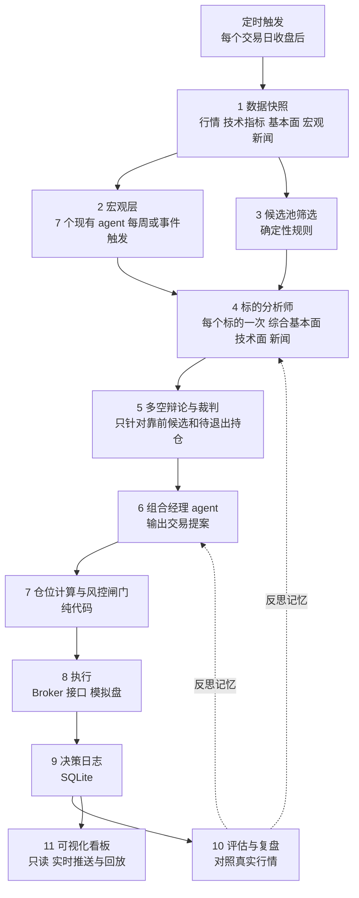

# 升级方案：从宏观情景模拟器到美股波段交易系统

日期：2026-11-17　状态：阶段 0 和阶段 1 已完成；阶段 2、阶段 3 和阶段 4 的代码已完成并验证，已合并；阶段 5（看板）的代码已完成并验证，在独立副本里，尚未合并；阶段 6 的定时运行已提前做完。阶段 2 的完成标准里"连续 5 个交易日运行"需要按天积累，尚未达到

## 1. 目标与已定事项

把现有的多 agent 宏观情景模拟器，升级成一个能自己产生买卖判断并执行的系统。

| 事项 | 决定 |
|---|---|
| 市场 | 美股 |
| 持仓周期 | 波段，数天到数周 |
| 执行 | 先做与券商无关的接口和本地模拟盘，券商以后再接 |
| 运行节奏 | 每个交易日收盘后运行一次，订单在下一个交易日执行 |

## 2. 设计原则

1. **LLM 只提案，代码做决定。** agent 输出结构化的观点和交易提案；仓位大小、风控、订单生成全部是确定性代码。LLM 无法绕过风控。
2. **每个决定都留档、都能打分。** 每次运行保存当时用到的数据、agent 输出、提案、风控结果、订单和成交，事后与真实行情对账。
3. **先影子、再模拟、最后实盘。** 先只出信号不下单，再跑模拟盘，达到事先写定的门槛后才考虑实盘。
4. **固定流水线，不用自由发挥的循环。** 交易流程的阶段顺序由代码决定，LLM 只在阶段内部工作。这样结果可复现、可审计，成本也可控。
5. **默认安全。** 默认模式是模拟盘；实盘需要单独的开关和密钥；任何数据异常或输出不合规都导致"不交易"。

## 3. 目标架构



第 2、4、5、6 步是 LLM，其余是代码。

### 新增目录

```
data/        行情、基本面、宏观、新闻的 provider，交易日历，时点快照
pipeline/    每日固定流水线、候选池筛选
agents/ticker/  标的分析师和组合经理
portfolio/   仓位计算
risk/        风控闸门、熔断、停止开关
execution/   Broker 接口、PaperBroker、以后的券商适配器
journal/     SQLite 决策日志和评估
dashboard/   只读数据接口和网页看板
tests/       单元测试和冒烟测试
```

## 4. 现有代码的处置

| 现有部分 | 处置 |
|---|---|
| 7 个宏观 agent（`agents/`） | 保留，作为宏观层。输入从"假设情景"改为"当前宏观快照加近期事件"，输出增加结构化字段（风险偏好、板块倾向）。 |
| `agents/base.py` 的模板 | 保留并扩展，新的标的分析师沿用同一模式。 |
| 多空辩论 | 改造。现在争论"冲击大还是小"，改为争论"这个仓位该不该开、该不该留"。 |
| ReAct 编排器（`orchestrator.py`） | 保留为"研究模式"，继续做情景分析。交易流程不走它。 |
| `utils/llm_client.py` | 重写调用方式，并做成可切换模型提供方，见阶段 0。 |
| `mcp_tools/yfinance_server.py` | 数据函数抽到 `data/` 直接调用，MCP 服务只留薄封装给研究模式用。 |
| `mcp_tools/client.py` | 已删除。关键词路由在阶段 1 去掉后，模拟器不再经过 MCP，这个客户端没有任何调用方。 |
| ChromaDB 记忆 | 修复后保留，只用于检索复盘文字。交易记录以 SQLite 为准。 |
| `orchestrator_legacy.py` | 已删除，原文件留在 git 历史里（提交 `96565d9`）。其中"批评者审稿"的做法（`_node_critic`、`_node_revise`）可在组合经理提案后复用，届时用 `git show 96565d9:orchestrator_legacy.py` 查看。 |
| Streamlit 界面（`app.py`） | 保留研究模式页面。交易看板另做，见阶段 5。 |

## 5. 分阶段计划

每个阶段的完成标准都能在交付当时直接检查。

### 阶段 0：让系统重新跑起来

现状比上次汇报的更严重：按 Claude API 文档，`.env` 里配置的 `claude-sonnet-4-20250514` 已于 2026-06-15 退役，所以现在任何一次模拟都会在第一次 LLM 调用时失败。（依据是 API 文档，没有做真实调用验证。）

工作内容：

- 模型 ID 换成当前模型，集中到一处配置，见第 8 节。
- 重写 `LLMClient` 的调用方式，原因是当前模型的接口变了：
  - 去掉 `temperature`，当前模型传非默认值会返回 400。
  - 强制 `tool_choice` 在 Opus 5.5 和 Sonnet 5.5 上返回 400，而现有代码的结构化输出全部依赖它。改用结构化输出（`client.messages.parse()` 加 Pydantic 模型）。
  - 现有的 1024 到 4096 的 `max_tokens` 预算在"思考常开"的模型上会截断输出，提高到 16000 左右，并检查 `stop_reason`。
  - 处理 `refusal` 停止原因。
  - 记录每次调用的 token 用量和费用。
- **模型提供方可切换**：调用层对外只有一个统一接口，输入提示词和 Pydantic schema，输出校验过的对象和用量。下面挂两个实现：Claude（走官方 SDK），以及 OpenAI 兼容接口（Ollama 和多数托管开源模型服务都是这种）。每个角色用哪个提供方、哪个模型都是配置项。开源模型一侧用按 schema 约束的输出，校验失败后重试。
- 升级 `anthropic` SDK（当前 0.86，上述接口需要新版本）。
- `orchestrator.py` 的主循环直接调用了 client 并传了 `temperature`，一并修改。
- 修复已确认的问题：重装 chromadb 并让初始化失败时报错而不是静默跳过；审议后丢失未参与 agent 的分析；`requirements.txt` 补 `yfinance`、`pandas`、`pytest`；`MAX_ITERATIONS` 读配置；`.memory/` 移出 git；删除空目录 `{agents,models,utils}`。
- 加 pytest 和用假 LLM 的冒烟测试。

完成标准：`python main.py -s "..."` 端到端产出报告（会花少量 API 费用）；pytest 通过；启动时打印记忆库和数据通道的真实状态；同一个结构化输出冒烟测试在 Claude 和本机 Ollama 的一个小模型上都能通过。

**完成记录（2026-11-16）**

阶段 0 已完成，按你的要求默认使用本机开源模型。验证结果：

- 单元测试 46 个通过，不需要真实模型。
- 本机 Ollama 的真实模型测试通过（主模型 `qwen2.5-coder:7b`，快速模型 `llama3.2`）。
- 端到端情景模拟跑通：7 分 24 秒，25 次模型调用，无按量费用。记忆库（11 条历史记录）和行情通道（8 个工具）都正常。
- 经过一轮独立代码评审，6 条意见全部处理。

与原计划不同的地方：

- 默认提供方是 Ollama，不是 Claude。Claude 和 OpenAI 兼容接口两条路径都已实现并有单元测试。
- Claude 路径没有用真实 API 验证过，因为那需要花钱。验证命令是 `RUN_LIVE_ANTHROPIC=1 pytest -m live`。
- `anthropic` SDK 没有升级：现有的 0.86 已经支持结构化输出。
- 编排器不再使用厂商的工具调用格式。每一步由模型返回一个结构化的"下一步动作"，这样三种提供方的行为一致。场景解析改为固定的第一步。
- Ollama 在提示词超长时默认静默截断。现在请求里带 `truncate: false`，超长时服务端直接报错。

同一天的后续修复，起因是用本机模型跑出的报告暴露了两个系统设计问题：

- **辩论双方改名。** 原来叫 bull 和 bear，但含义是"影响严重"和"影响有限"，与市场上牛熊的通常含义相反，导致报告的情景矩阵写反。现在叫"影响严重方"和"影响有限方"，合成报告时明确规定牛市情景是对风险资产更有利的情形。重跑后矩阵方向正确。
- **拦住 agent 互相照抄。** 弱模型会把别的 agent 的句子直接粘进自己的分析，多个独立视角因此变成一个。现在审议后某个字段若是照抄的，退回该 agent 自己原来的文字；最终报告里有大段相同文字的两个 agent 会列在"质量警告"里。判定标准是连续照搬 30 个词以上，或 20 个词以上且占该字段四成。两次真实运行中，没有照抄时两个 agent 最多共有 17 个词的相同片段，而被照抄的那段有 90 个词。

遗留事项：

- **分析质量不够。** 7B 的本机模型能跑通流程，但报告里有自相矛盾的结论和编造的数字。在换用更强的模型之前，输出不能当作分析结论使用。
- `.memory/` 已加入 `.gitignore`，但它之前被提交过，仍在 git 的跟踪里。提交时需要执行 `git rm -r --cached .memory`。
- `docs/` 下两份逐行代码讲解文档讲的是改造前的代码，已经过时。
- Claude 路径没有启用"模型拒答时自动换模型重试"的功能，拒答会直接报错。

### 阶段 1：数据层

- **交易日历**：用现成的交易所日历库判断哪天是交易日、哪天提前收盘。流水线每天被触发，但非交易日直接退出。后面所有提到"交易日""次日"的地方都以它为准。
- 新建 `data/`，把日线、技术指标、基本面、板块表现、收益率曲线做成普通 Python 函数，统一走一个 provider 接口。第一版用 yfinance。
- 新增宏观序列（CPI、失业率、政策利率等），来源用 FRED。
- 新增新闻和财报日历，做成可插拔接口，具体来源在本阶段内选定。
- 取公司行为数据（拆股、分红），供阶段 3 使用。
- **时点快照**：每次运行把用到的全部数据按日期存盘。评估、复盘、回放都只读快照。
- 数据质量检查：缺字段、数据过期、价格异常时，该标的不进入决策。
- 删除关键词路由；研究模式的 `fetch_market_data` 改成显式指定工具和参数。
- agent 提示词里，数据放在单独的"数据快照"段，不再冒充上游 agent 的结论。"禁止给具体数字"改为"只能引用快照里出现的数字"。

完成标准：一条命令为任意标的列表生成快照并通过校验；数据函数有基于缓存样本的单元测试；日历对节假日和提前收盘日的判断有单元测试；研究模式下货币、财政、商品三类情景都能取到正确数据。

**完成记录（2026-11-16）**

阶段 1 已完成，四条完成标准全部满足：

- 命令 `python -m data.snapshot --tickers AAPL,MSFT` 约 8 秒生成快照并存盘；有标的不可用时返回非零退出码。
- 数据层测试用当天录制的真实样本离线运行。全部测试共 143 个通过。
- 交易日历的测试覆盖周末、感恩节、圣诞节、顺延的独立日、两个提前收盘日，以及盘中、收盘前一分钟、收盘时刻、纽约深夜（UTC 已是次日）等时间点。
- 用真实数据验证了货币、财政、商品三类情景，每类都取到 21 个市场序列和 10 个宏观序列。
- 用本机模型完整跑通一次石油情景：快照取到并存盘，7 个 agent 都拿到了数据。
- 经过一轮独立代码评审：没有发现前视偏差，5 条具体问题全部修复。

做出的选择：

- **数据源**：行情、基本面、财报日期、新闻标题来自 Yahoo Finance（通过 yfinance）；宏观数据来自 FRED 的公开 CSV 接口。都免费，不需要密钥。
- **新闻**：yfinance 原有的新闻接口已经失效，改用它的搜索接口，并只保留标注了该标的的标题。相关性一般，会混入大盘新闻。新闻取不到只记警告，不影响标的可用。
- **交易日历**：用 `exchange_calendars` 库的纽交所日历。
- **研究模式不再经过 MCP**：编排器直接调用数据层。MCP 服务保留为一层薄封装，供外部 MCP 客户端使用。
- **取数是确定的**：编排器选择"取数据"时，固定取全套市场和宏观数据，另加模型点名的标的。不再按关键词猜该取什么。

数据层强制的三条规则：

- 只用已收盘的交易日。盘中运行时，当天未走完的 K 线被剔除。
- 数据有问题就拒用。价格过期、历史太短、任何一根 K 线价格缺失或非正、高低价不包含开收盘价、无成交量、复权后单日涨跌超过 50%，都会把标的标为不可用并写明原因。
- 每次取数都存盘，路径是 `data_store/snapshots/<交易日>/`。

遗留事项：

- **提示词约束不住编数字，已加代码检查。** agent 被要求只引用快照里的数字，但实测 7B 本机模型仍然会编点位和收益率。现在代码会把每个 agent 的分析和报告汇总部分里的数字，与快照、情景和该 agent 自己的指令逐一比对，找不到来源的列在报告的"质量警告"里。这个检查只报告，不改写 agent 的文字，也分不清"编的"和"自己算出来的"。要让模型不编数字，仍然需要更强的模型，或者在阶段 2 把输出改成结构化的引用。
- yfinance 是非官方接口，测试期间它的一个新闻接口就是坏的。实盘前要换成正式数据源。
- 基本面是取数当时的值。yfinance 不提供历史时点的基本面，所以回放历史时基本面不可用。
- 宏观数据按观测日期截取，没有处理"某月数据在次月才公布"的发布滞后。前瞻运行不受影响，回放历史时要注意。

### 阶段 2：信号层（影子模式，不下单）

- 定义三个结构化输出：
  - `MacroRegime`：风险偏好、板块倾向、主要风险、把握度。
  - `TickerView`：方向、把握度（0 到 1）、预期周期、失效条件、催化剂、引用的数据。
  - `TradeProposal`：标的、动作（买入、卖出、持有、减仓）、把握度、理由。
- 宏观层：7 个 agent 改为分析当前状态，每周运行一次，遇到重大事件额外运行，结果缓存复用。
- 标的层：新增一个标的分析师，每个标的调用一次，同时看基本面、技术面和新闻。先不拆成三个分析师：合在一起能权衡三类信息之间的矛盾，调用次数也只有三分之一。以后发现这一层是质量瓶颈再拆。
- 候选池：用确定性规则（流动性、价格、趋势）从白名单里筛出 10 到 30 个候选，加上全部现有持仓。
- 辩论：只对排名靠前的候选和出现退出信号的持仓进行，裁判输出校准后的把握度和失效条件。
- 组合经理 agent：综合宏观结论、各标的观点和当前持仓，输出提案列表。
- **影子持仓**：这一阶段还没有模拟盘，所以按前几天的提案记一份假想持仓（次日开盘价、固定仓位）。这样组合经理每天都能看到持仓，卖出、持有、减仓三条路径在本阶段就会被执行到。另外用预置持仓的测试用例直接验证退出路径。
- 固定流水线 `pipeline/daily.py`。
- **模型对比**：影子模式下可以让两套模型配置（例如 Claude 和一个开源模型）读同一份数据快照，各出一份信号并分别记录，留给阶段 4 打分比较。
- **交互事件记录**：每一次 agent 发言都记成一条事件，包含谁说的、回应谁、属于哪个环节、时间和内容。每个结构化输出带一句 agent 自己写的简短发言，供看板展示。阶段 5 的看板只读这些记录，所以必须从这一阶段开始记。

完成标准：每天收盘后一条命令产出信号表（JSON 和 Markdown），全部通过 schema 校验；记录单次运行费用；连续 5 个交易日运行无错误；期间至少产生过卖出或减仓提案并通过校验。

**进展记录（2026-11-16）**

代码和测试已完成。四条完成标准的现状：

| 标准 | 现状 |
|---|---|
| 一条命令产出信号表，全部通过校验 | 满足。命令是 `python -m pipeline.daily`，产出 `signals.json` 和 `signals.md`。 |
| 记录单次运行费用 | 满足。每次运行记录调用次数、token 数、模型用时和费用；本机模型没有按量费用。 |
| 连续 5 个交易日运行无错误 | 未满足，只能按天积累。`python -m pipeline.daily --status` 显示进度。 |
| 期间出现过卖出或减仓提案并通过校验 | 在写入临时目录的真实运行里出现过一次（第二天提出减仓并被接受）。正式记录里要等连续运行期间出现才算。卖出、减仓、持有三条路径都有测试，包括预置持仓的用例。 |

验证：

- 离线测试共 349 个通过，不需要真实模型和网络。
- 我故意改坏 61 条规则（例如"在提案当天成交""没有宏观结论也能买入""拆股调整两次"），每一条都有测试能发现。
- 用真实数据和本机模型（`qwen2.5-coder:7b`）连续跑了两个交易日（11 月 12 日和 13 日），写入临时目录，没有动正式记录。第一天 27 次模型调用、约 8.5 分钟，接受了 7 条买入；第二天复用宏观结论，21 次调用、约 5.5 分钟。第一天的 7 笔买入都在第二天开盘价成交；第二天组合经理提出减仓一只并被接受，另一条买入因为裁判判了"不持有"被代码拒绝。`--status` 显示"连续 2 个交易日无错误，期间有减仓被接受"。
- 这两天是把时钟拨回去跑的，因为当晚 Yahoo 还没有发布当天的收盘价。行情是当时的，基本面是运行时的值，晚于时钟的新闻标题被过滤掉了。
- 五轮独立代码评审，意见全部处理，见下面"评审发现的问题"。

做出的选择：

- **宏观结论由代码合成。** 7 个宏观 agent 各给出立场、把握度和板块倾向，代码按规则合成：取把握度加总最高的立场，打平或总把握度为零时没有结论；板块倾向要超过单个 agent 能给出的权重才成立。没有第 8 个模型来写总结，结论能追溯到每个 agent。
- **模型的输出是草稿，代码检查后才算数。** 数值越界的输出直接拒绝并记录原因，不做修正。
- **买入的硬规则。** 标的必须是当天候选；必须有通过检查的看多观点；辩论过的话裁判没有判"不持有"；必须有当前的宏观结论；仓位数不超过上限。同一标的只认第一条提案。持仓没有得到有效决定时默认持有。
- **结构化引用。** 分析师要列出依据的数据点（指标名和数值），代码逐条与快照比对，不一致的记在观点上，组合经理和裁判都能看到。
- **影子持仓。** 每笔固定金额，在提案的下一个交易日开盘价成交；不记现金、分红和滑点。一只持仓如果从某次运行发现问题起，超过 10 天都没有可用且前后一致的价格（例如退市，或者数据源的拆股记录和价格对不上），按最后一个可信的收盘价平掉，不再跟踪。流水线自己没运行的日子不计入这 10 天。
- **决策日志提前到本阶段。** 原计划在阶段 3 建 SQLite 日志，但看板要读的事件记录必须从现在开始记，所以现在就建了：运行记录、事件、宏观结论、影子持仓和成交。
- **运行时间。** 必须在收盘价发布之后、下一个交易日开盘之前运行。开盘后运行会被拒绝，因为那时模型看到的是当天的新闻和价格，而成交价是已经过去的开盘价。
- **候选池规则（占位值）。** 股价不低于 5 美元，20 日均成交额不低于 2000 万美元，收盘价高于 50 日均线且 50 日均线高于 200 日均线；通过的按 3 个月涨幅排序取前 10。
- **默认标的范围（占位）。** 70 只：大盘和板块 ETF 加各板块的大型股。可以用 `UNIVERSE_FILE` 换成自己的清单。

真实运行暴露的事实：

- **Yahoo 的收盘价发布得晚。** 周一收盘 4 个多小时后，当天的收盘价仍是空的。这时运行会明确失败并提示稍后重跑，不会记成"今天没有信号"。
- **Yahoo 的开高低收已经按拆股回调过。** 阶段 1 里我写的"未复权"是错的，已更正。影子持仓的拆股处理按这个事实重写，并且只在"列出的拆股"和"回调后的价格"互相对得上时才调整，对不上就不估值、订单等待。
- **结构化引用有效。** 第一次真实运行里，分析师引用的 50 个数据点全部与快照一致。研究模式里同一个模型大量编造数字，这里基本没有。
- **7B 模型没有区分度。** 10 个候选里 9 个给出完全相同的"看多、把握度 0.85、10 天"；三场辩论的裁决都是"持有、0.75"；空方基本在重复多方的话。
- **7B 模型不守指令，代码兜住了。** 第二天组合经理对两个没有持有的候选说"持有"，却漏掉了真正的持仓。代码拒绝了前两条并说明原因，给真正的持仓补了默认持有。

评审发现的问题（已全部修复）：

- 拆股会被调整两次，测试没发现是因为测试用的假行情和 Yahoo 的行为不一样。假行情已改成和 Yahoo 一致。
- 持仓数据不可用的那天发生拆股，拆股会永久丢失。
- 下一个交易日盘中运行时，模型能看到当天的价格和新闻，成交却按已经过去的开盘价。
- 模型返回 NaN 会让记录读不回来；新订单会悄悄覆盖还在等待的旧订单；买入不受分析师观点和裁判裁决约束；订单和运行状态不是一起保存的；有问题的运行被记成正常。
- 修复过程中新引入、又被后续评审发现的三个问题：数据库提交失败后连接会卡住，之后什么都写不进去；持仓的价格记录一旦对不上就永远冻结；为解决冻结加的"超期平仓"把流水线没运行的日子也算了进去，可能误平正常持仓。三个都已修复。

遗留事项：

- **连续 5 个交易日需要每天运行一次。** 自动定时在阶段 6，在那之前要手动运行。
- **模型质量。** 上面两条关于 7B 模型的事实说明，它产出的信号目前没有参考价值。`--arm` 可以让两套模型读同一份数据各出一份信号。用 Claude 做对比需要你的 API 密钥并产生费用，我没有运行。
- **风险偏好为 risk-off 时是否禁止开仓**没有规定，现在不禁止。这是风控取舍，由你决定。
- 宏观 agent 只看行情和宏观数据，没有新闻输入。"重大事件时额外运行宏观层"目前只能手动加 `--refresh-macro`。
- 一次运行中途失败后只能整轮重跑，已完成的模型调用不会复用。阶段级的断点续跑在阶段 3。
- 流水线里的模型调用是串行的。本机模型本来就只能串行；换成托管模型后可以并行来缩短时间。
- 影子持仓依赖 Yahoo 的拆股记录和价格互相一致。不一致时会停下来报告，但不会自己修复。
- "超期平仓"还有一个很窄的漏洞：某次运行碰到一只持仓的数据暂时不可用，之后流水线停了 10 天以上，恢复当天同一只持仓的数据又恰好不可用，它就会按停机前的价格被平掉。可以再加一条"至少连续几次运行都看到问题"来堵，留到阶段 3 做模拟盘时一起处理。
- 数据源对价格做了 5% 以内的调整却没有列出原因时（例如小比例送股），会被当作价格更正接受，持仓的账面会差这么多。当天会有警告。

### 阶段 3：仓位、风控、模拟盘

仓位和风控：

- `portfolio/`：由把握度和波动率（ATR）算出目标仓位，止损位来自失效条件和 ATR。
- `risk/`：风控闸门，规则见第 6 节。每条被拒绝或被削减的订单都记录原因。

执行（`execution/`）：

- `Broker` 接口：查账户、查持仓、下单、撤单、查订单。
- `PaperBroker` 按日线撮合，规则如下：
  - 市价单在下一个交易日按开盘价成交。
  - 限价单在当日最高最低价覆盖限价时成交，默认当日有效。
  - 止损单一直有效，直到触发或撤销。开盘价已低于止损价时按开盘价成交，否则按止损价成交。
  - 每日处理顺序是先止损、再限价、再市价。同一天止损和止盈都可能触发时，按止损先触发处理。
  - 第一版不模拟部分成交，订单要么全成、要么不成。这是已知的简化。
  - 滑点可配置。
- 公司行为：
  - 拆股时调整持仓数量、成本价和止损价。
  - 分红记为现金流入。
  - 退市或代码变更时标记该持仓，停止对它下新单，模拟盘按最后成交价平仓。
  - 并购等其他情况标记为需人工处理。
  - 持仓记账用未复权价格加显式调整，技术指标用复权价格。（阶段 2 实测：Yahoo 返回的开高低收已经按拆股回调过，只有分红没有调整，拿不到真正的未复权价格。所以记账要么换数据源，要么沿用阶段 2 影子持仓的做法：每次先把持仓换算到当前快照的股数口径，再成交和估值。）

状态和恢复：

- `journal/`：SQLite 记录每次运行的快照引用、agent 输出、提案、风控结果、订单、成交和每日净值。
- `PaperBroker` 的账户、持仓、订单全部存 SQLite，每次变更立即落盘。
- 每次运行有唯一编号。流水线每个阶段的产出都落盘；中断后重跑时复用已完成阶段的产出，不重新取数，也不重复调用 LLM。
- 下单分三步：先记录意图，再提交，再确认。每张订单带唯一编号，重跑时据此去重。
- 停止开关。

回放测试用脚本化的提案，不调用真实 LLM。原因是模型"知道"历史行情，用真实 LLM 回放时它会避开亏损，熔断和亏损上限根本不会被触发，测试等于没测。脚本化场景包括：连续亏损触发熔断、单票和板块超限、当日开仓数超限、拆股、流水线中途崩溃后重跑。

完成标准：每日流水线端到端在模拟盘下单；每条风控规则都有单元测试；脚本化回放中每条风控都在设定的阈值处触发；中途杀掉进程后重跑不产生重复订单。

**完成记录（2026-11-16）**

四条完成标准都满足：

| 标准 | 现状 |
|---|---|
| 每日流水线端到端在模拟盘下单 | 满足。同一条命令 `python -m pipeline.daily`，现在会同步模拟账户、计算仓位、过风控、下单。 |
| 每条风控规则都有单元测试 | 满足。每条规则都有"刚好在限额内通过、刚好超出被削减或拒绝"的测试。 |
| 脚本化回放中每条风控在阈值处触发 | 满足。用脚本化的提案和可控的假行情跑多天，覆盖：连续止损亏损触发回撤熔断（阈值上下各测一次）、当日亏损熔断、单票和板块超限、当日开仓数超限、持仓数超限、现金下限和换手上限、持仓期间拆股。 |
| 中途杀掉进程后重跑不产生重复订单 | 满足。在取数后、模型调用中、下单进行到一半这几个位置分别杀掉，重跑后订单各只有一张，且不重新取数、不重复调用模型。 |

验证：

- 离线测试共 480 个通过（阶段 3 新增 131 个）。
- 故意改坏 53 条规则（模拟盘、下单、流水线、风控、仓位），每一条都有测试能发现。
- 用真实数据和本机模型在临时目录里连续跑了三个交易日（11 月 12 日、13 日和 16 日，其中 16 日是按真实时间跑的），前后跑了三遍，每遍都是当时的最新代码。典型的一遍：第一天 7 条买入提案被接受，风控把其中 3 条削减或放行、另外 4 条因"当日最多新开 3 个仓位"被拒；第二天这 3 笔按周五开盘价成交，又下了 3 张单；第三天其中一只周一开盘直接跌破止损价，按开盘价止损卖出（亏 11.26%），其余持仓都带着止损单，账户净值约 99,300。同一个交易日再运行一次会被跳过。最后一遍（评审通过后的代码）还多做了两步：对第三天强制重跑，3 张单里有 1 张的理由变了，被替换成新的一张，另外 2 张原样保留，没有重复下单；再打开停止开关强制重跑，7 条被接受的提案全部被风控拒绝，上一次下的 3 张单被撤回，这个交易日最后没有留下任何新订单，已有持仓的止损单不受影响。
- 独立代码评审三轮：第一轮指出 2 个严重问题和 6 个中等问题，第二轮指出修复中新引入的 1 个严重问题，都已修复，见下面"评审发现的问题"。

模块：

- `execution/paper.py`：模拟盘。账户、持仓、订单、成交和每日净值都存在 SQLite 里，每次变更和引起它的成交在同一个事务里落盘。
- `execution/placement.py`：下单分三步（记录意图、提交、确认），每步落盘后才做下一步。
- `portfolio/sizing.py`：仓位计算。`risk/gate.py`：风控闸门和停止开关。这两个模块由另一个 agent 按我写的规格实现，我审过并改了两处。
- `journal/store.py`：新增模拟盘的表、订单日志和断点记录。

做出的选择：

- **模拟盘取代影子持仓。** 阶段 2 的影子持仓已删除。每套模型配置各有一个模拟账户。
- **仓位由代码算。** 一笔买入拿净值的一个固定比例去冒险（默认 1%，乘以组合经理和分析师两个把握度里较低的那个），除以"收盘价到止损价"的距离得到股数。止损价在收盘价下方 2 倍 ATR，且不近于价格的 1%。卖出是全部，减仓是一半。（11 月 17 日起，止损价可以由分析师提出，见下面"阶段 3 之后的改动"。）
- **止损是挂在券商那里的单子。** 买入成交时自动挂上保护性止损单，之后跟着持仓走：减仓时数量跟着减，拆股时价格和数量跟着调，清仓时撤掉。加仓不会把已有股份的止损放宽。
- **开盘就跌破止损的买入不做。** 止损价是按前一天收盘算的。如果第二天开盘价已经在止损价或更低，这笔买入的前提已经不成立，订单取消。
- **撮合顺序。** 每个交易日依次是：分红、已有持仓的止损、限价单、市价单（先卖后买）、当天新开仓的止损检查。止损排在限价前面，所以同一天两者都可能触发时按止损先触发算。
- **断点续跑。** 取到的数据和每个模型的回答都随到随存。被杀掉或崩溃的运行，下次直接接着做，不重新取数，也不重复问模型。一个回答只对"当时那个问题"有效：如果问题变了（比如上次失败的调用这次成功了），会重新问。
- **订单编号由决定本身确定**（交易日、账户、标的、方向），券商对同一编号只认第一次。所以重跑不会重复下单。
- **同一个交易日重新决定时先对账。** 下单前，把这个交易日之前的尝试已经下出去、而这次决定不再需要或数量不同的订单撤回。停止开关也靠这一步生效：打开开关后重跑，之前下出去的单会被撤回。
- **另一个进程还在跑同一个交易日时不启动。** 运行记录里存了进程号。进程还活着就拒绝，`--force` 也不行；进程已经不在了就把那次运行记为失败并接着做。
- **`--force` 的含义**是把这个交易日从头再做一遍：丢掉已存的回答，之前的完成记录标为"已被取代"。

真实运行暴露的事实：

- **风控确实在起作用。** 7B 模型每天都想买七八只，而且算出来的仓位普遍是单票上限的两倍，全靠风控削减和拒绝。
- 模型质量的问题和阶段 2 一样，没有变化。

评审发现的问题（已全部修复）：

- 买入当天开盘价低于止损价时，模拟盘会先按开盘价买入，再"按止损价卖出"，凭空赚到差价。我写的测试还把这个结果当成了正确的。
- 强制重跑如果中途失败，之前的订单已被撤掉、新的没下，而这个交易日仍被当作已完成，订单就此丢失。
- 运行被杀掉后重跑，同步账户时发现的问题（例如订单被取消）不会再报，有问题的一天会被记成正常。
- 重跑时如果决定变了，之前下出去的订单没人管；停止开关拦不住已经下出去的单。
- 加仓会把整个持仓的止损降到新的、可能更低的价位。
- 持仓的保护性止损单会被"重复订单"规则误判，导致之后的卖出全部被拒。（这条是写风控的 agent 自己发现并报告的。）
- 修复时新加的"下单前对账"分两次落盘，如果恰好在两次之间被杀掉，这个交易日之后每次运行都会报错。已改为一次落盘，并且对账时会把"日志里有、券商那里没有"的订单记录清掉重来。

遗留事项：

- **风控的限额是按收盘价检查的，成交在第二天开盘。** 开盘跳空会让实际仓位和实际风险比批准时大一些。现金不够时券商会整单拒绝，但单票上限和单笔风险上限在成交那一刻没有保证。
- **一只标的某天取不到可用价格时，那一天不会回头补做。** 它的订单和止损顺延到下一个能定价的交易日，按那天的价格处理。如果这一天价格先跌破止损又收回，这次止损就漏掉了。
- 模拟盘只有日线的开高低收，不模拟盘中路径、部分成交和手续费，成交结果比真实市场乐观。
- 分红按除息日记入现金，没有处理实际派息日的时间差。
- 风控给"还在券商那里等待的买单"预留现金时，用的是它的限价或止损价（当天取不到收盘价的情况下），略偏低；一张既没有限价也没有止损价的等待买单不会被计入。流水线自己下的买单都带止损价，所以只影响其他调用方。
- 断点续跑只在"模型看到的内容没变"时复用回答。改了提示词之后要用 `--force` 重跑，否则会复用旧回答。
- 所有风控数值和初始资金都是占位值，见第 9 节。

**阶段 3 之后的改动（2026-11-17）：分析师提出止损价**

起因：止损价和股数原先全由固定公式算，模型对个股的判断进不来。本节开头的计划写的是"止损位来自失效条件和 ATR"，阶段 3 只做了 ATR 这一半，这次补上另一半。

做法：

- **分析师提出止损价。** 分析师对它看多的候选标的给出一个止损价，并说明它设在数据里哪个价位的下方（比如某条均线）。
- **代码只在范围内采用。** 止损价必须在收盘价下方 1 到 4 倍 ATR 之间，而且不近于价格的 1%。范围之外的止损价会被拒绝，并在这条观点上注明原因；它不会被挪到最近的允许价位，观点的其余部分照常使用，这次运行也不会因此被记为有问题。
- **没有可用的止损价时沿用公式**，即收盘价下方 2 倍 ATR。
- **冒险的钱不超过预算。** 股数等于风险预算除以止损距离，所以止损放得远，股数就少，触及止损时亏的钱不会超过预算。模型能影响止损放在哪里，不能直接决定买多少。
- **已持有的仓位沿用开仓时的止损。** 分析师对已有持仓给出的止损价不采用。
- 报告里每张订单都注明止损来自分析师还是公式。辩手和组合经理也能看到分析师的止损价。
- 顺带改了一处：断点里存的模型回答如果和现在要求的字段对不上（比如在升级前被杀掉的运行），会重新问模型，不再报错。

新增两个设置：`SIZING_STOP_MIN_ATR_MULTIPLE`（默认 1）和 `SIZING_STOP_MAX_ATR_MULTIPLE`（默认 4），都是占位值。

验证：

- 离线测试共 541 个通过（这次新增 61 个）。
- 故意改坏这次涉及的 39 条规则，每一条都有测试能发现。阶段 3 的 53 条也重新跑了一遍，仍然全部被发现。
- 独立代码评审两轮。第一轮没有严重问题，指出 2 个中等问题和 6 个小问题；修复后第二轮通过。
- 用真实数据和本机模型在临时目录里跑了 11 月 16 日这个交易日，结果见下面。

评审发现的问题（已修复）：

- **公式算出的止损价取整到分以后，可能比取整前离收盘价更远，而股数是按取整前的距离算的。** 在几美元的低价股上，实际风险可以超出预算将近 9%。这是阶段 3 就有的问题，被拒绝的分析师止损都会走这条路，所以一并修了：现在先把止损价定到分，再按实际距离算股数。
- **分析师写的止损理由里的数字没有核对**，却会原样出现在辩手和组合经理看到的材料里，等于把可能是编造的价位当成了核对过的数据。现在止损理由和观点正文一样做数字核对。
- 允许范围原先按未取整的 ATR 计算，而模型看到的 ATR 只有两位小数。模型把止损刚好放在边界上时会被误拒。现在按模型看到的数值算。
- 两个范围设置写错时（下限大于上限、零、不是数字），原先会悄悄变成别的含义。现在这种情况下一律不采用分析师的止损，并在观点上写明原因。

真实运行暴露的事实：

- 同一个交易日跑了两遍，第二遍是最终代码的强制重跑。7B 模型对看多的股票大多会给止损价：第一遍 7 只都给了，全部在范围内；第二遍 8 只里有 5 只在范围内被采用，1 只（MA）把止损设在 200 日均线上，离收盘价 8.7 倍 ATR，被拒绝并改用公式，另外 2 只没给。
- 被采用的止损多数直接取自数据里的均线（例如 LLY 两遍都设在 20 日均线 1,364.33），也有取整数的（650、400、280）。模型把止损设在均线上，而不是提示词要求的"略低于"。
- 理由经常标错，把 20 日均线说成 50 日或 200 日均线。
- 同样的数据，两遍给出的止损不一样（PG 第一遍 164.01，第二遍没给；MA 第一遍 630，第二遍 541.31）。模型给的止损和它的其他输出一样不稳定。
- 最终那遍下了 3 张单：LLY 和 KO 用分析师的止损，PG 用公式，报告里都有标注。强制重跑时，上一遍留下的 KO 和 PG 两张单因为止损价变了被替换，没有重复订单。
- **在现在的占位限额下，股数几乎总是由"单票不超过净值 10%"决定。** 两遍里每张买单都被风控削减到这个上限。所以分析师的止损目前实际改变的是止损挂在哪里、触及时亏多少，而不是买多少股。只有把单笔风险比例调低，或者把单票上限调高，止损距离才会真正决定股数。

遗留事项：

- 止损只在开仓时设一次，之后不会随价格上移（没有移动止损）。
- 分析师只看得到日线数据里的价位（收盘价、均线、52 周高低点、ATR），看不到盘中的支撑和阻力。
- 代码只核对止损理由里的数字，不核对"说的是哪条均线"。7B 模型经常把均线标错。
- 止损价本身是分析师可以提到的数字。数字核对按 0.5% 的容差比对，所以离止损价 0.5% 以内的其他数字也不会被标出。
- 更近的止损更容易被触发（包括买入当天），开盘跳空时相对损失也更大。
- 公式止损取整到分以后，可能比"价格的 1%"近不到半分钱。
- 止损价不是数字（无穷大之类）时，整条观点按格式错误处理，和其他字段一样。

### 阶段 4：评估闭环

- 评估任务：给每一条 `TickerView` 打分，不只是成交的交易。观点到期后计算方向对错和相对 SPY 的超额收益；成交的交易另外记录是否触发止损和实际盈亏。
- 统计：按把握度分桶的命中率（检验把握度是否可信）；按板块、宏观状态拆分；并行跑过多套模型配置时按模型拆分；盈亏归因。
- 三个对照基准，全部是纯代码：
  - SPY 买入持有。
  - 候选池等权：衡量筛选规则本身的贡献。
  - 候选池随机选股：用同样的候选池、仓位和风控规则随机选股，模拟上千次，得到一个结果分布。LLM 组合落在这个分布的什么位置，直接回答"LLM 的选择是否好于在同一个池子里随便选"。
- 反思记忆：LLM 根据真实结果写复盘，存入记忆，相似情形下检索。记忆里的"结果"从此是真实结果，不再是系统自己的预测。
- 评估报告：一条命令生成，包含净值对比基准、观点记分卡、三个基准对照和 LLM 费用。完整的可视化看板在阶段 5 做。

完成标准（交付时可检查的部分）：评估报告用合成数据正确生成；打分逻辑在 5 个以上手工构造、结果已知的用例上算对；随机基准可运行。用真实结果验收的部分放在阶段 6。

**完成记录（2026-11-17）**

交付时可检查的三条标准都满足：

| 标准 | 现状 |
|---|---|
| 评估报告用合成数据正确生成 | 满足。用假行情跑一周流水线再评估，报告里的每个数字都和手算一致。 |
| 打分逻辑在 5 个以上手工构造、结果已知的用例上算对 | 满足。看多和看空、涨和跌、是否跑赢基准共 8 种组合，另有中性、未到期、缺价格、分红、跨周末和节假日等情形，全部按手算结果核对。 |
| 随机基准可运行 | 满足。合成数据和真实数据上都跑过。 |

用法：

- `python -m evaluation`：评估账本里的每一套模型配置，报告写到 `data_store/evaluation/<日期>/`（`evaluation.md` 和 `evaluation.json`）。
- `python -m evaluation --lessons`：另外让模型对自己的几条观点写复盘。

评估不做任何买卖决定，也不改动流水线已有的记录。它往账本里新增的只有观点得分（给看板读）和复盘。

验证：

- 离线测试共 722 个通过（阶段 4 新增 136 个）。
- 故意改坏 123 条规则（打分、交易整理、三个基准、复盘的读写、账本、命令入口、每日流程里的开关），每一条都有测试能发现。
- 重放逻辑有测试直接拿它和真实模拟盘的记录对比（止损卖出和主动卖出各一例），结果一致。
- 用真实数据评估了之前留下的三天真实记录，见下面"真实运行暴露的事实"。
- 独立代码评审三轮。第一轮指出 1 个严重问题和 3 个中等问题，第二轮指出修复后仍存在的 2 个中等问题，都已修复，第三轮通过。见下面"评审发现的问题"。
- 评审确认：复盘开关关闭时，每日流程给模型的提示词和断点键与之前逐字节相同，行为完全不变。

做出的选择：

- **评估是一条独立的命令，不在每日流水线里。** 每晚自动运行的流程完全不受影响。
- **每条观点都打分，不只是成交的交易。** 观点从写下之后的下一个交易日开盘算起，到它自己说的周期结束那天收盘为止，分红计入。从下一个开盘算起，是因为观点是收盘后写的，模型已经看到了当晚的新闻，而收盘价还没有反映这些新闻；如果从收盘价算，模型会因为"预测"到它已经知道的事情而得分。
- **两个口径。** 方向对不对（看多且上涨、看空且下跌），以及是否跑赢 SPY。上涨的市场里几乎所有看多的观点方向都"对"，所以第二个口径更有信息量。中性观点不表态，单独计数。
- **得分两个交易日后才算定下来。** 收盘后几分钟读到的收盘价还可能变，分红也可能晚一天才公布。定下来之前每次评估都重算；定下来之后保留，即使数据源后来不再提供这只股票。换了对照基准后旧的得分不保留。
- **随机选股对照的做法。** 把账户的每一笔买入，替换成同一天候选池里随机的一只，重复一千次。账户自己选的那只和其他每一只候选走的是完全相同的重放流程：同一天按同样的仓位规则和风控定股数，同一个开盘价买入，用规则算出的止损，持有到账户卖出自己那只的同一天，按账本当前所在的交易日估值。两边只有"选了哪只"不同。账本里记录的实际盈亏另外列出，不参与比较，因为它还受分析师提出的止损、同一天其他订单造成的削减等因素影响，这些都不是"选股"。
- **和计划原文的差别。** 计划写的是"用同样的候选池、仓位和风控规则随机选股"。实际做的是逐笔替换，没有把整个组合逐日重新模拟。原因是保存下来的每日数据只包含当天的候选和持仓，随机组合持有的其他股票在之后的日子里没有数据可用；而且逐笔替换把"选股"和"何时买卖"分开了，问题更干净。代价是每只候选单独过风控，同一天其他订单的影响没有计入，用的也是评估时的限额设置。
- **重放按模拟盘的撮合顺序写**，并有测试把重放结果和真实模拟盘的记录逐一对比。
- **复盘记忆没有用向量库。** 复盘存在账本里，按"同一只股票优先，其次同一板块"检索。原因是规则明确、可测试、不需要另外的模型。
- **复盘默认不给分析师看。** 只有设置 `PIPELINE_USE_LESSONS=true` 才会显示，因为这会改变分析师看到的内容，从而改变买卖决定。显示时也只显示在做决定那天已经知道结果的复盘。
- **复盘里的事实由代码写**（涨跌多少、是否跑赢基准、交易台做了什么，且只写到观点到期那天为止）。模型只写评价和一句教训。教训里出现任何数字、超过 300 个字符、或者评价里有没给过它的数字，这条复盘就只存档不显示。
- **账本格式号不变。** 新增的两张表在打开账本时自动补上，已有的记录原样保留，旧版程序仍然能打开同一个账本。
- **在独立副本里开发。** 阶段 4 在 git worktree 里做，每晚的自动运行继续使用项目文件夹里已经测试过的代码。

真实运行暴露的事实：

- 评估了阶段 3 时留下的三天真实记录（11 月 12、13、16 日，7B 模型）的一份副本。这个账本是阶段 4 之前的程序写的，直接就能打开，原有记录完好。
- **31 条观点全部还没到期。** 模型给的周期都在 3 个交易日以上，而评估时最后一个完成的交易日是 11 月 16 日，所以还没有任何一条观点得分。
- 账户 −0.73%，同期 SPY 买入持有 −2.65%，候选池等权 −1.81%。这三天市场在跌，账户大部分是现金所以跌得少，不说明选股好。
- **重放和真实模拟盘一致。** 6 笔买入的重放结果和账本记录逐笔一致到分，合计都是 −732.22，其中包括 AMD 开盘跳空跌破止损的那一笔。
- 随机对照：账户的选择好于 41% 的随机结果。只有 6 笔买入，这个数字基本是运气。AMD 是 11 月 12 日 10 只候选里结果最差的一只，PG 是 11 月 13 日 8 只里最好的一只。
- 让 7B 模型对三条真实观点写了复盘（为了当天就有结果可看，把周期缩短成 2 个交易日来量），每条约 9 秒。**内容泛泛，其中一条把事实读反了**：LLY 实际跑赢 SPY 2.8 个点，它写成了"相对 SPY 亏了 2.8 个点"。数字核对拦不住这种错误，因为那些数字本身都给过它。给分析师看的只有代码写的事实和模型的那一句教训，评价部分不显示；即便如此，换更强的模型之前不建议打开这个开关。

评审发现的问题（已修复）：

- **随机对照两边口径不一致。** 账户自己的结果取自账本，随机结果是重放出来的。两者的估值日期、止损（分析师提出的还是规则算的）、股数都可能不同，百分位会随大盘涨跌而偏。现在账户自己选的那只也走同样的重放，账本数字只作参考。
- **重放在买入当天的顺序错了。** 账户的股票在买入当天被止损时，随机替代品会先按收盘价卖出，而不是先检查它自己的止损，结果对随机一方偏好。
- **随机池里混进了流程不可能买的股票。** 数据不可用或分析失败、没有观点的候选也被放进了池子。现在只从当天有观点的候选里抽。
- **已打的分永久保留会留住错的分。** 收盘后几分钟读到的价格、晚公布的分红、换了对照基准，都可能让旧的分不对。现在两个交易日后才定下来，换基准后不保留。
- **数据源不报错、只返回空结果时，评估照常出一份"全部缺价格"的报告并返回成功**，加上 `--rescore` 还会把已有的得分全部冲掉。现在取不到基准的价格就报错退出，已有得分不动。
- 复盘里"交易台做了什么"原先会写到观点到期之后的卖出，等于让一条标着某天日期的复盘知道了那天之后的事。现在只写到观点到期那天。
- 随机替代品的止损用到了决定日之后才派发的分红（通过复权价格带入）。现在按决定日当天的口径算。
- 拆股后的减仓会被当成全部卖出。现在每次卖出按"占当时持仓的比例"记录。
- 另有若干小问题：模型写的复盘文本进入别的模型的提示词前没有清理换行和长度；命令在账本打不开时直接抛出错误；账本路径写错时会凭空创建一个空账本；报告里两种口径的数字并排却没有标明。都已修复。

遗留事项：

- **样本量。** 同一天写的观点一起涨跌，有效样本远少于条数。几十条观点或几十笔交易时，命中率和抛硬币分不开，报告里每组数字旁边都写了误差范围。
- **两个参照基准是满仓的。** SPY 买入持有和候选池等权从第一天起就满仓，账户不是（留现金、每天最多开几个仓）。它们是参照，不是同口径的对手。
- **随机对照的简化。** 每只候选单独过风控，不计同一天的其他订单；限额用的是评估时的设置；随机替代品一律用规则止损。
- 分红进了账户现金，没有计入单笔交易的盈亏。
- 复盘只按股票和板块检索，不是语义上的"相似情形"。
- 多套模型配置各出一份评估，没有并排对比的表格，留给看板阶段。（阶段 5 已做：看板的评估页有这张表。）
- 评估没有接入定时任务，现在需要手动运行，留给阶段 6。
- 主要评估指标、观察期长度和上线门槛还需要你定，见第 7 节和第 9 节。

### 阶段 5：可视化看板

一个网页看板，覆盖系统的全部信息。每个 agent 展示成一个有名字、头像和职位的人物，它们之间的交互展示成一场会议。

人物：

- 12 个 LLM 角色：7 个宏观分析师、标的分析师、多方、空方、裁判、组合经理。
- 2 个代码角色：风控官（风控闸门）和交易员（执行）。它们也做成人物，但在界面上标明是规则，不是 LLM。
- 每个人物有头像、姓名、职位、当前状态（空闲、分析中、发言中）、今天的观点摘要和历史记分。

页面内容：

- 总览：净值对比三个基准、现金、当日盈亏、熔断和停止开关的状态。
- 会议室：这是看板的主画面。所有人物以站立的全身形象围成一圈，多方和空方隔着圆圈相对。当前发言者被高亮，发言内容显示在圆圈中央，并标出是对谁说的。当天的流水线按时间顺序逐条播放：宏观组简报，分析师汇报，多空逐轮辩论，裁判裁决，组合经理提案，风控官批准、削减或拒绝，交易员下单和成交。
- 持仓和订单：当前持仓、止损位、挂单、成交记录、候选池和信号表。
- 评估：观点记分卡、把握度校准、随机选股对照的分布图、按模型拆分的对比。
- 回放：任选一个历史交易日，重放当天的会议和决定。
- 运行状态：数据源是否正常、每次运行的 LLM 费用、失败和告警。

规则：

- **只展示真实记录。** 对话气泡里的文字就是 agent 当时的真实输出，界面不另外生成或润色对话。
- **只读。** 看板不能下单，也不能改风控参数。
- 流水线运行时实时推送事件，平时可回放。

实现：

- 后端是一个只读接口（FastAPI），读 SQLite 日志，用事件流做实时推送。前端是单独的网页，具体框架在本阶段定。（实际用的是 Starlette 和不需要构建的原生网页，原因见完成记录。）
- 交易看板不用 Streamlit。它能做带头像的聊天列表，但做自定义布局和人物动态很吃力。`app.py` 的研究模式页面保留。
- 头像第一版用代码绘制的插画风格。写实照片风格需要你提供图片，或者接图像生成服务。不使用真实人物的肖像。

完成标准：用阶段 2 到 4 积累的真实记录，每个页面都能正确显示；能回放任选一天的完整会议；启动一次流水线时，会议室里的事件随运行实时出现；界面上没有任何下单或改参数的入口。

**完成记录（2026-11-17）**

四条完成标准：

| 标准 | 现状 |
|---|---|
| 用真实记录，每个页面都能正确显示 | 基本满足。用三天真实记录（11 月 12、13、16 日）的一份副本，在浏览器里逐页核对了六个页面，明暗两种主题，页面上的数字和账本、评估报告一致。有两处真实记录里还没有内容，只能用合成数据核对：评估页的"把握度准不准"图（真实的 31 条观点都还没到期），和复盘教训的列表（真实账本里还没有复盘）。 |
| 能回放任选一天的完整会议 | 满足。三个真实交易日都能回放：逐句前进后退、自动播放、调速、按环节跳转、只看某一个人的发言。 |
| 流水线运行时，事件实时出现 | 满足，但用的是脚本化的模型，不是真实模型。做法是让真正的每日流程代码在临时账本上慢速跑一场，页面开着不刷新：页面自己从上一场切到新的一场，显示"运行中"，发言一条一条出现，跑完后变成"正常完成"。用真实模型的那一次没有做，因为验证时美股还在交易时段，流程按设计拒绝运行。看板只读账本，谁写的账本对它没有区别。 |
| 界面上没有任何下单或改参数的入口 | 满足，并有测试守着，见下面"只读是怎么保证的"。 |

用法：`python -m dashboard`，然后在浏览器打开 `http://127.0.0.1:8765`。

你做的两个决定：界面用中文（agent 说的话保持英文原文）；人物只有职位，不起人名。

只读是怎么保证的：

- 服务器的每一个地址只接受读取，其他请求一律拒绝。没有任何一个地址能下单、改限额或启动运行。
- 账本用 SQLite 的只读方式打开，连建表都做不到。账本还不存在时，看板不会创建它。
- 页面里没有表单，没有任何发送数据的代码，只有一处向服务器要数据，而且只读。
- 这三层各有测试。把任何一层改掉，测试都会失败。

只展示真实记录是怎么保证的：

- 会议室中央的文字、每一句的完整记录、表格里标着"原文"的列，都是账本里记下的原样，没有改写、翻译或补充。有测试把页面拿到的内容和账本逐条比对。
- 记录里的文字按纯文本放到页面上，不会被当成网页代码执行。有测试用一句带 `<script>` 的话验证它原样通过。
- 固定的词汇（买入、卖出、状态、环节名）显示成中文。模型或规则自己写的句子一个字不动。
- 每个人"这一场做了什么"的那一行是从记录里数出来的（几条观点、几次发言、几笔成交），不是总结出来的。

验证：

- 离线测试共 758 个通过、3 个跳过，其中看板新增 36 个。页面自己的逻辑（回放、跟随正在进行的运行、请求的先后顺序、记录里的文字只能以纯文本进入页面、数字格式、座位）另有 37 个测试，用 Node 运行，由上面 36 个里的一个统一调起；没装 Node 的机器上这一个会跳过。
- 故意改坏 126 条规则，每一条都有测试能发现。范围包括：只读的三层保证、显示哪一次运行、被杀掉的运行、实时推送、账户数字、停机开关和熔断、持仓订单成交、评估报告的读取、原话不被改动、来访地址的检查、页面的回放和跟随逻辑。
- 浏览器里用三天真实记录的副本逐页核对，明暗两种主题；窄屏看过基本布局。
- 实时：用脚本化的模型让真正的每日流程在临时账本上慢速跑了一场，页面不刷新，发言逐条出现，跑完后状态自己变成"正常完成"。
- 断线：停掉看板服务，页面顶部提示连接断了，内容保留；服务重新启动后页面自己恢复，没有刷新。
- 独立代码评审两轮。第一轮指出 1 个必须改的问题和 8 个小问题，全部修复；第二轮通过，同时指出用 IPv6 地址访问会被误拒，也已修复。详见下面"评审发现的问题"。

做出的选择：

- **后端用 Starlette，不是计划里写的 FastAPI。** Starlette 环境里已经装了，FastAPI 没有。看板只需要几个只读地址和一条事件流，用不上 FastAPI 多出来的部分，少一个依赖。
- **前端是不需要构建的原生网页**（HTML、CSS、JavaScript 模块），不从外网加载任何东西，断网也能用。
- **实时推送的做法**：服务器每秒看一次账本，有新记录就推给页面。页面断线后自己重连并补齐，断线期间页面顶部会写明"连接断了"，不会假装还在实时更新。
- **一个交易日跑过多次时显示哪一次**：正在跑的那次优先，其次是当天算数的那次，再其次是最后一次尝试。失败的或被取代的那几次也能看：在"运行状态"页的每一行点"回放这一次"。
- **被中途杀掉的运行不会显示成"运行中"。** 流程被强行终止时来不及写下结局，账本里会一直留着"运行中"，直到下次再跑同一个交易日才被清理。看板会检查当初运行它的那个进程还在不在，不在就显示"中断"，不再当成实时。"中断"是看板自己的判断，不是账本里的状态，页面上写明了这一点。
- **熔断不另外判断。** 两个熔断用和风控闸门相同的比较方式，有测试拿闸门的实际裁决逐个对照。
- **停机开关分两处显示。** 一处是看板此刻自己看到的状态，用的是风控闸门的同一个函数；它看得到停机文件，但看不到只给流程单独设置的环境变量 `TRADING_HALT`。另一处是最近完成的那一场自己记下的原话（当时有没有停机）。两处分开写，不混在一起。
- **只回答用本机地址访问的浏览器。** 看板没有登录，所以只认 `127.0.0.1` 和 `localhost` 这两个名字。这样别的网站没法把自己的域名指向你的电脑、再借你的浏览器读走记录。把 `DASHBOARD_HOST` 设成 `0.0.0.0` 等于你主动对外开放，那时任何名字都回答。
- **账户数字和模拟券商一致。** 看板不能用模拟券商的代码读账本（那段代码会写账本），所以另写了只读的读法，再用测试在多种账本状态下（有挂单、历史高点高于或低于当前净值、持仓当天没有价格、清仓之后）逐项和模拟券商的结果比对。
- **评估页只读上一次评估写下的报告**，不会自己去跑评估。总览页的两条基准线也来自这份报告，页面上写明了报告的日期。
- **"三个基准"里的随机选股是一个分布，不是一条线**，所以放在评估页，没有画进总览的净值图。
- **人物是代码画的站立全身像**，靠衣服颜色、发型和一个配饰区分，没有参照任何真实的人。风控官和交易员标着"规则"。
- **图表配色用程序校验过色盲安全**（明暗两套各校验一次）。每张图有图例、能用键盘读到的数值提示，以及一张同样内容的数据表，数值不只靠悬停才看得到。
- **页面逻辑单独测试。** 回放、跟随正在进行的运行、新发言去重、请求先后顺序这些规则，从绘图代码里抽出来单独成文件，用 Node 自带的测试工具测；没装 Node 的机器上这部分测试自动跳过。

和计划原文的差别：

- **人物没有"分析中"这个状态。** 账本只记录说出来的话，不记录谁正在思考，页面不编造状态。人物的状态只有：发言中、在听、无。
- **"历史记分"只有两个人物有。** 评估只衡量了观点（标的分析师）和交易（组合经理），所以只有这两个人物的卡片上有成绩；其余人物写明"评估没有单独衡量这个角色"。
- **运行状态页没有单独的"数据源是否正常"指示。** 数据源出问题时，流程会把它记成那次运行的警告或错误，页面按原文显示这些记录。
- 人物没有姓名（见上面你的决定）。

评审发现的问题（已修复）：

- **被杀掉的运行会一直显示成"运行中"。** 这是唯一一个必须改的问题。流程被强行终止后，账本里那次运行的状态停在"运行中"，看板就会一直显示"流程正在运行"，回放那一天时还会一直等下一句。现在看板检查进程是否还在，不在就显示"中断"。
- **一次运行刚结束、下一次紧接着开始时，实时推送会漏掉前一次的最后几句和它的结局。** 现在换到新的一次之前，先把旧的那次剩下的发言和结局发完。
- **会议室可能停在旧的一次运行上。** 页面刚打开时会连续问服务器两次，如果先问的那次后到，页面就留在旧内容上，新发言也进不来。现在只认最后一次问的回答。
- **会议室读取失败后不会自己恢复。** 现在它和其他页面一样会定时重读，重连后也会重读。
- **停机开关的说明说过头了。** 原先写的是"页面和风控不可能不一致"，实际上看板只能看到它自己这个进程的状态。现在如实说明，并把上一场记下的原话摆在旁边。
- **失败或被取代的那几次运行说了什么，页面上打不开。** 现在可以从"运行状态"页打开。
- **别的网站可以借浏览器读到记录**（把自己的域名指向本机）。现在只回答用本机地址访问的请求。第二轮评审发现这个检查会把 IPv6 的本机地址也拒掉，改成了自己写的检查，IPv4、IPv6 和主机名都认得。
- **读账本会卡住其他请求。** 读取放到了后台线程里，一个慢的读取不再拖住别的页面和实时推送。
- README 里几句话比代码做到的多（"不会创建任何文件"、"任意一场"），已改成和实际一致。
- 评审指出的测试空白都补上了：多套模型配置互不串数据、被杀掉的运行、两次运行紧挨着、页面的实时跟随逻辑、记录里的文字只能以纯文本进入页面。

遗留事项：

- **没有登录。** 看板默认只有本机能访问。把 `DASHBOARD_HOST` 改成对外地址之前要想清楚，任何能连上的人都能看到全部记录。
- **"进程还在不在"有一个盲点。** 如果被杀掉的那个进程号后来被系统分给了别的程序，看板仍会把那次运行当成还在跑。每日流程自己的同类检查也有这个盲点。
- **看板看不到只给流程设置的 `TRADING_HALT`。** 用停机文件停机时两边一致；用环境变量停机时，以"最近完成的一场记下的"那一行为准。
- **画图的代码没有自动测试。** 人物、图表和页面布局只在浏览器里人工核对过。自动测试覆盖的是数据接口、只读保证和回放逻辑。
- 评估页有两处还没有用真实记录核对过（见上表）。等真实观点到期、跑过一次评估后需要再看一眼。
- 手机这类窄屏只做了基本适配：能用，但人物的名牌很小。
- 多套模型配置时，页面一次只看一套（右上角切换）；并排比较只有评估页的那张表。
- 看板需要手动启动，没有接入定时任务。

### 阶段 6：自动运行和模拟盘观察期

- 定时运行（macOS 用 launchd），失败时发通知。
- 事件触发：持仓公司财报、议息会议和 CPI 公布日、持仓大幅跳空时，额外复核相关持仓。
- 按第 7 节事先写定的门槛做观察期评审。

完成标准：无人值守连续运行达到观察期长度；积累到约定数量的已到期观点和平仓交易后，看板显示真实评估结果，复盘内容引用真实行情；产出评审报告。

**进展（2026-11-17）：定时运行已提前做完，其余未开始**

应用户要求，把本阶段的第一条提前做了，为的是让阶段 2 的"连续 5 个交易日"能自动积累。

- `scripts/daily_run.sh`：无人值守地跑一次。需要时自动启动 Ollama，跑完关掉；运行期间不让电脑休眠；日志写到 `data_store/logs/`；结束时弹一条系统通知，说明结果；同一时间只允许一个在跑。
- `scripts/schedule.sh`：用 launchd 安装、卸载、查看定时任务。默认每天 18:00、20:00、22:00、23:45 和次日 07:00（本机时间，按美东设定）各试一次。多试几次是因为收盘价有时很晚才发布；当天已经跑成功后，后面几次会直接跳过。
- **项目不能放在"桌面"、"文稿"或"下载"文件夹里。** macOS 不允许后台定时任务读取这些位置，项目原先在桌面上，定时任务一启动就被系统拒绝，所以移了出去。定时任务里写的是安装时项目所在的路径，项目再换位置后要重新执行一次 `scripts/schedule.sh install`。
- 验证：两个脚本有 43 个自动测试（用替身代替 Python、Ollama、通知和 launchctl，不碰真实记录和系统设置），故意改坏 44 处行为，每一处都有测试能发现。另外在 launchd 环境里用临时目录实际触发过，脚本正常启动和关闭 Ollama、写日志、返回流水线的退出码；当时美股已开盘，所以流水线按设计拒绝运行，没有产生任何正式记录。独立检查第一轮指出 3 个中等问题（通知可能取错结果行、重装定时任务会打断正在进行的运行、手动和定时同时启动会并行跑两遍），第二轮又指出 2 个（脚本被终止时流水线可能留在后台继续跑；电脑重启后残留的锁可能让之后每次运行都被静默跳过），都已修复。

已知局限：

- launchd 不会唤醒休眠中的电脑。错过的那次会在电脑醒来后补跑一次；如果醒来时下一个交易日已经开盘，这个交易日就漏掉了。
- 定时时间按本机时区算，本机不在美东时区时需要自己换算后重新安装。
- 事件触发的复核和观察期评审还没有做。

### 阶段 7：接入真实券商

- 选定券商，写适配器。先接券商自己的模拟环境，与 `PaperBroker` 的结果对照。
- 把券商账户的结算规则和日内交易限制建进风控，接入时按当时的规则核对。
- 实盘用独立的开关和独立的密钥，默认关闭，初期用更严格的上限。
- 实盘的密钥配置、开关和启动由你本人操作。

完成标准：在券商模拟环境连续运行无对账差异；实盘开关和各项限额经你确认。

## 6. 风控规则

全部是配置项，由代码强制执行。具体数值由你决定，代码里先放保守的占位值。

- 只做多；不融资、不做空、不做期权。
- 标的白名单；最低股价；最低日均成交额。
- 单只股票仓位上限；单个板块仓位上限；持仓数量上限；最低现金比例。
- 单笔风险上限：按止损位计算，一笔交易的最大亏损占净值的比例。
- 每日新开仓数量上限；每日换手上限。
- 当日亏损上限和最大回撤熔断：触发后停止新开仓并通知。
- 订单检查：限价偏离上限；只在常规交易时段；整数股；拦截重复订单。
- 数据检查：快照过期或缺字段时不交易。
- 停止开关：一个文件或环境变量即可停止全部下单。

新闻等外部文本是不可信输入，可能包含诱导模型的内容。对应的防护是三条规则的组合：LLM 不能直接生成订单，标的必须在白名单内，仓位有硬上限。

## 7. 验证方法和上线门槛

哪些证据有效：

- **历史回测只能验证代码是否正确**（流水线、仓位、风控、撮合），不能用来估计 LLM 的选股能力。模型的训练数据包含那段历史，它"知道"后来发生了什么，回测成绩会虚高。
- **有效的证据只能来自前瞻的模拟盘**，也就是模型知识截止日之后的真实行情。

样本量的现实：

- 命中率的统计误差大约是 0.5/√n。50 笔平仓时约 7 个百分点，100 笔时约 5 个百分点。
- 所以几十笔交易无法把"55% 命中率"和"抛硬币"区分开。要有把握地区分，大约需要 400 笔。
- 按波段周期，积累 100 笔平仓就可能需要半年以上。这个时间应该事先接受，而不是中途因为着急而缩短。

两个增加证据的办法（已写进阶段 4）：

1. 给每一条标的观点打分，而不只是成交的交易。每天 10 到 30 条观点，一个月就有几百条。同一天的观点互相相关，有效样本比条数少，但仍远多于只看成交。
2. 随机选股对照。它给出的是一个分布，可以直接读出 LLM 组合的结果有多大可能只是运气。

观察期能回答什么：

- 能发现：系统明显有害、风控失效、运行不稳定、把握度不可信。
- 不能在几个月内证明：系统有稳定的超额收益。
- 因此即使通过门槛，阶段 7 的实盘初期也使用更严格的上限。

上线门槛在观察期开始前写定，数值由你决定：

- 一个主要评估指标，事先选定，之后不换；
- 观察期长度、最少已到期观点数和最少平仓笔数；
- 最大回撤上限；
- 相对三个基准的表现，其中随机选股对照要达到的分位；
- 风控越界次数为零；
- 无人值守运行的稳定性。

如果模拟盘显示 LLM 层并不比随机选股对照好，结论就是不上实盘或者改设计。这个结果同样有价值，而且是在没有真金白银风险的情况下得到的。

## 8. 模型和成本

| 模型 | ID | 输入 / 输出（每百万 token） |
|---|---|---|
| Claude Opus 5.5 | `claude-opus-5-5` | $4 / $20 |
| Claude Sonnet 5.5 | `claude-sonnet-5-5` | $2 / $10 |
| Claude Haiku 5.5 | `claude-haiku-5-5` | $0.10 / $0.50 |

现有代码是"Sonnet 做主力、Haiku 做解析"两档。阶段 0 默认按原样平移：`claude-sonnet-4-20250514` 换成 `claude-sonnet-5-5`，`claude-haiku-4-5-20251001` 换成 `claude-haiku-5-5`。每个角色用哪个模型做成配置项。是否把组合经理和裁判这类决策关键的角色、或者全部角色升到 Opus 5.5，由你决定。

费用粗估，假设每天 15 个候选、约 60 到 80 次调用、每次约 5k 输入加 2k 输出（含思考）：

- 全部用 Haiku 5.5：约 $0.1 一天，约 $2 一个月。
- 全部用 Sonnet 5.5：约 $2 一天，约 $45 一个月。
- 全部用 Opus 5.5：约 $4 一天，约 $90 一个月。
- 每日分析不要求实时，可以走 Batch API，价格再减半，代价是流水线变成多段异步。

以上是 API 按 token 计费的价格，记在 API 账户上，与 Claude 订阅套餐无关。这只是估算，阶段 0 加上用量记录后以实测为准。

### 开源模型

调用层支持切换到开源模型（见阶段 0）。两种跑法：

- 本机跑（Ollama）：没有按量费用。这台 Mac 是 M1 Pro、16 GB 内存，只能跑 8B 到 14B 参数的量化模型；粗估一次每日流水线要连续跑 2 到 4 小时。
- 托管的开源模型 API：可以用更大的模型，按 token 付费，价格在选用时再查。

取舍：

- 按上面的用量，Claude 最便宜的一档每月约 $2，所以省钱不是选开源模型的主要理由。
- 小模型在严格按 schema 输出、只引用快照里的数字、综合权衡这几件事上更容易出错。
- 开源模型的权重可以永久固定，不会被厂商退役，验证过的系统可以一直用同一个模型。

哪个模型更适合，用阶段 2 的并行对比和阶段 4 的打分来决定，不靠预判。

## 9. 需要你决定的事项

| 事项 | 最晚在哪个阶段前 |
|---|---|
| 模型分档（沿用两档，还是部分或全部升到 Opus 5.5） | 阶段 0 |
| 新闻数据源（免费还是付费） | 阶段 1 |
| 标的范围（如标普 500 成分股加主要 ETF） | 阶段 2 |
| 每日 LLM 费用上限 | 阶段 2 |
| 模拟盘初始资金和第 6 节的各项数值 | 阶段 3 |
| agent 的人物设定（姓名、形象）和头像风格（已定：只用职位，不起人名；代码绘制的站立全身像；界面用中文） | 阶段 5 |
| 观察期用哪套模型配置（依据影子模式的对比结果，定了之后不换） | 阶段 6 |
| 主要评估指标、观察期长度和第 7 节的上线门槛 | 阶段 6 |
| 运行位置（本机需保持开机，或云服务器） | 阶段 6 |
| 券商 | 阶段 7 |

## 10. 风险和已知局限

- 目前没有任何证据表明 LLM 产生的信号能跑赢基准。本方案的作用是用模拟盘低成本地验证这一点。
- yfinance 是非官方接口，可能限流或变更。模拟盘阶段够用，实盘前需要换成正式数据源。
- 换模型会改变系统行为。模型 ID 固定在配置里；一旦更换，观察期重新计算。
- 本机定时运行依赖电脑开机和联网。
- 反思记忆的样本量小，容易从偶然结果里总结出错误规律。它只作为参考文字提供给 agent，不直接改变规则。
- 模拟盘按日线撮合，不模拟部分成交和盘中流动性，成交结果会比真实市场乐观。
