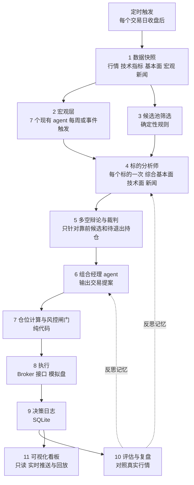

# 升级方案：从宏观情景模拟器到美股波段交易系统

日期：2026-11-17　状态：阶段 0 和阶段 1 已完成；阶段 2 到阶段 5 的代码已完成并验证（阶段 5 的看板做完后又按要求改版过几次界面，最近的是 2026-11-24 的会议室改版、2026-11-26 的专业化改版和英文模式，三者在 2026-11-26 一起合并进主目录）；阶段 6 的定时运行已提前做完，评估在 2026-11-26 接入了定时运行（做完并验证，当天合并进主目录）。阶段 2 的完成标准里"连续 5 个交易日运行"在 2026-11-23 达到（基准组 11-17 到 11-23 五个交易日无错误，期间 11-19 的卖出提案通过校验），阶段 2 至此完成。第二期的设计（全天运转、预测、倒推、人性与组织席位）在第 11 节，2026-11-19 写成；其中阶段 8（信息台账、全天会议、看板打开当下）和阶段 9（预测引擎和它的对账）的代码已完成并验证，阶段 9 在 2026-11-23 合并进主目录；阶段 10 的前半部分（倒推、情景推演、到期对账）在 2026-11-23 完成并验证，当晚合并进主目录，后半部分（作战计划和触发条件）没有做；阶段 11、12 尚未开始

## 1. 目标与已定事项

把现有的多 agent 宏观情景模拟器，升级成一个能自己产生买卖判断并执行的系统。

| 事项 | 决定 |
|---|---|
| 市场 | 美股 |
| 持仓周期 | 波段，数天到数周 |
| 执行 | 先做与券商无关的接口和本地模拟盘，券商以后再接 |
| 运行节奏 | 每个交易日收盘后运行一次，订单在下一个交易日执行。2026-11-19 起另有一组全天开会的"席位"与它并排运行（第 11 节），这一条对原有流程仍然成立 |

## 2. 设计原则

1. **LLM 只提案，代码做决定。** agent 输出结构化的观点和交易提案；仓位大小、风控、订单生成全部是确定性代码。LLM 无法绕过风控。
2. **每个决定都留档、都能打分。** 每次运行保存当时用到的数据、agent 输出、提案、风控结果、订单和成交，事后与真实行情对账。
3. **先影子、再模拟、最后实盘。** 先只出信号不下单，再跑模拟盘，达到事先写定的门槛后才考虑实盘。
4. **固定流水线，不用自由发挥的循环。** 交易流程的阶段顺序由代码决定，LLM 只在阶段内部工作。这样结果可复现、可审计，成本也可控。
5. **默认安全。** 默认模式是模拟盘；实盘需要单独的开关和密钥；任何数据异常或输出不合规都导致"不交易"。

## 3. 目标架构



第 2、4、5、6 步是 LLM，其余是代码。

### 新增目录

```
data/        行情、基本面、宏观、新闻的 provider，交易日历，时点快照
pipeline/    每日固定流水线、候选池筛选
agents/ticker/  标的分析师和组合经理
portfolio/   仓位计算
risk/        风控闸门、熔断、停止开关
execution/   Broker 接口、PaperBroker、以后的券商适配器
journal/     SQLite 决策日志和评估
dashboard/   只读数据接口和网页看板
tests/       单元测试和冒烟测试
```

## 4. 现有代码的处置

| 现有部分 | 处置 |
|---|---|
| 7 个宏观 agent（`agents/`） | 保留，作为宏观层。输入从"假设情景"改为"当前宏观快照加近期事件"，输出增加结构化字段（风险偏好、板块倾向）。 |
| `agents/base.py` 的模板 | 保留并扩展，新的标的分析师沿用同一模式。 |
| 多空辩论 | 改造。现在争论"冲击大还是小"，改为争论"这个仓位该不该开、该不该留"。 |
| ReAct 编排器（`orchestrator.py`） | 保留为"研究模式"，继续做情景分析。交易流程不走它。 |
| `utils/llm_client.py` | 重写调用方式，并做成可切换模型提供方，见阶段 0。 |
| `mcp_tools/yfinance_server.py` | 数据函数抽到 `data/` 直接调用，MCP 服务只留薄封装给研究模式用。 |
| `mcp_tools/client.py` | 已删除。关键词路由在阶段 1 去掉后，模拟器不再经过 MCP，这个客户端没有任何调用方。 |
| ChromaDB 记忆 | 修复后保留，只用于检索复盘文字。交易记录以 SQLite 为准。 |
| `orchestrator_legacy.py` | 已删除，原文件留在 git 历史里（提交 `96565d9`）。其中"批评者审稿"的做法（`_node_critic`、`_node_revise`）可在组合经理提案后复用，届时用 `git show 96565d9:orchestrator_legacy.py` 查看。 |
| Streamlit 界面（`app.py`） | 保留研究模式页面。交易看板另做，见阶段 5。 |

## 5. 分阶段计划

每个阶段的完成标准都能在交付当时直接检查。

### 阶段 0：让系统重新跑起来

现状比上次汇报的更严重：按 Claude API 文档，`.env` 里配置的 `claude-sonnet-4-20250514` 已于 2026-06-15 退役，所以现在任何一次模拟都会在第一次 LLM 调用时失败。（依据是 API 文档，没有做真实调用验证。）

工作内容：

- 模型 ID 换成当前模型，集中到一处配置，见第 8 节。
- 重写 `LLMClient` 的调用方式，原因是当前模型的接口变了：
  - 去掉 `temperature`，当前模型传非默认值会返回 400。
  - 强制 `tool_choice` 在 Opus 5.5 和 Sonnet 5.5 上返回 400，而现有代码的结构化输出全部依赖它。改用结构化输出（`client.messages.parse()` 加 Pydantic 模型）。
  - 现有的 1024 到 4096 的 `max_tokens` 预算在"思考常开"的模型上会截断输出，提高到 16000 左右，并检查 `stop_reason`。
  - 处理 `refusal` 停止原因。
  - 记录每次调用的 token 用量和费用。
- **模型提供方可切换**：调用层对外只有一个统一接口，输入提示词和 Pydantic schema，输出校验过的对象和用量。下面挂两个实现：Claude（走官方 SDK），以及 OpenAI 兼容接口（Ollama 和多数托管开源模型服务都是这种）。每个角色用哪个提供方、哪个模型都是配置项。开源模型一侧用按 schema 约束的输出，校验失败后重试。
- 升级 `anthropic` SDK（当前 0.86，上述接口需要新版本）。
- `orchestrator.py` 的主循环直接调用了 client 并传了 `temperature`，一并修改。
- 修复已确认的问题：重装 chromadb 并让初始化失败时报错而不是静默跳过；审议后丢失未参与 agent 的分析；`requirements.txt` 补 `yfinance`、`pandas`、`pytest`；`MAX_ITERATIONS` 读配置；`.memory/` 移出 git；删除空目录 `{agents,models,utils}`。
- 加 pytest 和用假 LLM 的冒烟测试。

完成标准：`python main.py -s "..."` 端到端产出报告（会花少量 API 费用）；pytest 通过；启动时打印记忆库和数据通道的真实状态；同一个结构化输出冒烟测试在 Claude 和本机 Ollama 的一个小模型上都能通过。

**完成记录（2026-11-16）**

阶段 0 已完成，按你的要求默认使用本机开源模型。验证结果：

- 单元测试 46 个通过，不需要真实模型。
- 本机 Ollama 的真实模型测试通过（主模型 `qwen2.5-coder:7b`，快速模型 `llama3.2`）。
- 端到端情景模拟跑通：7 分 24 秒，25 次模型调用，无按量费用。记忆库（11 条历史记录）和行情通道（8 个工具）都正常。
- 经过一轮独立代码评审，6 条意见全部处理。

与原计划不同的地方：

- 默认提供方是 Ollama，不是 Claude。Claude 和 OpenAI 兼容接口两条路径都已实现并有单元测试。
- Claude 路径没有用真实 API 验证过，因为那需要花钱。验证命令是 `RUN_LIVE_ANTHROPIC=1 pytest -m live`。
- `anthropic` SDK 没有升级：现有的 0.86 已经支持结构化输出。
- 编排器不再使用厂商的工具调用格式。每一步由模型返回一个结构化的"下一步动作"，这样三种提供方的行为一致。场景解析改为固定的第一步。
- Ollama 在提示词超长时默认静默截断。现在请求里带 `truncate: false`，超长时服务端直接报错。

同一天的后续修复，起因是用本机模型跑出的报告暴露了两个系统设计问题：

- **辩论双方改名。** 原来叫 bull 和 bear，但含义是"影响严重"和"影响有限"，与市场上牛熊的通常含义相反，导致报告的情景矩阵写反。现在叫"影响严重方"和"影响有限方"，合成报告时明确规定牛市情景是对风险资产更有利的情形。重跑后矩阵方向正确。
- **拦住 agent 互相照抄。** 弱模型会把别的 agent 的句子直接粘进自己的分析，多个独立视角因此变成一个。现在审议后某个字段若是照抄的，退回该 agent 自己原来的文字；最终报告里有大段相同文字的两个 agent 会列在"质量警告"里。判定标准是连续照搬 30 个词以上，或 20 个词以上且占该字段四成。两次真实运行中，没有照抄时两个 agent 最多共有 17 个词的相同片段，而被照抄的那段有 90 个词。

遗留事项：

- **分析质量不够。** 7B 的本机模型能跑通流程，但报告里有自相矛盾的结论和编造的数字。在换用更强的模型之前，输出不能当作分析结论使用。
- `.memory/` 已加入 `.gitignore`，但它之前被提交过，仍在 git 的跟踪里。提交时需要执行 `git rm -r --cached .memory`。
- `docs/` 下两份逐行代码讲解文档讲的是改造前的代码，已经过时。
- Claude 路径没有启用"模型拒答时自动换模型重试"的功能，拒答会直接报错。

### 阶段 1：数据层

- **交易日历**：用现成的交易所日历库判断哪天是交易日、哪天提前收盘。流水线每天被触发，但非交易日直接退出。后面所有提到"交易日""次日"的地方都以它为准。
- 新建 `data/`，把日线、技术指标、基本面、板块表现、收益率曲线做成普通 Python 函数，统一走一个 provider 接口。第一版用 yfinance。
- 新增宏观序列（CPI、失业率、政策利率等），来源用 FRED。
- 新增新闻和财报日历，做成可插拔接口，具体来源在本阶段内选定。
- 取公司行为数据（拆股、分红），供阶段 3 使用。
- **时点快照**：每次运行把用到的全部数据按日期存盘。评估、复盘、回放都只读快照。
- 数据质量检查：缺字段、数据过期、价格异常时，该标的不进入决策。
- 删除关键词路由；研究模式的 `fetch_market_data` 改成显式指定工具和参数。
- agent 提示词里，数据放在单独的"数据快照"段，不再冒充上游 agent 的结论。"禁止给具体数字"改为"只能引用快照里出现的数字"。

完成标准：一条命令为任意标的列表生成快照并通过校验；数据函数有基于缓存样本的单元测试；日历对节假日和提前收盘日的判断有单元测试；研究模式下货币、财政、商品三类情景都能取到正确数据。

**完成记录（2026-11-16）**

阶段 1 已完成，四条完成标准全部满足：

- 命令 `python -m data.snapshot --tickers AAPL,MSFT` 约 8 秒生成快照并存盘；有标的不可用时返回非零退出码。
- 数据层测试用当天录制的真实样本离线运行。全部测试共 143 个通过。
- 交易日历的测试覆盖周末、感恩节、圣诞节、顺延的独立日、两个提前收盘日，以及盘中、收盘前一分钟、收盘时刻、纽约深夜（UTC 已是次日）等时间点。
- 用真实数据验证了货币、财政、商品三类情景，每类都取到 21 个市场序列和 10 个宏观序列。
- 用本机模型完整跑通一次石油情景：快照取到并存盘，7 个 agent 都拿到了数据。
- 经过一轮独立代码评审：没有发现前视偏差，5 条具体问题全部修复。

做出的选择：

- **数据源**：行情、基本面、财报日期、新闻标题来自 Yahoo Finance（通过 yfinance）；宏观数据来自 FRED 的公开 CSV 接口。都免费，不需要密钥。
- **新闻**：yfinance 原有的新闻接口已经失效，改用它的搜索接口，并只保留标注了该标的的标题。相关性一般，会混入大盘新闻。新闻取不到只记警告，不影响标的可用。
- **交易日历**：用 `exchange_calendars` 库的纽交所日历。
- **研究模式不再经过 MCP**：编排器直接调用数据层。MCP 服务保留为一层薄封装，供外部 MCP 客户端使用。
- **取数是确定的**：编排器选择"取数据"时，固定取全套市场和宏观数据，另加模型点名的标的。不再按关键词猜该取什么。

数据层强制的三条规则：

- 只用已收盘的交易日。盘中运行时，当天未走完的 K 线被剔除。
- 数据有问题就拒用。价格过期、历史太短、任何一根 K 线价格缺失或非正、高低价不包含开收盘价、无成交量、复权后单日涨跌超过 50%，都会把标的标为不可用并写明原因。
- 每次取数都存盘，路径是 `data_store/snapshots/<交易日>/`。

遗留事项：

- **提示词约束不住编数字，已加代码检查。** agent 被要求只引用快照里的数字，但实测 7B 本机模型仍然会编点位和收益率。现在代码会把每个 agent 的分析和报告汇总部分里的数字，与快照、情景和该 agent 自己的指令逐一比对，找不到来源的列在报告的"质量警告"里。这个检查只报告，不改写 agent 的文字，也分不清"编的"和"自己算出来的"。要让模型不编数字，仍然需要更强的模型，或者在阶段 2 把输出改成结构化的引用。
- yfinance 是非官方接口，测试期间它的一个新闻接口就是坏的。实盘前要换成正式数据源。
- 基本面是取数当时的值。yfinance 不提供历史时点的基本面，所以回放历史时基本面不可用。
- 宏观数据按观测日期截取，没有处理"某月数据在次月才公布"的发布滞后。前瞻运行不受影响，回放历史时要注意。

### 阶段 2：信号层（影子模式，不下单）

- 定义三个结构化输出：
  - `MacroRegime`：风险偏好、板块倾向、主要风险、把握度。
  - `TickerView`：方向、把握度（0 到 1）、预期周期、失效条件、催化剂、引用的数据。
  - `TradeProposal`：标的、动作（买入、卖出、持有、减仓）、把握度、理由。
- 宏观层：7 个 agent 改为分析当前状态，每周运行一次，遇到重大事件额外运行，结果缓存复用。（2026-11-22 起改为每个交易日重算，原因和改动见 11.13 的"头两个真实交易日之后改的三条规则"。）
- 标的层：新增一个标的分析师，每个标的调用一次，同时看基本面、技术面和新闻。先不拆成三个分析师：合在一起能权衡三类信息之间的矛盾，调用次数也只有三分之一。以后发现这一层是质量瓶颈再拆。
- 候选池：用确定性规则（流动性、价格、趋势）从白名单里筛出 10 到 30 个候选，加上全部现有持仓。
- 辩论：只对排名靠前的候选和出现退出信号的持仓进行，裁判输出校准后的把握度和失效条件。
- 组合经理 agent：综合宏观结论、各标的观点和当前持仓，输出提案列表。
- **影子持仓**：这一阶段还没有模拟盘，所以按前几天的提案记一份假想持仓（次日开盘价、固定仓位）。这样组合经理每天都能看到持仓，卖出、持有、减仓三条路径在本阶段就会被执行到。另外用预置持仓的测试用例直接验证退出路径。
- 固定流水线 `pipeline/daily.py`。
- **模型对比**：影子模式下可以让两套模型配置（例如 Claude 和一个开源模型）读同一份数据快照，各出一份信号并分别记录，留给阶段 4 打分比较。
- **交互事件记录**：每一次 agent 发言都记成一条事件，包含谁说的、回应谁、属于哪个环节、时间和内容。每个结构化输出带一句 agent 自己写的简短发言，供看板展示。阶段 5 的看板只读这些记录，所以必须从这一阶段开始记。

完成标准：每天收盘后一条命令产出信号表（JSON 和 Markdown），全部通过 schema 校验；记录单次运行费用；连续 5 个交易日运行无错误；期间至少产生过卖出或减仓提案并通过校验。

**进展记录（2026-11-16）**

代码和测试已完成。四条完成标准的现状：

| 标准 | 现状 |
|---|---|
| 一条命令产出信号表，全部通过校验 | 满足。命令是 `python -m pipeline.daily`，产出 `signals.json` 和 `signals.md`。 |
| 记录单次运行费用 | 满足。每次运行记录调用次数、token 数、模型用时和费用；本机模型没有按量费用。 |
| 连续 5 个交易日运行无错误 | **2026-11-23 满足。** 正式记录里基准组 11-17、11-18、11-19、11-20、11-23 连续五个交易日无错误，`python -m pipeline.daily --status` 显示 5 of 5。会议室组 11-19 才开始，当天是 3 of 5。 |
| 期间出现过卖出或减仓提案并通过校验 | 在写入临时目录的真实运行里出现过一次（第二天提出减仓并被接受）。正式记录里要等连续运行期间出现才算。卖出、减仓、持有三条路径都有测试，包括预置持仓的用例。**2026-11-23 满足：** 正式记录里基准组 11-19 的组合经理提出卖出 MA 并通过校验，11-20 开盘成交。 |

验证：

- 离线测试共 349 个通过，不需要真实模型和网络。
- 我故意改坏 61 条规则（例如"在提案当天成交""没有宏观结论也能买入""拆股调整两次"），每一条都有测试能发现。
- 用真实数据和本机模型（`qwen2.5-coder:7b`）连续跑了两个交易日（11 月 12 日和 13 日），写入临时目录，没有动正式记录。第一天 27 次模型调用、约 8.5 分钟，接受了 7 条买入；第二天复用宏观结论，21 次调用、约 5.5 分钟。第一天的 7 笔买入都在第二天开盘价成交；第二天组合经理提出减仓一只并被接受，另一条买入因为裁判判了"不持有"被代码拒绝。`--status` 显示"连续 2 个交易日无错误，期间有减仓被接受"。
- 这两天是把时钟拨回去跑的，因为当晚 Yahoo 还没有发布当天的收盘价。行情是当时的，基本面是运行时的值，晚于时钟的新闻标题被过滤掉了。
- 五轮独立代码评审，意见全部处理，见下面"评审发现的问题"。

做出的选择：

- **宏观结论由代码合成。** 7 个宏观 agent 各给出立场、把握度和板块倾向，代码按规则合成：取把握度加总最高的立场，打平或总把握度为零时没有结论；板块倾向要超过单个 agent 能给出的权重才成立。没有第 8 个模型来写总结，结论能追溯到每个 agent。
- **模型的输出是草稿，代码检查后才算数。** 数值越界的输出直接拒绝并记录原因，不做修正。
- **买入的硬规则。** 标的必须是当天候选；必须有通过检查的看多观点；辩论过的话裁判没有判"不持有"；必须有当前的宏观结论；仓位数不超过上限。同一标的只认第一条提案。持仓没有得到有效决定时默认持有。
- **结构化引用。** 分析师要列出依据的数据点（指标名和数值），代码逐条与快照比对，不一致的记在观点上，组合经理和裁判都能看到。
- **影子持仓。** 每笔固定金额，在提案的下一个交易日开盘价成交；不记现金、分红和滑点。一只持仓如果从某次运行发现问题起，超过 10 天都没有可用且前后一致的价格（例如退市，或者数据源的拆股记录和价格对不上），按最后一个可信的收盘价平掉，不再跟踪。流水线自己没运行的日子不计入这 10 天。
- **决策日志提前到本阶段。** 原计划在阶段 3 建 SQLite 日志，但看板要读的事件记录必须从现在开始记，所以现在就建了：运行记录、事件、宏观结论、影子持仓和成交。
- **运行时间。** 必须在收盘价发布之后、下一个交易日开盘之前运行。开盘后运行会被拒绝，因为那时模型看到的是当天的新闻和价格，而成交价是已经过去的开盘价。
- **候选池规则（占位值）。** 股价不低于 5 美元，20 日均成交额不低于 2000 万美元，收盘价高于 50 日均线且 50 日均线高于 200 日均线；通过的按 3 个月涨幅排序取前 10。
- **默认标的范围（占位）。** 70 只：大盘和板块 ETF 加各板块的大型股。可以用 `UNIVERSE_FILE` 换成自己的清单。

真实运行暴露的事实：

- **Yahoo 的收盘价发布得晚。** 周一收盘 4 个多小时后，当天的收盘价仍是空的。这时运行会明确失败并提示稍后重跑，不会记成"今天没有信号"。
- **Yahoo 的开高低收已经按拆股回调过。** 阶段 1 里我写的"未复权"是错的，已更正。影子持仓的拆股处理按这个事实重写，并且只在"列出的拆股"和"回调后的价格"互相对得上时才调整，对不上就不估值、订单等待。
- **结构化引用有效。** 第一次真实运行里，分析师引用的 50 个数据点全部与快照一致。研究模式里同一个模型大量编造数字，这里基本没有。
- **7B 模型没有区分度。** 10 个候选里 9 个给出完全相同的"看多、把握度 0.85、10 天"；三场辩论的裁决都是"持有、0.75"；空方基本在重复多方的话。
- **7B 模型不守指令，代码兜住了。** 第二天组合经理对两个没有持有的候选说"持有"，却漏掉了真正的持仓。代码拒绝了前两条并说明原因，给真正的持仓补了默认持有。

评审发现的问题（已全部修复）：

- 拆股会被调整两次，测试没发现是因为测试用的假行情和 Yahoo 的行为不一样。假行情已改成和 Yahoo 一致。
- 持仓数据不可用的那天发生拆股，拆股会永久丢失。
- 下一个交易日盘中运行时，模型能看到当天的价格和新闻，成交却按已经过去的开盘价。
- 模型返回 NaN 会让记录读不回来；新订单会悄悄覆盖还在等待的旧订单；买入不受分析师观点和裁判裁决约束；订单和运行状态不是一起保存的；有问题的运行被记成正常。
- 修复过程中新引入、又被后续评审发现的三个问题：数据库提交失败后连接会卡住，之后什么都写不进去；持仓的价格记录一旦对不上就永远冻结；为解决冻结加的"超期平仓"把流水线没运行的日子也算了进去，可能误平正常持仓。三个都已修复。

遗留事项：

- **连续 5 个交易日需要每天运行一次。** 自动定时在阶段 6，在那之前要手动运行。（2026-11-23 已达到，见上面的表。）
- **模型质量。** 上面两条关于 7B 模型的事实说明，它产出的信号目前没有参考价值。`--arm` 可以让两套模型读同一份数据各出一份信号。用 Claude 做对比需要你的 API 密钥并产生费用，我没有运行。
- **风险偏好为 risk-off 时是否禁止开仓**没有规定，现在不禁止。这是风控取舍，由你决定。**2026-11-23 已定：现在不加，等阶段 12 和 11.10 的"市场状态"规则一起做。** 当天的依据：头四个真实交易日（11-17 到 11-20）标普 5 个交易日跌 8.6%，SPY 整周没有通过上升趋势规则，会议室的宏观结论是 risk-off（置信 0.86），系统仍然每天最多开 3 个新仓，基准组三天从空仓加到 59%。到 11-20 收盘基准组 −1.01%、会议室 −0.50%，同期 SPY 是 −5.94% 和 −3.33%；亏损主要来自大盘，样本太小，判断不了这条规则的好坏。
- 宏观 agent 只看行情和宏观数据，没有新闻输入。"重大事件时额外运行宏观层"目前只能手动加 `--refresh-macro`。
- 一次运行中途失败后只能整轮重跑，已完成的模型调用不会复用。阶段级的断点续跑在阶段 3。
- 流水线里的模型调用是串行的。本机模型本来就只能串行；换成托管模型后可以并行来缩短时间。
- 影子持仓依赖 Yahoo 的拆股记录和价格互相一致。不一致时会停下来报告，但不会自己修复。
- "超期平仓"还有一个很窄的漏洞：某次运行碰到一只持仓的数据暂时不可用，之后流水线停了 10 天以上，恢复当天同一只持仓的数据又恰好不可用，它就会按停机前的价格被平掉。可以再加一条"至少连续几次运行都看到问题"来堵，留到阶段 3 做模拟盘时一起处理。
- 数据源对价格做了 5% 以内的调整却没有列出原因时（例如小比例送股），会被当作价格更正接受，持仓的账面会差这么多。当天会有警告。

### 阶段 3：仓位、风控、模拟盘

仓位和风控：

- `portfolio/`：由把握度和波动率（ATR）算出目标仓位，止损位来自失效条件和 ATR。
- `risk/`：风控闸门，规则见第 6 节。每条被拒绝或被削减的订单都记录原因。

执行（`execution/`）：

- `Broker` 接口：查账户、查持仓、下单、撤单、查订单。
- `PaperBroker` 按日线撮合，规则如下：
  - 市价单在下一个交易日按开盘价成交。
  - 限价单在当日最高最低价覆盖限价时成交，默认当日有效。
  - 止损单一直有效，直到触发或撤销。开盘价已低于止损价时按开盘价成交，否则按止损价成交。
  - 每日处理顺序是先止损、再限价、再市价。同一天止损和止盈都可能触发时，按止损先触发处理。
  - 第一版不模拟部分成交，订单要么全成、要么不成。这是已知的简化。
  - 滑点可配置。
- 公司行为：
  - 拆股时调整持仓数量、成本价和止损价。
  - 分红记为现金流入。
  - 退市或代码变更时标记该持仓，停止对它下新单，模拟盘按最后成交价平仓。
  - 并购等其他情况标记为需人工处理。
  - 持仓记账用未复权价格加显式调整，技术指标用复权价格。（阶段 2 实测：Yahoo 返回的开高低收已经按拆股回调过，只有分红没有调整，拿不到真正的未复权价格。所以记账要么换数据源，要么沿用阶段 2 影子持仓的做法：每次先把持仓换算到当前快照的股数口径，再成交和估值。）

状态和恢复：

- `journal/`：SQLite 记录每次运行的快照引用、agent 输出、提案、风控结果、订单、成交和每日净值。
- `PaperBroker` 的账户、持仓、订单全部存 SQLite，每次变更立即落盘。
- 每次运行有唯一编号。流水线每个阶段的产出都落盘；中断后重跑时复用已完成阶段的产出，不重新取数，也不重复调用 LLM。
- 下单分三步：先记录意图，再提交，再确认。每张订单带唯一编号，重跑时据此去重。
- 停止开关。

回放测试用脚本化的提案，不调用真实 LLM。原因是模型"知道"历史行情，用真实 LLM 回放时它会避开亏损，熔断和亏损上限根本不会被触发，测试等于没测。脚本化场景包括：连续亏损触发熔断、单票和板块超限、当日开仓数超限、拆股、流水线中途崩溃后重跑。

完成标准：每日流水线端到端在模拟盘下单；每条风控规则都有单元测试；脚本化回放中每条风控都在设定的阈值处触发；中途杀掉进程后重跑不产生重复订单。

**完成记录（2026-11-16）**

四条完成标准都满足：

| 标准 | 现状 |
|---|---|
| 每日流水线端到端在模拟盘下单 | 满足。同一条命令 `python -m pipeline.daily`，现在会同步模拟账户、计算仓位、过风控、下单。 |
| 每条风控规则都有单元测试 | 满足。每条规则都有"刚好在限额内通过、刚好超出被削减或拒绝"的测试。 |
| 脚本化回放中每条风控在阈值处触发 | 满足。用脚本化的提案和可控的假行情跑多天，覆盖：连续止损亏损触发回撤熔断（阈值上下各测一次）、当日亏损熔断、单票和板块超限、当日开仓数超限、持仓数超限、现金下限和换手上限、持仓期间拆股。 |
| 中途杀掉进程后重跑不产生重复订单 | 满足。在取数后、模型调用中、下单进行到一半这几个位置分别杀掉，重跑后订单各只有一张，且不重新取数、不重复调用模型。 |

验证：

- 离线测试共 480 个通过（阶段 3 新增 131 个）。
- 故意改坏 53 条规则（模拟盘、下单、流水线、风控、仓位），每一条都有测试能发现。
- 用真实数据和本机模型在临时目录里连续跑了三个交易日（11 月 12 日、13 日和 16 日，其中 16 日是按真实时间跑的），前后跑了三遍，每遍都是当时的最新代码。典型的一遍：第一天 7 条买入提案被接受，风控把其中 3 条削减或放行、另外 4 条因"当日最多新开 3 个仓位"被拒；第二天这 3 笔按周五开盘价成交，又下了 3 张单；第三天其中一只周一开盘直接跌破止损价，按开盘价止损卖出（亏 11.26%），其余持仓都带着止损单，账户净值约 99,300。同一个交易日再运行一次会被跳过。最后一遍（评审通过后的代码）还多做了两步：对第三天强制重跑，3 张单里有 1 张的理由变了，被替换成新的一张，另外 2 张原样保留，没有重复下单；再打开停止开关强制重跑，7 条被接受的提案全部被风控拒绝，上一次下的 3 张单被撤回，这个交易日最后没有留下任何新订单，已有持仓的止损单不受影响。
- 独立代码评审三轮：第一轮指出 2 个严重问题和 6 个中等问题，第二轮指出修复中新引入的 1 个严重问题，都已修复，见下面"评审发现的问题"。

模块：

- `execution/paper.py`：模拟盘。账户、持仓、订单、成交和每日净值都存在 SQLite 里，每次变更和引起它的成交在同一个事务里落盘。
- `execution/placement.py`：下单分三步（记录意图、提交、确认），每步落盘后才做下一步。
- `portfolio/sizing.py`：仓位计算。`risk/gate.py`：风控闸门和停止开关。这两个模块由另一个 agent 按我写的规格实现，我审过并改了两处。
- `journal/store.py`：新增模拟盘的表、订单日志和断点记录。

做出的选择：

- **模拟盘取代影子持仓。** 阶段 2 的影子持仓已删除。每套模型配置各有一个模拟账户。
- **仓位由代码算。** 一笔买入拿净值的一个固定比例去冒险（默认 1%，乘以组合经理和分析师两个把握度里较低的那个），除以"收盘价到止损价"的距离得到股数。止损价在收盘价下方 2 倍 ATR，且不近于价格的 1%。卖出是全部，减仓是一半。（11 月 17 日起，止损价可以由分析师提出，见下面"阶段 3 之后的改动"。）
- **止损是挂在券商那里的单子。** 买入成交时自动挂上保护性止损单，之后跟着持仓走：减仓时数量跟着减，拆股时价格和数量跟着调，清仓时撤掉。加仓不会把已有股份的止损放宽。
- **开盘就跌破止损的买入不做。** 止损价是按前一天收盘算的。如果第二天开盘价已经在止损价或更低，这笔买入的前提已经不成立，订单取消。
- **撮合顺序。** 每个交易日依次是：分红、已有持仓的止损、限价单、市价单（先卖后买）、当天新开仓的止损检查。止损排在限价前面，所以同一天两者都可能触发时按止损先触发算。
- **断点续跑。** 取到的数据和每个模型的回答都随到随存。被杀掉或崩溃的运行，下次直接接着做，不重新取数，也不重复问模型。一个回答只对"当时那个问题"有效：如果问题变了（比如上次失败的调用这次成功了），会重新问。
- **订单编号由决定本身确定**（交易日、账户、标的、方向），券商对同一编号只认第一次。所以重跑不会重复下单。
- **同一个交易日重新决定时先对账。** 下单前，把这个交易日之前的尝试已经下出去、而这次决定不再需要或数量不同的订单撤回。停止开关也靠这一步生效：打开开关后重跑，之前下出去的单会被撤回。
- **另一个进程还在跑同一个交易日时不启动。** 运行记录里存了进程号。进程还活着就拒绝，`--force` 也不行；进程已经不在了就把那次运行记为失败并接着做。
- **`--force` 的含义**是把这个交易日从头再做一遍：丢掉已存的回答，之前的完成记录标为"已被取代"。

真实运行暴露的事实：

- **风控确实在起作用。** 7B 模型每天都想买七八只，而且算出来的仓位普遍是单票上限的两倍，全靠风控削减和拒绝。
- 模型质量的问题和阶段 2 一样，没有变化。

评审发现的问题（已全部修复）：

- 买入当天开盘价低于止损价时，模拟盘会先按开盘价买入，再"按止损价卖出"，凭空赚到差价。我写的测试还把这个结果当成了正确的。
- 强制重跑如果中途失败，之前的订单已被撤掉、新的没下，而这个交易日仍被当作已完成，订单就此丢失。
- 运行被杀掉后重跑，同步账户时发现的问题（例如订单被取消）不会再报，有问题的一天会被记成正常。
- 重跑时如果决定变了，之前下出去的订单没人管；停止开关拦不住已经下出去的单。
- 加仓会把整个持仓的止损降到新的、可能更低的价位。
- 持仓的保护性止损单会被"重复订单"规则误判，导致之后的卖出全部被拒。（这条是写风控的 agent 自己发现并报告的。）
- 修复时新加的"下单前对账"分两次落盘，如果恰好在两次之间被杀掉，这个交易日之后每次运行都会报错。已改为一次落盘，并且对账时会把"日志里有、券商那里没有"的订单记录清掉重来。

遗留事项：

- **风控的限额是按收盘价检查的，成交在第二天开盘。** 开盘跳空会让实际仓位和实际风险比批准时大一些。现金不够时券商会整单拒绝，但单票上限和单笔风险上限在成交那一刻没有保证。
- **一只标的某天取不到可用价格时，那一天不会回头补做。** 它的订单和止损顺延到下一个能定价的交易日，按那天的价格处理。如果这一天价格先跌破止损又收回，这次止损就漏掉了。
- 模拟盘只有日线的开高低收，不模拟盘中路径、部分成交和手续费，成交结果比真实市场乐观。
- 分红按除息日记入现金，没有处理实际派息日的时间差。
- 风控给"还在券商那里等待的买单"预留现金时，用的是它的限价或止损价（当天取不到收盘价的情况下），略偏低；一张既没有限价也没有止损价的等待买单不会被计入。流水线自己下的买单都带止损价，所以只影响其他调用方。
- 断点续跑只在"模型看到的内容没变"时复用回答。改了提示词之后要用 `--force` 重跑，否则会复用旧回答。
- 所有风控数值和初始资金都是占位值，见第 9 节。

**阶段 3 之后的改动（2026-11-17）：分析师提出止损价**

起因：止损价和股数原先全由固定公式算，模型对个股的判断进不来。本节开头的计划写的是"止损位来自失效条件和 ATR"，阶段 3 只做了 ATR 这一半，这次补上另一半。

做法：

- **分析师提出止损价。** 分析师对它看多的候选标的给出一个止损价，并说明它设在数据里哪个价位的下方（比如某条均线）。
- **代码只在范围内采用。** 止损价必须在收盘价下方 1 到 4 倍 ATR 之间，而且不近于价格的 1%。范围之外的止损价会被拒绝，并在这条观点上注明原因；它不会被挪到最近的允许价位，观点的其余部分照常使用，这次运行也不会因此被记为有问题。
- **没有可用的止损价时沿用公式**，即收盘价下方 2 倍 ATR。
- **冒险的钱不超过预算。** 股数等于风险预算除以止损距离，所以止损放得远，股数就少，触及止损时亏的钱不会超过预算。模型能影响止损放在哪里，不能直接决定买多少。
- **已持有的仓位沿用开仓时的止损。** 分析师对已有持仓给出的止损价不采用。
- 报告里每张订单都注明止损来自分析师还是公式。辩手和组合经理也能看到分析师的止损价。
- 顺带改了一处：断点里存的模型回答如果和现在要求的字段对不上（比如在升级前被杀掉的运行），会重新问模型，不再报错。

新增两个设置：`SIZING_STOP_MIN_ATR_MULTIPLE`（默认 1）和 `SIZING_STOP_MAX_ATR_MULTIPLE`（默认 4），都是占位值。

验证：

- 离线测试共 541 个通过（这次新增 61 个）。
- 故意改坏这次涉及的 39 条规则，每一条都有测试能发现。阶段 3 的 53 条也重新跑了一遍，仍然全部被发现。
- 独立代码评审两轮。第一轮没有严重问题，指出 2 个中等问题和 6 个小问题；修复后第二轮通过。
- 用真实数据和本机模型在临时目录里跑了 11 月 16 日这个交易日，结果见下面。

评审发现的问题（已修复）：

- **公式算出的止损价取整到分以后，可能比取整前离收盘价更远，而股数是按取整前的距离算的。** 在几美元的低价股上，实际风险可以超出预算将近 9%。这是阶段 3 就有的问题，被拒绝的分析师止损都会走这条路，所以一并修了：现在先把止损价定到分，再按实际距离算股数。
- **分析师写的止损理由里的数字没有核对**，却会原样出现在辩手和组合经理看到的材料里，等于把可能是编造的价位当成了核对过的数据。现在止损理由和观点正文一样做数字核对。
- 允许范围原先按未取整的 ATR 计算，而模型看到的 ATR 只有两位小数。模型把止损刚好放在边界上时会被误拒。现在按模型看到的数值算。
- 两个范围设置写错时（下限大于上限、零、不是数字），原先会悄悄变成别的含义。现在这种情况下一律不采用分析师的止损，并在观点上写明原因。

真实运行暴露的事实：

- 同一个交易日跑了两遍，第二遍是最终代码的强制重跑。7B 模型对看多的股票大多会给止损价：第一遍 7 只都给了，全部在范围内；第二遍 8 只里有 5 只在范围内被采用，1 只（MA）把止损设在 200 日均线上，离收盘价 8.7 倍 ATR，被拒绝并改用公式，另外 2 只没给。
- 被采用的止损多数直接取自数据里的均线（例如 LLY 两遍都设在 20 日均线 1,364.33），也有取整数的（650、400、280）。模型把止损设在均线上，而不是提示词要求的"略低于"。
- 理由经常标错，把 20 日均线说成 50 日或 200 日均线。
- 同样的数据，两遍给出的止损不一样（PG 第一遍 164.01，第二遍没给；MA 第一遍 630，第二遍 541.31）。模型给的止损和它的其他输出一样不稳定。
- 最终那遍下了 3 张单：LLY 和 KO 用分析师的止损，PG 用公式，报告里都有标注。强制重跑时，上一遍留下的 KO 和 PG 两张单因为止损价变了被替换，没有重复订单。
- **在现在的占位限额下，股数几乎总是由"单票不超过净值 10%"决定。** 两遍里每张买单都被风控削减到这个上限。所以分析师的止损目前实际改变的是止损挂在哪里、触及时亏多少，而不是买多少股。只有把单笔风险比例调低，或者把单票上限调高，止损距离才会真正决定股数。

遗留事项：

- 止损只在开仓时设一次，之后不会随价格上移（没有移动止损）。
- 分析师只看得到日线数据里的价位（收盘价、均线、52 周高低点、ATR），看不到盘中的支撑和阻力。
- 代码只核对止损理由里的数字，不核对"说的是哪条均线"。7B 模型经常把均线标错。
- 止损价本身是分析师可以提到的数字。数字核对按 0.5% 的容差比对，所以离止损价 0.5% 以内的其他数字也不会被标出。
- 更近的止损更容易被触发（包括买入当天），开盘跳空时相对损失也更大。
- 公式止损取整到分以后，可能比"价格的 1%"近不到半分钱。
- 止损价不是数字（无穷大之类）时，整条观点按格式错误处理，和其他字段一样。

### 阶段 4：评估闭环

- 评估任务：给每一条 `TickerView` 打分，不只是成交的交易。观点到期后计算方向对错和相对 SPY 的超额收益；成交的交易另外记录是否触发止损和实际盈亏。
- 统计：按把握度分桶的命中率（检验把握度是否可信）；按板块、宏观状态拆分；并行跑过多套模型配置时按模型拆分；盈亏归因。
- 三个对照基准，全部是纯代码：
  - SPY 买入持有。
  - 候选池等权：衡量筛选规则本身的贡献。
  - 候选池随机选股：用同样的候选池、仓位和风控规则随机选股，模拟上千次，得到一个结果分布。LLM 组合落在这个分布的什么位置，直接回答"LLM 的选择是否好于在同一个池子里随便选"。
- 反思记忆：LLM 根据真实结果写复盘，存入记忆，相似情形下检索。记忆里的"结果"从此是真实结果，不再是系统自己的预测。
- 评估报告：一条命令生成，包含净值对比基准、观点记分卡、三个基准对照和 LLM 费用。完整的可视化看板在阶段 5 做。

完成标准（交付时可检查的部分）：评估报告用合成数据正确生成；打分逻辑在 5 个以上手工构造、结果已知的用例上算对；随机基准可运行。用真实结果验收的部分放在阶段 6。

**完成记录（2026-11-17）**

交付时可检查的三条标准都满足：

| 标准 | 现状 |
|---|---|
| 评估报告用合成数据正确生成 | 满足。用假行情跑一周流水线再评估，报告里的每个数字都和手算一致。 |
| 打分逻辑在 5 个以上手工构造、结果已知的用例上算对 | 满足。看多和看空、涨和跌、是否跑赢基准共 8 种组合，另有中性、未到期、缺价格、分红、跨周末和节假日等情形，全部按手算结果核对。 |
| 随机基准可运行 | 满足。合成数据和真实数据上都跑过。 |

用法：

- `python -m evaluation`：评估账本里的每一套模型配置，报告写到 `data_store/evaluation/<日期>/`（`evaluation.md` 和 `evaluation.json`）。
- `python -m evaluation --lessons`：另外让模型对自己的几条观点写复盘。

评估不做任何买卖决定，也不改动流水线已有的记录。它往账本里新增的只有观点得分（给看板读）和复盘。

验证：

- 离线测试共 722 个通过（阶段 4 新增 136 个）。
- 故意改坏 123 条规则（打分、交易整理、三个基准、复盘的读写、账本、命令入口、每日流程里的开关），每一条都有测试能发现。
- 重放逻辑有测试直接拿它和真实模拟盘的记录对比（止损卖出和主动卖出各一例），结果一致。
- 用真实数据评估了之前留下的三天真实记录，见下面"真实运行暴露的事实"。
- 独立代码评审三轮。第一轮指出 1 个严重问题和 3 个中等问题，第二轮指出修复后仍存在的 2 个中等问题，都已修复，第三轮通过。见下面"评审发现的问题"。
- 评审确认：复盘开关关闭时，每日流程给模型的提示词和断点键与之前逐字节相同，行为完全不变。

做出的选择：

- **评估是一条独立的命令，不在每日流水线里。** 每晚自动运行的流程完全不受影响。
- **每条观点都打分，不只是成交的交易。** 观点从写下之后的下一个交易日开盘算起，到它自己说的周期结束那天收盘为止，分红计入。从下一个开盘算起，是因为观点是收盘后写的，模型已经看到了当晚的新闻，而收盘价还没有反映这些新闻；如果从收盘价算，模型会因为"预测"到它已经知道的事情而得分。
- **两个口径。** 方向对不对（看多且上涨、看空且下跌），以及是否跑赢 SPY。上涨的市场里几乎所有看多的观点方向都"对"，所以第二个口径更有信息量。中性观点不表态，单独计数。
- **得分两个交易日后才算定下来。** 收盘后几分钟读到的收盘价还可能变，分红也可能晚一天才公布。定下来之前每次评估都重算；定下来之后保留，即使数据源后来不再提供这只股票。换了对照基准后旧的得分不保留。
- **随机选股对照的做法。** 把账户的每一笔买入，替换成同一天候选池里随机的一只，重复一千次。账户自己选的那只和其他每一只候选走的是完全相同的重放流程：同一天按同样的仓位规则和风控定股数，同一个开盘价买入，用规则算出的止损，持有到账户卖出自己那只的同一天，按账本当前所在的交易日估值。两边只有"选了哪只"不同。账本里记录的实际盈亏另外列出，不参与比较，因为它还受分析师提出的止损、同一天其他订单造成的削减等因素影响，这些都不是"选股"。
- **和计划原文的差别。** 计划写的是"用同样的候选池、仓位和风控规则随机选股"。实际做的是逐笔替换，没有把整个组合逐日重新模拟。原因是保存下来的每日数据只包含当天的候选和持仓，随机组合持有的其他股票在之后的日子里没有数据可用；而且逐笔替换把"选股"和"何时买卖"分开了，问题更干净。代价是每只候选单独过风控，同一天其他订单的影响没有计入，用的也是评估时的限额设置。
- **重放按模拟盘的撮合顺序写**，并有测试把重放结果和真实模拟盘的记录逐一对比。
- **复盘记忆没有用向量库。** 复盘存在账本里，按"同一只股票优先，其次同一板块"检索。原因是规则明确、可测试、不需要另外的模型。
- **复盘默认不给分析师看。** 只有设置 `PIPELINE_USE_LESSONS=true` 才会显示，因为这会改变分析师看到的内容，从而改变买卖决定。显示时也只显示在做决定那天已经知道结果的复盘。
- **复盘里的事实由代码写**（涨跌多少、是否跑赢基准、交易台做了什么，且只写到观点到期那天为止）。模型只写评价和一句教训。教训里出现任何数字、超过 300 个字符、或者评价里有没给过它的数字，这条复盘就只存档不显示。
- **账本格式号不变。** 新增的两张表在打开账本时自动补上，已有的记录原样保留，旧版程序仍然能打开同一个账本。
- **在独立副本里开发。** 阶段 4 在 git worktree 里做，每晚的自动运行继续使用项目文件夹里已经测试过的代码。

真实运行暴露的事实：

- 评估了阶段 3 时留下的三天真实记录（11 月 12、13、16 日，7B 模型）的一份副本。这个账本是阶段 4 之前的程序写的，直接就能打开，原有记录完好。
- **31 条观点全部还没到期。** 模型给的周期都在 3 个交易日以上，而评估时最后一个完成的交易日是 11 月 16 日，所以还没有任何一条观点得分。
- 账户 −0.73%，同期 SPY 买入持有 −2.65%，候选池等权 −1.81%。这三天市场在跌，账户大部分是现金所以跌得少，不说明选股好。
- **重放和真实模拟盘一致。** 6 笔买入的重放结果和账本记录逐笔一致到分，合计都是 −732.22，其中包括 AMD 开盘跳空跌破止损的那一笔。
- 随机对照：账户的选择好于 41% 的随机结果。只有 6 笔买入，这个数字基本是运气。AMD 是 11 月 12 日 10 只候选里结果最差的一只，PG 是 11 月 13 日 8 只里最好的一只。
- 让 7B 模型对三条真实观点写了复盘（为了当天就有结果可看，把周期缩短成 2 个交易日来量），每条约 9 秒。**内容泛泛，其中一条把事实读反了**：LLY 实际跑赢 SPY 2.8 个点，它写成了"相对 SPY 亏了 2.8 个点"。数字核对拦不住这种错误，因为那些数字本身都给过它。给分析师看的只有代码写的事实和模型的那一句教训，评价部分不显示；即便如此，换更强的模型之前不建议打开这个开关。

评审发现的问题（已修复）：

- **随机对照两边口径不一致。** 账户自己的结果取自账本，随机结果是重放出来的。两者的估值日期、止损（分析师提出的还是规则算的）、股数都可能不同，百分位会随大盘涨跌而偏。现在账户自己选的那只也走同样的重放，账本数字只作参考。
- **重放在买入当天的顺序错了。** 账户的股票在买入当天被止损时，随机替代品会先按收盘价卖出，而不是先检查它自己的止损，结果对随机一方偏好。
- **随机池里混进了流程不可能买的股票。** 数据不可用或分析失败、没有观点的候选也被放进了池子。现在只从当天有观点的候选里抽。
- **已打的分永久保留会留住错的分。** 收盘后几分钟读到的价格、晚公布的分红、换了对照基准，都可能让旧的分不对。现在两个交易日后才定下来，换基准后不保留。
- **数据源不报错、只返回空结果时，评估照常出一份"全部缺价格"的报告并返回成功**，加上 `--rescore` 还会把已有的得分全部冲掉。现在取不到基准的价格就报错退出，已有得分不动。
- 复盘里"交易台做了什么"原先会写到观点到期之后的卖出，等于让一条标着某天日期的复盘知道了那天之后的事。现在只写到观点到期那天。
- 随机替代品的止损用到了决定日之后才派发的分红（通过复权价格带入）。现在按决定日当天的口径算。
- 拆股后的减仓会被当成全部卖出。现在每次卖出按"占当时持仓的比例"记录。
- 另有若干小问题：模型写的复盘文本进入别的模型的提示词前没有清理换行和长度；命令在账本打不开时直接抛出错误；账本路径写错时会凭空创建一个空账本；报告里两种口径的数字并排却没有标明。都已修复。

遗留事项：

- **样本量。** 同一天写的观点一起涨跌，有效样本远少于条数。几十条观点或几十笔交易时，命中率和抛硬币分不开，报告里每组数字旁边都写了误差范围。
- **两个参照基准是满仓的。** SPY 买入持有和候选池等权从第一天起就满仓，账户不是（留现金、每天最多开几个仓）。它们是参照，不是同口径的对手。
- **随机对照的简化。** 每只候选单独过风控，不计同一天的其他订单；限额用的是评估时的设置；随机替代品一律用规则止损。
- 分红进了账户现金，没有计入单笔交易的盈亏。
- 复盘只按股票和板块检索，不是语义上的"相似情形"。
- 多套模型配置各出一份评估，没有并排对比的表格，留给看板阶段。（阶段 5 已做：看板的评估页有这张表。）
- 评估没有接入定时任务，现在需要手动运行，留给阶段 6。（2026-11-26 已接入，见阶段 6 的进展。）
- 主要评估指标、观察期长度和上线门槛还需要你定，见第 7 节和第 9 节。

### 阶段 5：可视化看板

一个网页看板，覆盖系统的全部信息。每个 agent 展示成一个有名字、头像和职位的人物，它们之间的交互展示成一场会议。

人物：

- 12 个 LLM 角色：7 个宏观分析师、标的分析师、多方、空方、裁判、组合经理。
- 2 个代码角色：风控官（风控闸门）和交易员（执行）。它们也做成人物，但在界面上标明是规则，不是 LLM。
- 每个人物有头像、姓名、职位、当前状态（空闲、分析中、发言中）、今天的观点摘要和历史记分。

页面内容：

- 总览：净值对比三个基准、现金、当日盈亏、熔断和停止开关的状态。
- 会议室：这是看板的主画面。所有人物以站立的全身形象围成一圈，多方和空方隔着圆圈相对。当前发言者被高亮，发言内容显示在圆圈中央，并标出是对谁说的。当天的流水线按时间顺序逐条播放：宏观组简报，分析师汇报，多空逐轮辩论，裁判裁决，组合经理提案，风控官批准、削减或拒绝，交易员下单和成交。
- 持仓和订单：当前持仓、止损位、挂单、成交记录、候选池和信号表。
- 评估：观点记分卡、把握度校准、随机选股对照的分布图、按模型拆分的对比。
- 回放：任选一个历史交易日，重放当天的会议和决定。
- 运行状态：数据源是否正常、每次运行的 LLM 费用、失败和告警。

规则：

- **只展示真实记录。** 对话气泡里的文字就是 agent 当时的真实输出，界面不另外生成或润色对话。
- **只读。** 看板不能下单，也不能改风控参数。
- 流水线运行时实时推送事件，平时可回放。

实现：

- 后端是一个只读接口（FastAPI），读 SQLite 日志，用事件流做实时推送。前端是单独的网页，具体框架在本阶段定。（实际用的是 Starlette 和不需要构建的原生网页，原因见完成记录。）
- 交易看板不用 Streamlit。它能做带头像的聊天列表，但做自定义布局和人物动态很吃力。`app.py` 的研究模式页面保留。
- 头像第一版用代码绘制的插画风格。写实照片风格需要你提供图片，或者接图像生成服务。不使用真实人物的肖像。

完成标准：用阶段 2 到 4 积累的真实记录，每个页面都能正确显示；能回放任选一天的完整会议；启动一次流水线时，会议室里的事件随运行实时出现；界面上没有任何下单或改参数的入口。

**完成记录（2026-11-17）**

四条完成标准：

| 标准 | 现状 |
|---|---|
| 用真实记录，每个页面都能正确显示 | 基本满足。用三天真实记录（11 月 12、13、16 日）的一份副本，在浏览器里逐页核对了六个页面，明暗两种主题，页面上的数字和账本、评估报告一致。有两处真实记录里还没有内容，只能用合成数据核对：评估页的"把握度准不准"图（真实的 31 条观点都还没到期），和复盘教训的列表（真实账本里还没有复盘）。 |
| 能回放任选一天的完整会议 | 满足。三个真实交易日都能回放：逐句前进后退、自动播放、调速、按环节跳转、只看某一个人的发言。 |
| 流水线运行时，事件实时出现 | 满足，但用的是脚本化的模型，不是真实模型。做法是让真正的每日流程代码在临时账本上慢速跑一场，页面开着不刷新：页面自己从上一场切到新的一场，显示"运行中"，发言一条一条出现，跑完后变成"正常完成"。用真实模型的那一次没有做，因为验证时美股还在交易时段，流程按设计拒绝运行。看板只读账本，谁写的账本对它没有区别。 |
| 界面上没有任何下单或改参数的入口 | 满足，并有测试守着，见下面"只读是怎么保证的"。 |

用法：`python -m dashboard`，然后在浏览器打开 `http://127.0.0.1:8765`。

你做的两个决定：界面用中文（agent 说的话保持英文原文）；人物只有职位，不起人名。

只读是怎么保证的：

- 服务器的每一个地址只接受读取，其他请求一律拒绝。没有任何一个地址能下单、改限额或启动运行。
- 账本用 SQLite 的只读方式打开，连建表都做不到。账本还不存在时，看板不会创建它。
- 页面里没有表单，没有任何发送数据的代码，只有一处向服务器要数据，而且只读。
- 这三层各有测试。把任何一层改掉，测试都会失败。

只展示真实记录是怎么保证的：

- 会议室中央的文字、每一句的完整记录、表格里标着"原文"的列，都是账本里记下的原样，没有改写、翻译或补充。有测试把页面拿到的内容和账本逐条比对。
- 记录里的文字按纯文本放到页面上，不会被当成网页代码执行。有测试用一句带 `<script>` 的话验证它原样通过。
- 固定的词汇（买入、卖出、状态、环节名）显示成中文。模型或规则自己写的句子一个字不动。
- 每个人"这一场做了什么"的那一行是从记录里数出来的（几条观点、几次发言、几笔成交），不是总结出来的。

验证：

- 离线测试共 758 个通过、3 个跳过，其中看板新增 36 个。页面自己的逻辑（回放、跟随正在进行的运行、请求的先后顺序、记录里的文字只能以纯文本进入页面、数字格式、座位）另有 37 个测试，用 Node 运行，由上面 36 个里的一个统一调起；没装 Node 的机器上这一个会跳过。
- 故意改坏 126 条规则，每一条都有测试能发现。范围包括：只读的三层保证、显示哪一次运行、被杀掉的运行、实时推送、账户数字、停机开关和熔断、持仓订单成交、评估报告的读取、原话不被改动、来访地址的检查、页面的回放和跟随逻辑。
- 浏览器里用三天真实记录的副本逐页核对，明暗两种主题；窄屏看过基本布局。
- 实时：用脚本化的模型让真正的每日流程在临时账本上慢速跑了一场，页面不刷新，发言逐条出现，跑完后状态自己变成"正常完成"。
- 断线：停掉看板服务，页面顶部提示连接断了，内容保留；服务重新启动后页面自己恢复，没有刷新。
- 独立代码评审两轮。第一轮指出 1 个必须改的问题和 8 个小问题，全部修复；第二轮通过，同时指出用 IPv6 地址访问会被误拒，也已修复。详见下面"评审发现的问题"。

做出的选择：

- **后端用 Starlette，不是计划里写的 FastAPI。** Starlette 环境里已经装了，FastAPI 没有。看板只需要几个只读地址和一条事件流，用不上 FastAPI 多出来的部分，少一个依赖。
- **前端是不需要构建的原生网页**（HTML、CSS、JavaScript 模块），不从外网加载任何东西，断网也能用。
- **实时推送的做法**：服务器每秒看一次账本，有新记录就推给页面。页面断线后自己重连并补齐，断线期间页面顶部会写明"连接断了"，不会假装还在实时更新。
- **一个交易日跑过多次时显示哪一次**：正在跑的那次优先，其次是当天算数的那次，再其次是最后一次尝试。失败的或被取代的那几次也能看：在"运行状态"页的每一行点"回放这一次"。
- **被中途杀掉的运行不会显示成"运行中"。** 流程被强行终止时来不及写下结局，账本里会一直留着"运行中"，直到下次再跑同一个交易日才被清理。看板会检查当初运行它的那个进程还在不在，不在就显示"中断"，不再当成实时。"中断"是看板自己的判断，不是账本里的状态，页面上写明了这一点。
- **熔断不另外判断。** 两个熔断用和风控闸门相同的比较方式，有测试拿闸门的实际裁决逐个对照。
- **停机开关分两处显示。** 一处是看板此刻自己看到的状态，用的是风控闸门的同一个函数；它看得到停机文件，但看不到只给流程单独设置的环境变量 `TRADING_HALT`。另一处是最近完成的那一场自己记下的原话（当时有没有停机）。两处分开写，不混在一起。
- **只回答用本机地址访问的浏览器。** 看板没有登录，所以只认 `127.0.0.1` 和 `localhost` 这两个名字。这样别的网站没法把自己的域名指向你的电脑、再借你的浏览器读走记录。把 `DASHBOARD_HOST` 设成 `0.0.0.0` 等于你主动对外开放，那时任何名字都回答。
- **账户数字和模拟券商一致。** 看板不能用模拟券商的代码读账本（那段代码会写账本），所以另写了只读的读法，再用测试在多种账本状态下（有挂单、历史高点高于或低于当前净值、持仓当天没有价格、清仓之后）逐项和模拟券商的结果比对。
- **评估页只读上一次评估写下的报告**，不会自己去跑评估。总览页的两条基准线也来自这份报告，页面上写明了报告的日期。
- **"三个基准"里的随机选股是一个分布，不是一条线**，所以放在评估页，没有画进总览的净值图。
- **人物是代码画的站立全身像**，靠衣服颜色、发型和一个配饰区分，没有参照任何真实的人。风控官和交易员标着"规则"。
- **图表配色用程序校验过色盲安全**（明暗两套各校验一次）。每张图有图例、能用键盘读到的数值提示，以及一张同样内容的数据表，数值不只靠悬停才看得到。
- **页面逻辑单独测试。** 回放、跟随正在进行的运行、新发言去重、请求先后顺序这些规则，从绘图代码里抽出来单独成文件，用 Node 自带的测试工具测；没装 Node 的机器上这部分测试自动跳过。

和计划原文的差别：

- **人物没有"分析中"这个状态。** 账本只记录说出来的话，不记录谁正在思考，页面不编造状态。人物的状态只有：发言中、在听、无。
- **"历史记分"只有两个人物有。** 评估只衡量了观点（标的分析师）和交易（组合经理），所以只有这两个人物的卡片上有成绩；其余人物写明"评估没有单独衡量这个角色"。
- **运行状态页没有单独的"数据源是否正常"指示。** 数据源出问题时，流程会把它记成那次运行的警告或错误，页面按原文显示这些记录。
- 人物没有姓名（见上面你的决定）。

评审发现的问题（已修复）：

- **被杀掉的运行会一直显示成"运行中"。** 这是唯一一个必须改的问题。流程被强行终止后，账本里那次运行的状态停在"运行中"，看板就会一直显示"流程正在运行"，回放那一天时还会一直等下一句。现在看板检查进程是否还在，不在就显示"中断"。
- **一次运行刚结束、下一次紧接着开始时，实时推送会漏掉前一次的最后几句和它的结局。** 现在换到新的一次之前，先把旧的那次剩下的发言和结局发完。
- **会议室可能停在旧的一次运行上。** 页面刚打开时会连续问服务器两次，如果先问的那次后到，页面就留在旧内容上，新发言也进不来。现在只认最后一次问的回答。
- **会议室读取失败后不会自己恢复。** 现在它和其他页面一样会定时重读，重连后也会重读。
- **停机开关的说明说过头了。** 原先写的是"页面和风控不可能不一致"，实际上看板只能看到它自己这个进程的状态。现在如实说明，并把上一场记下的原话摆在旁边。
- **失败或被取代的那几次运行说了什么，页面上打不开。** 现在可以从"运行状态"页打开。
- **别的网站可以借浏览器读到记录**（把自己的域名指向本机）。现在只回答用本机地址访问的请求。第二轮评审发现这个检查会把 IPv6 的本机地址也拒掉，改成了自己写的检查，IPv4、IPv6 和主机名都认得。
- **读账本会卡住其他请求。** 读取放到了后台线程里，一个慢的读取不再拖住别的页面和实时推送。
- README 里几句话比代码做到的多（"不会创建任何文件"、"任意一场"），已改成和实际一致。
- 评审指出的测试空白都补上了：多套模型配置互不串数据、被杀掉的运行、两次运行紧挨着、页面的实时跟随逻辑、记录里的文字只能以纯文本进入页面。

遗留事项：

- **没有登录。** 看板默认只有本机能访问。把 `DASHBOARD_HOST` 改成对外地址之前要想清楚，任何能连上的人都能看到全部记录。
- **"进程还在不在"有一个盲点。** 如果被杀掉的那个进程号后来被系统分给了别的程序，看板仍会把那次运行当成还在跑。每日流程自己的同类检查也有这个盲点。
- **看板看不到只给流程设置的 `TRADING_HALT`。** 用停机文件停机时两边一致；用环境变量停机时，以"最近完成的一场记下的"那一行为准。
- **画图的代码没有自动测试。** 人物、图表和页面布局只在浏览器里人工核对过。自动测试覆盖的是数据接口、只读保证和回放逻辑。
- 评估页有两处还没有用真实记录核对过（见上表）。等真实观点到期、跑过一次评估后需要再看一眼。
- 手机这类窄屏只做了基本适配：能用，但人物的名牌很小。
- 多套模型配置时，页面一次只看一套（右上角切换）；并排比较只有评估页的那张表。
- 看板需要手动启动，没有接入定时任务。

**界面改版（2026-11-17）**

看板第一版合并后，按你的要求把界面重做了一遍：更好看，用动态效果让讨论和决策的来龙去脉一眼能看明白。

改了什么：

- **会议室变成舞台。** 中间是一张桌子，人围着桌子站。聚光灯跟着发言的人走；一条流动的光带沿着桌沿，从说话的人流向听的人，对所有人说话时光带绕桌一整圈；发言的人有说话和抬手的动作，听的人会侧向说话的人；原话逐字出现。
- **每个人头顶有状态牌**，写着到当前这一句为止他的结论：宏观分析师的立场和把握度，分析师对当前这只股票的方向，多空双方辩到第几轮，裁判的裁决，组合经理提了几个买卖，风控批准、削减、拒绝各几张，交易员成交和下单各几笔。回退时状态牌跟着退回去。
- **舞台上方**左边是当前环节和股票（辩论时还有第几轮），右边是宏观结论。
- **时间轴。** 舞台下面一条，按环节分段，每句话一格，辩论按股票分开。点一格跳到那一句，鼠标停上去能看到原话。
- **决策链路。** 舞台下方新增一块：每只股票一行，从左到右是观点、辩论、裁决、提案、检查、风控、下单。一只股票被提到之后才出现它那一行，一个步骤发生之后才出现它那一格，一条线从它的第一步连到当前走到的那一步，最右边写着"走到了哪一步"。上方是一条漏斗：多少个观点、几个经过辩论裁决、几个要动的提案、几个通过检查、几个风控放行、几个下了单。点任一格，回到那一句原话。也可以一键直接看最终结果。
- **新增"决策"页。** 一张表：每只股票一行，每个完成的交易日一列，格子里是当天分析师的方向和把握度、是否持仓、提了什么、最后怎样。方向和上一场不一样的格子有标记。表里的"风控放行"指订单通过了风控，取自当天的信号表；成交情况在"持仓和订单"页。下面是所选那一天的决策链路，和表里那一列读的是同一次运行；点表里的格子或链路上的任一步，回放的也是那一次运行。
- **总览页**多了一块"最近一场的决策"漏斗；数字出现时会滚动到位，净值曲线会描出来。
- **整体视觉**：顶栏、卡片、标签页、按钮都重新调过，明暗两种主题各有一套舞台配色。

这些新内容仍然只来自真实记录：

- 状态牌、决策链路和漏斗上的字，要么是记录里的固定字段（方向、裁决、股数），要么是数出来的条数，没有一个字是模型另外写的，也没有改写任何人的话。
- 读记录的方式和流程自己一致。组合经理写的股票代码先去掉首尾空白、转成大写，再归到对应的股票（去掉哪些空白字符，和流程用的 Python 写法逐个字符对过）；没写代码的提案不算任何股票的。同一只股票被提了不止一次时，只有第一条算数（流程就是这么处理的，后面的会被规则退回），链路和表里显示的是第一条，旁边注明"另有 N 条重复提案不算"。持仓的提案被退回后按规则继续持有的，写明"按规则继续持有"。
- 不显示还没发生的事。回放或直播到某一句时，状态牌和决策链路只用到这一句为止的记录：还没被提到的股票没有行，还没发生的步骤没有格子、标签和鼠标提示。只有播到一场已经结束的记录的最后一句，或者点了"直接看最终结果"，才会说某只股票"之后没有进一步动作"；一场还在跑的时候不会这么说。
- 逐字出现的原话，每一刻显示的加上还没显示的，都正好等于记录里的那句话；读屏软件拿到的是整句，不会一个字一个字地读。
- 滚动的数字最后一定停在真实数值上。
- 系统设置了"减少动态效果"的人，看到的是没有动画的版本，内容一样。

验证：

- 离线测试共 763 个通过、3 个跳过，其中看板 41 个。页面自己的逻辑有 79 个 Node 测试，新增四组："每个决策是怎么来的"（从记录推出每只股票走过的每一步、状态牌、漏斗、时间轴分段，包括代码大小写、重复提案、退回后按规则持有）、"决策链路在页面上显示什么"（逐句回放，页面上找不到任何后面才发生的内容；回退到某一句和直接跳到那一句，显示的一模一样）、"决策页读的是哪一次运行"、"动效不改变内容"。
- 另有一个测试用真实流程跑出几场，其中组合经理故意把清单写乱（同一只股票提两次、代码小写带空格、对已持仓的股票提买入），再把页面从发言记录推出的决策链路和从信号表读出的那张表逐只股票对照，两边必须一致。
- 还有一个测试把页面读股票代码的结果和流程的读法逐个字符对照（Python 和 JavaScript 认定的空白字符略有不同，页面按流程的来）。
- 故意改坏的规则增加到 259 条，每一条都有测试能发现。其中决策链路、"决策"页和那张表的 126 条是在最终代码上跑的；其余 133 条针对没有改动的部分，是在最后两处小修改之前的一份副本上跑的。
- 浏览器里用三天真实记录的副本看过新的会议室、决策页和总览页，明暗两种主题和窄屏；又用脚本化的模型慢速跑了一场，状态牌和决策链路随发言实时出现。
- 独立评审第一轮指出三处会把记录说错的地方：提案里的股票代码没有按流程的方式归一；同一只股票被提两次时显示了后一条，而流程算的是第一条；一场还没播完就说某只股票"没有进一步动作"。另有四处小问题（还没发生的步骤能从标签和提示里看到、表和链路可能来自同一天的不同运行、表里把"过了风控"写成"已下单"、同一天去重的写法）。都已改正并补了测试。第二轮评审通过，又提了三个小点：没写代码的提案在表里多出一行（已改）、两种语言去空白的规则略有不同（已改）、算不出仓位的那一句没带股票代码（见下面的遗留事项）。

没有变的：看板仍然只读，三层保证和原来一样；新加的一个地址（跨交易日的决策变化）同样只接受读取。

新的遗留事项：

- 动画、舞台和决策链路的画法仍然只靠浏览器里人工看，没有自动测试；自动测试管的是它们显示的内容从哪来、对不对、有没有提前显示。
- "决策"页的表读的是信号表，决策链路读的是发言记录。两者对同一次运行应该说同一件事，这一点有测试盯着；但表里的"风控放行"只表示订单过了风控，不表示已经成交。
- 提案通过检查、却因为算不出仓位而没有进风控的股票，链路上只会写"提案通过检查，之后没有进一步动作"。原因在风控官记下的一句说明里（记录里的类型是 `not_sized`），但流程记这一句时没有带股票代码，链路没法把它挂到那只股票上；要看原因得去发言记录里找。要补上，得让流程在记这一句时带上代码，这是流程的改动，不在这次界面改版里。
- 窄屏上状态牌和时间轴的文字标签会隐藏，只保留舞台、原话和决策链路。

**科技风改版（2026-11-17）**

上一版你看过之后说"还可以，但太清淡"，要更有科技感、能看出股票的波动、会议室里讨论到哪只股票就对应它的走势、还要体现每个角色的专业性。这一版照这四点做。

设计参考：在 Dribbble 和 Awwwards 上看了交易终端、指挥台一类的作品（Pinterest 没登录看不到）。共同点是近黑的底、密集的面板、细的发光边线、等宽数字、K 线和涨跌色，这一版按这个方向做，没有照搬任何一个作品。

改了什么：

- **整体视觉。** 固定为深色的"交易终端"风格，不再有亮色版：近黑底加细网格，面板带发光细边和两个定位角标，数字用等宽字体，主色是青色，警示用琥珀色。
- **顶部行情带。** 每一页顶部有一条自己滚动的行情带：最近一场的每只股票的收盘价、当日涨跌、最近三十个交易日的小走势线和日均波幅，后面是大盘指数、VIX、美元、黄金、原油。鼠标停上去会停，也有一个按钮可以让它停住。在会议室和回放页，行情带换成房间里那一场自己的行情，所以回放旧的一场时，头顶上不会跑着之后才有的价格。
- **会议室中央的行情屏。** 桌子中间立着一块屏，跟着讨论走：
  - 说到某只股票时，显示它最近约六十个交易日的日 K 线、成交量、记录里的均线位置、以收盘价为中心的一天典型波动范围（ATR），以及 5 日、1 月、3 月涨跌、RSI、在 52 周区间里的位置。
  - 分析师建议的止损价、风控批准的订单的止损和限价，在说到那一句时画到图上。
  - 屏上还有一排小标签，写着这只股票到这一句为止走到了哪几步。
  - 一场播完后，图的右边接上之后几个交易日的实际走势，并标明"当时看不到"，下面写之后涨跌了多少。
  - 组合经理念提案清单时，显示清单上每只股票的小走势和提的是什么。
  - 宏观分析师发言时，显示他那个领域的数据：债市分析师是各期限国债收益率和收益率曲线，股市分析师是指数和各板块近一个月的涨跌热力条，其余类推。
  - 其他时候显示大盘概况。
- **原话挪到舞台下面**，像一行通讯记录，逐字出现，腾出桌面给行情屏。
- **每个角色的专业性。** 每人有一个代表自己领域的徽标（央行是银行立柱，债市是收益率曲线，裁判是天平，风控是盾牌，等等）和三四个专长标签。右边的面板默认显示正在发言的人（点谁就固定看谁）：他的职责、专长、到这一句为止的结论和把握度（十格灯）、他自己说的关键原话（主要风险、作废条件、裁决理由等）、标的分析师引用的每个数据点和流程拿行情快照核对的结果（✓ 或 ✗；流程允许约 2% 的出入，所以只要引用的数和快照里的数不一样，两个都列出来），宏观分析师那个领域的数据，以及到这一句为止他发言了几次。他这一整场的合计（比如"下单 3 张"）要等这一场播完才显示。

数据从哪来、守住了什么：

- 所有价格、K 线、指标、大盘和宏观数据，都来自流程每一场自己存下的行情快照，也就是当时给各个角色看的那一份。是日线，不是盘中实时报价；看板不从外面取任何数据，快照文件只读不写。
- 一场还在跑的时候，它的快照位置还没写进运行记录（流程是跑完才写）。看板这时改从流程开跑前存的"当天数据存放处"去找，所以直播时行情屏一样有数据。没有改流程。这个存放处是按交易日记的，不是按某一次运行记的：一次运行被中途杀掉、之后当天又重跑时，里面会换成重跑那次的数据。所以只有确实还在跑的运行才用它，并且只认在这次运行开始之前就取好的数据（数据总是先取、运行后开始，比运行开始时间还晚的快照一定是别的运行存进去的）；已经不在跑、自己又没记下快照位置的运行（没拿到数据就失败的，或被杀掉的），页面上写"没有留下行情快照"，不会拿别的运行的行情顶替。
- "之后的实际走势"取自后面几场的快照，只在一场已经结束、并且播到最后一句时才接上。如果中间发生过拆股，前后价格不是一个口径，就不接。
- 行情屏和面板同样不提前：某一步还没说到，它的标签、止损线就不在屏上；面板里一个角色的结论只取他到这一句为止最后说的那次。
- 涨跌不只靠颜色区分：涨跌都带箭头，上涨的蜡烛是空心的，下跌的是实心的。图表里的三条数据线沿用上一版已经用程序校验过的深色配色（色弱也分得清）。
- 给宏观分析师各自摆出的"领域数据"是看板按领域挑的，页面上写明了每位宏观分析师拿到的其实是同一张完整的数据表。

验证：

- 离线测试共 769 个通过、3 个跳过，其中看板 47 个。页面自己的逻辑有 110 个 Node 测试，新增三组：行情换算（K 线位置、止损线什么时候上图、各类数据的单位、之后涨跌的算法）、行情屏和行情带在页面上显示什么、整个会议室（行情屏跟着发言走、每个角色的面板）。
- 后端新增的测试：行情数据和那一场自己的快照逐项一致；之后的走势取自后面几场；用带拆股的合成行情验证拆股前后不接在一起；快照文件缺失、损坏、读过后变化；运行中通过"当天数据存放处"找到快照；被杀掉后又重跑的那次运行不会显示重跑那次的行情。
- 故意改坏的规则现在共 355 条，每一条都有测试能发现。其中针对这次新代码的 95 条是在最终代码上跑的；之前两批 259 条是在评审修改之前的一份副本上重跑的（那次评审修改没有动到它们针对的代码），重跑时发现一条的匹配文本过期了，修正后和新补的一条一起在最终代码上跑过。
- 浏览器里用三天真实记录的副本看过回放（个股、提案清单、各宏观分析师、播完后的之后走势）、其余五个页面；用脚本化的模型慢速跑了一场，确认运行中行情屏就有数据、跑完才出现之后的走势。
- 独立评审第一轮要求修改，指出两处必须改：被杀掉后重跑时旧的那次可能显示成新那次的行情；面板里的发言次数和整场合计在回放第一句就能看到最后的数字。另有四处建议：回放旧场次时行情带显示的是更新的价格、"已核对"的说法没提允许误差、评估成绩的标注、行情带没有键盘暂停。六处都已改正并补了测试。第二轮评审通过，又提了一个边角：两个模型配置的运行同时进行、后一个又重新取数时，前一个正在跑的运行可能暂时看到后一个的行情。已加上"只认运行开始之前取好的数据"这一条来挡住。

新的遗留事项：

- 运行跑到一半时，行情快照的位置要靠"当天数据存放处"间接找。更干净的做法是让流程在运行一开始就把快照位置记进运行记录，这样被杀掉的运行也能看到自己的行情。这是流程的改动，没有在这次界面改版里做，要不要做由你定。
- 没有盘中实时行情。要接的话需要新的数据源，看板也就不再只读本机记录，这要你来定。
- 没有亮色版了。
- 行情屏、行情带、徽标的画法仍然只靠浏览器里人工看；自动测试管的是画上去的数字从哪来、什么时候可以出现。
- 行情屏上的均线只画了记录里的最新值（一小段横线），没有画整条均线，因为快照里只存了最新值。

**会议室改版（2026-11-24）：做完并验证，2026-11-26 合并到主目录**

起因是你指出的三件事：大盘画面看起来有趋势图却没显示；页面还像草稿，信息要重新组织，让人最快看懂讨论和结果；席位之间的关联要体现在动画里。这次只动了会议室（回放页用的是同一个会议室），其它页面没有改。

- **大盘小卡片的趋势线。** 原来卡片里并没有画线，只是三行涨跌幅被挤得换行，留出了像"缺了图"的空白。现在每张卡片有一条小走势线。快照里只给了四个值（当日、1 个、5 个、21 个交易日前，用"当日值减去记录的变动"还原），所以这种线画成**虚线加四个圆点**，不让人把两点之间的直线当成真实走势。标普和行业基金从阶段 9 起快照里存了日线，这几项画成实线（真实记录里从 11 月 24 日那场起才有）。收益率曲线和行业涨跌现在排在卡片下面同一行，三样能同时看到。
- **"这一场的结果"。** 会议室上方新增一块，不随回放位置变：宏观结论；有多少只股票走到了观点、裁决、提案、通过检查、风控放行、下单；每只股票的结局，分成"有动作 / 被拦下 / 保持不动 / 只到讨论"四组。点任一只，跳到说那句话的地方。用的全是决策链路已有的固定措辞和记录里的数字。会议还在进行时标题是"到目前为止"。
- **阶段进度条。** 会议室顶部一排箭头：结算、宏观、观点、预测、辩论、提案、检查、风控、推演、下单，各有多少句；正在播的那一段亮起并随发言填充；点一下跳到那一段的第一句。
- **席位之间的连线。** 每一句话从发言人身上"抛"向听的人：一道弧线带着三个光点飞过去，颜色是发言人衣服的颜色，落点处听者脚下的光圈闪一下并点一下头。对所有人说的话是一圈向外扩散的波纹，其他人由近到远依次亮一下。同一句话只抛一次。
- **没有座位的发言者通过屏幕说话。** 流程播报、情报员、量化工程师、情景推演师没有人物。他们发言时，中间行情屏的上沿垂下一个标签（是谁、模型还是代码、发言中或在听），屏幕边框呼吸；连线从屏幕离对方最近的那条边出发或落下。
- **"谁在对谁说"。** 右侧新增一张关系图：人物按会议室里的位置排成一圈，没有座位的在中间；到当前这一句为止谁对谁说过话就连一条线，说得越多线越粗，正在说的那一条发亮流动；对所有人说过话的在圆点外加一圈。下面列出说得最多的四对，点一下跳到两人之间最近的一句。点圆点可以固定看这个人。
- **发言栏**在发言人后面加了流动的箭头和听者的头像。

验证：

- 页面逻辑测试 145 个通过（改版前 134 个）。新增的管：谁对谁说了几句、阶段和进度、结果怎样分组、趋势线取哪些值、连线从哪到哪、同一句不重复抛、没有座位的发言者怎样显示。全量 Python 测试 1277 个通过、3 个跳过。
- 在浏览器里用真实记录的副本（到 11 月 23 日收盘会为止）和昨晚临时试跑的那场会（含量化工程师和情景推演师的发言）逐段看过：大盘画面、个股画面、辩论、对所有人的播报、推演阶段、窄屏。控制台没有报错。
- 系统设置了"减少动态效果"时，飞行的光点、波纹和流动的线都不出现，只留一条静止的虚线。

已知局限：

- 弧线会短暂地从行情屏上方划过。人物围着屏幕站成一圈，对面两个人之间没有别的路可走。
- 四个值连成的虚线很粗略，只说明"一个月前、一周前、昨天、今天"的相对高低。
- 关系图只统计"谁对谁说"，不区分说的内容；对所有人说的话不画成线。
- 连线、光点、波纹的样子仍然只靠在浏览器里看；自动测试管的是从哪到哪、什么时候出现。
- 总览、决策、持仓、评估、运行状态这几页这次没有重新设计。

**专业化改版（2026-11-26）：做完并验证，当天合并到主目录**

你看过 11 月 24 日的版本后说它"有一点像一个 toy project"，要"很强的专业性和精确性"，可以参考 TradingView 这类交易看板；并且定了几条：人物保留但画得更专业，动态效果保留，背景要体现股市的波动、时效和不确定，会议室要让人觉得自己在带一个团队、团队经过多轮辩论得出方案。这次先看了 TradingView 的图表页（平面深色、细边框、无发光；图例一行给出开高低收和涨跌；右侧价格轴、底部时间轴），再动手。这一版和 11 月 24 日那一版、以及后面的英文模式，在 2026-11-26 一起合并到主目录。合并之后要把你开着的看板重新启动一次：页面文件刷新浏览器就能拿到，但大盘画面的趋势线要用到看板服务端新加的一段数据，只有重启才生效。

- **全站配色和字体。** 去掉了发光、渐变、网格底纹和卡片四角的装饰。底色是平的深灰蓝，卡片靠一条细边框区分；强调色从青色换成克制的蓝色，涨跌用青绿和红；正文 13 号字，数字等宽对齐。总览、决策、持仓等页面跟着换了配色，布局没有动。
- **人物重画。** 深色西装（只带一点席位颜色的色调）、白衬衫，席位的颜色只用在一处点缀上：领带、口袋巾或胸牌挂绳。头身比例接近真人。**去掉了卡通的眼睛和笑脸**：这些是职位不是肖像，画一个笑脸等于替模型的发言加了记录里没有的表情。发言时头旁边有三根像音量表一样跳动的小条，手微微抬起，不再蹦跳。规则席位（风控官、交易员）脚下是虚线圈。
- **背景的行情墙。** 人物身后画着这一场快照里每只股票最近 60 个交易日的走势（记录的收盘价，起点对齐为 0%），一只一条细线。线散得越开，说明这段时间股票之间差别越大。正在讨论的那只加粗、末端有一个跳动的点和"代码 涨跌幅"的标签，右边有刻度。全部是记录里的真实数据。
- **顶部的状态栏。** 一行读数：会议时刻（正在播放的这句话在纽约时间几点几分几秒记下）、信息截止时刻、行情截至哪个交易日、VIX 和当日变动、这些股票 60 日里几涨几跌和首尾两只、正在讨论的股票的日常波幅；量化工程师说过市场状态之后，再加上"平静 28% · 动荡 72%"这样的估计，并标明是谁的估计。
- **负责人席。** 会议室正前方是你的位置。"这一场的结果"改叫"团队给你的结论"（会议进行中叫"团队目前的进展"）。对所有人说的话，负责人席也会亮一下。
- **你的团队。** 右侧新增一张表：所有席位按组排列（决策、标的组、宏观组、辩论、执行），每个席位到这一句为止的结论和发言次数；正在发言和正在听的那一行有标记；点一行固定看这个席位。
- **多轮辩论。** 会议室下方新增一块：正在讨论的那只股票，一轮一行，左边多方的原话和它自称最有力的依据，右边空方的；裁判裁定后显示裁定、把握度和原话；之后发生了什么（通过检查、风控、下单）用决策链路的固定措辞写出来。只显示到当前这一句为止的内容，点任一格回到那句原话。
- **K 线图的读数行。** 图的上沿多了一行：日期、开、高、低、收、相对前一日收盘的涨跌额和涨跌幅、成交量。鼠标移到哪一天就显示哪一天，移开回到开会那天；底部标出月份，鼠标所在处有一条竖线。
- 桌边的流动线改细改淡，只做背景；主要的指向靠抛过去的弧线。

你确认方向之后又细化的几处（同一天）：

- **决策页的日期表头**原来竖着叠成一列，现在横着排在各列上方。这是早先加"当天会议条"时留下的样式冲突，不是这次改版引入的。
- **行情墙上不再写字。** 正在讨论的股票的"近 60 日涨跌幅"原来标在线的末端，会压到后排人物的名牌；现在挪到顶部状态栏的"正在讨论 XX"一格里，和日常波幅放在一起，墙上只留一个跳动的点。
- **名牌加了描边**，背后有线穿过时仍然清楚。
- **发言记录**每一行加了时刻和"谁 → 谁"。
- **键盘操作**：左右方向键换句，空格播放或暂停；焦点在按钮、下拉框、进度条上时不抢键。控制条右侧有提示。
- **两条价位线重合时**（例如分析师建议的止损和订单带的止损是同一个价），标签原来叠在一起看不清，现在并排写。
- **人物不会"隐身"。** 上一版给人物加了淡入，浏览器处理动画慢的时候人物会有几秒看不见；现在入场只有位移，没有透明度变化。切换阶段时整块闪亮一下的效果也去掉了。
- 顶部导航的七个标签收紧，窄窗口下不再折成两行。

验证：

- 页面逻辑测试 155 个通过（11 月 24 日那版之后是 145 个）。新增的管：行情墙每条线取哪些值、怎样共用一个刻度、怎样标出正在讨论的那只；状态栏每一格的内容和出现的时机；团队表每行的结论、发言数和状态；辩论按轮次怎样归到多空两边、裁定和后续；读数行的数字。全量 Python 测试 1277 个通过、3 个跳过。
- 在浏览器里用真实记录的副本看过 11 月 25 日的收盘会（阶段 9 和 10 上线后的真实会议，有预测、倒推和情景推演师的发言）：总览页、会议室的辩论段、裁决、对所有人的播报。控制台没有报错。

已知局限：

- 行情墙的线会从后排人物和他们的名牌后面穿过，个别位置会和名牌挨着。
- 真实记录里每只股票只辩论一轮（流程就是这样配置的），所以"多轮辩论"目前每只只有一行；轮数多了它会自己加行。
- 人物没有脸是有意的。如果你觉得太冷，可以改成只画眼镜和发型以外再加一点轮廓，但不会画表情。
- 决策、持仓、评估、运行状态几页只换了配色，没有重新排版。
- 人物、行情墙、动效的样子仍然只靠在浏览器里看；自动测试管的是数字从哪来、什么时候出现。

**英文模式（2026-11-26）：做完并验证，当天合并到主目录**

你要一个全英文模式，可以随时切换，中文版保持现在的样子不动。

- **怎么切换。** 页面右上角多了一个按钮：中文界面下写着"English"，英文界面下写着"中文"。点一下，页面用另一种语言重新载入，停在原来那一页。选择记在浏览器里，下次打开还是上次选的语言。
- **中文版没有变。** 做法是给页面脚本里每一处中文（997 处，822 条不同的文字）包上一层"查表"：中文界面下原样返回，英文界面下去词表（`en.js`，903 条）里找对应的英文。包这一层是脚本自动做的，做完之后原有的 155 个页面测试一个没改、全部通过，这就是"中文版不动"的依据。
- **服务器送来的中文也翻了。** 席位名、阶段名、分组名、每个席位的职责和专长，以及服务器拼出来的统计句子（例如"10 条观点：看多 8，中性 2，看空 0"），在数据到达页面时换成英文。
- **记录下来的原话不翻。** 模型和规则说的话本来就是英文，两种语言下都照原样显示，一个字不动。
- **英文下重新排版的地方。** 人物名牌按英文字宽重新定位；阶段进度条单独占一行；关系图里用缩写（PM、Rates、Cmdty 等）；成交量用 K / M / B，K 线图月份写成 Jan、Feb。窗口宽度不到 1400 像素时，顶栏的七个页签单独占一行（英文页签比中文长，和其他东西挤在一行会有四个被挤出视线，而且看不出后面还有）。
- **语言按钮对中文顶栏的影响。** 按钮本身要占大约 77 像素。窗口在 985 到 1062 像素宽之间时，这会把最后一个页签"运行状态"挤掉半个（原来刚好放得下）。处理办法：窗口在 701 到 1070 像素宽之间时，"模型配置"这四个字不显示（读屏软件仍然读得到，下拉框本身还在），间距略收紧，腾出的地方比按钮占的多一点。更宽的窗口里，中文顶栏只是右边多了一个按钮，其他不变。
- **席位的英文名。** Portfolio Manager、Ticker Analyst、Central Bank、Fiscal Policy、Equity Market、Fixed Income、FX、Commodities & Inflation、Sentiment、Bull、Bear、Judge、Risk Officer、Trader；没有座位的是 Pipeline、News Desk、Quant Engineer、Scenario Analyst。

验证：

- 页面逻辑测试 160 个通过（之前 155 个）。新增的 5 个在一个"浏览器记着英文"的环境里跑：查表和带变量的句子、词表每一条都有内容且变量位置对得上、服务器的句子、切换语言、**整个会议室逐句播放时页面上没有一个汉字**而记录的原话一字不差。
- 新增 4 个 Python 测试守住以后的改动：页面脚本里新写的中文如果没有包查表、或者词表里没有对应的英文，测试会失败并列出是哪几条；服务器送的每个名字都有英文且 14 个席位的英文名互不相同；服务器拼的 20 种句子都能变成英文。全量 Python 测试 1281 个通过、3 个跳过。
- 在浏览器里用真实记录的副本，把七个页面、会议室的十个阶段、十句抽样发言和 14 个席位的详情都过了一遍，自动扫描页面上的文字和提示：英文模式下没有残留的中文。两个方向各切换了一次。
- 顶栏在不同窗口宽度下量过：中文 700、990、1024、1070、1071、1440 像素，英文 760、1024、1400、1401 像素，七个页签都完整可见，页面没有横向溢出。
- 独立审查员看了一遍（查四件事：记录的原话会不会被误翻、中文版有没有被改动、有没有拿翻译后的文字去做判断、交易用语有没有译错），结论是通过，没有严重、高、中等级的问题。它指出两处测试覆盖偏薄，都是低等级：英文整屏测试只走了收盘会的记录类型，没走盘中碰头会的；检查"中文都包了查表"的测试只扫脚本，不扫 `index.html`（那里的几处中文由 `app.js` 载入时翻译，目前都有英文）。
- 审查员的结论有一个前提："模型说的话是英文"。这一点对照真实记录的副本查过：到 11-25 收盘为止的 821 条记录和其余 19 张表里，没有一个值含中文。

已知局限：

- 切换语言会重新载入页面，会议室的播放位置回到开头。
- "原话不翻"靠的是"原话里没有中文"。如果哪天模型用中文回了一句话，而且这句话恰好和词表里某一条一字不差（例如只回了"持有"两个字），英文模式下它会被显示成英文。整句的中文发言不受影响，照原样显示。到目前为止的真实记录里没有出现过中文。
- 同一句中文在不同地方只能对应同一句英文。例如"持有"既是动作也是裁判的裁定，英文都写 hold。
- 英文句子是按中文的拼接方式一段一段对应的，个别地方读起来像电报（例如 "Judge ruled: hold, no further action"）。
- 鼠标悬停提示里的文字没有逐个看过，靠的是"每一条都有英文"这条测试。
- 盘中碰头会（情报阶段）在英文模式下没有专门逐句看，靠的同样是词表覆盖和测试。

### 阶段 6：自动运行和模拟盘观察期

- 定时运行（macOS 用 launchd），失败时发通知。
- 事件触发：持仓公司财报、议息会议和 CPI 公布日、持仓大幅跳空时，额外复核相关持仓。
- 按第 7 节事先写定的门槛做观察期评审。

完成标准：无人值守连续运行达到观察期长度；积累到约定数量的已到期观点和平仓交易后，看板显示真实评估结果，复盘内容引用真实行情；产出评审报告。

**进展（2026-11-17）：定时运行已提前做完，其余未开始**

应用户要求，把本阶段的第一条提前做了，为的是让阶段 2 的"连续 5 个交易日"能自动积累。

- `scripts/daily_run.sh`：无人值守地跑一次。需要时自动启动 Ollama，跑完关掉；运行期间不让电脑休眠；日志写到 `data_store/logs/`；结束时弹一条系统通知，说明结果；同一时间只允许一个在跑。
- `scripts/schedule.sh`：用 launchd 安装、卸载、查看定时任务。默认每天 18:00、20:00、22:00、23:45 和次日 07:00（本机时间，按美东设定）各试一次。多试几次是因为收盘价有时很晚才发布；当天已经跑成功后，后面几次会直接跳过。
- **项目不能放在"桌面"、"文稿"或"下载"文件夹里。** macOS 不允许后台定时任务读取这些位置，项目原先在桌面上，定时任务一启动就被系统拒绝，所以移了出去。定时任务里写的是安装时项目所在的路径，项目再换位置后要重新执行一次 `scripts/schedule.sh install`。
- 验证：两个脚本有 43 个自动测试（用替身代替 Python、Ollama、通知和 launchctl，不碰真实记录和系统设置），故意改坏 44 处行为，每一处都有测试能发现。另外在 launchd 环境里用临时目录实际触发过，脚本正常启动和关闭 Ollama、写日志、返回流水线的退出码；当时美股已开盘，所以流水线按设计拒绝运行，没有产生任何正式记录。独立检查第一轮指出 3 个中等问题（通知可能取错结果行、重装定时任务会打断正在进行的运行、手动和定时同时启动会并行跑两遍），第二轮又指出 2 个（脚本被终止时流水线可能留在后台继续跑；电脑重启后残留的锁可能让之后每次运行都被静默跳过），都已修复。

已知局限：

- launchd 不会唤醒休眠中的电脑。错过的那次会在电脑醒来后补跑一次；如果醒来时下一个交易日已经开盘，这个交易日就漏掉了。
- 定时时间按本机时区算，本机不在美东时区时需要自己换算后重新安装。
- 事件触发的复核和观察期评审还没有做。

**评估接入定时运行（2026-11-26）：做完并验证，2026-11-26 合并进主目录**

起因：2026-11-26 清点真实运行情况时发现，评估程序（`python -m evaluation`）从来没有在真实记录上跑过。它一直要手动运行，没有人运行，所以看板的"评估"页是空的，观点到期了也不会有人给它打分。

做了什么：

- **每日流程跑完，接着跑评估。** `scripts/daily_run.sh` 在每日流程正常结束之后，用同一次运行接着执行 `python -m evaluation --if-changed`，报告写到看板读取的位置。定时任务本身不用改，也不用重装：它调用的就是这个脚本。
- **只在有新东西时才真的评估。** 定时任务一天调用五次。评估命令新增了 `--if-changed`：如果最近一个已收盘交易日的报告已经存在、包含了所有模型配置、并且写在最后一次运行和最后一场会议结束之后，就只说一句"已是最新"，不取行情也不重算。下面几种情况会重新评估：还没有这一天的报告（也就是又收了一个盘）；报告写完之后有运行或会议结束；报告缺某套配置；报告读不出来；记录里的结束时间读不懂。拿不准时一律重新评估，多花一分钟没有害处。
- **平常一个晚上评估两次。** 18:00 每日流程跑完评估一次；会议室的收盘会在这之后开，20:00 那次调用发现有会议在报告之后结束，再评估一次，把收盘会算进去；之后三次都是"已是最新"。
- **评估出问题不影响流程本身。** 流程的结果、通知、退出状态和原来完全一样，评估印出什么、怎么结束都改变不了它们。评估失败只多记一行日志、多弹一条"Evaluation did not finish"的通知，下一次调用自动重试。
- **评估不会卡住后面的事。** 它和每日流程、会议室共用一把锁（它要往记录里写评分，不能和别的运行同时写）。为了不让它占着锁，给了时间上限，默认 10 分钟（`DAILY_EVALUATION_SECONDS`），超时就停掉并记日志、发通知。实测一次评估只要两三秒。
- **什么时候不跑。** 每日流程失败时不跑（下一次调用会重试流程，评估跟着重试）；会议室的会议结束后不跑（留给下一次每日调用）；`DAILY_EVALUATION=0` 可以整个关掉。
- **不写复盘。** 定时评估不带 `--lessons`，不调用模型，不改变流程的任何决定。它往记录里写的只有评分，和手动运行时一样。

验证：

- **自动测试**：全量 Python 测试 1324 个通过、3 个跳过（之前是 1281 个）。新增的 43 个都在定时脚本和评估命令这两个测试文件里：定时脚本 22 个（跟在流程后面并记日志、跳过的那次也问一遍、流程失败不跑、会议后不跑、可以关掉、失败时的通知和原因、流程的通知不受影响、超时停掉并还锁、对"停不下来"的评估强制结束、上限写错时的各种情况、持有同一把锁、收到信号一起停），评估命令 21 个（已是最新时不动、运行或会议在报告之后结束、还在进行的不算、换了交易日、报告残缺或读不出、时间按时刻比较而不是按文字比较、没写时区的时间按 UTC 读、结束时间读不懂、记录库问不了、查和算用同一次时钟读数）。
- **故意改坏规则** 56 处，在临时副本里每次只改坏一处再跑相关测试。55 处当场被发现；漏掉的 1 处是"查报告和做评估各读一次时钟"（两次读数如果正好跨过收盘完成的那一刻，会查这一天的报告却写另一天的），补了测试后被发现。
- **真实试跑**（临时目录，真实记录的新副本，真实行情，不碰真实记录，不弹通知，不启停 Ollama）。把改好的定时脚本原样连跑三次：第一次每日流程按设计跳过（11-25 已有结果），评估写出 2026-11-25 的报告，用时 2 秒；第二次说"已是最新"，报告没有动；把副本里最后一场会议的结束时间改成"刚刚"之后，第三次重新评估。
- **看板实看**：用这份报告启动看板，"评估"页正常显示两套配置的对比、账户和两条基准、交易明细、和随机挑选的比较、预测对账，页面没有报错。这是这个页面第一次显示真实数据。
- **独立审查**：结论是通过，没有严重、高、中等级的问题。它逐条检查了六条性质（流程的结果不受影响、不和别的运行并行且占锁有上限、只在每日流程成功后跑、不会把过期的报告当成最新、不多写任何东西、测试能发现这些被破坏），并按半日市、假日、流程全天失败几种情况走了一遍。提了两条低等级意见：对"不理会停止信号"的评估强制结束这条路只被流程自己的测试间接覆盖（已补一个专门的测试）；盘中巡检写的是信息台账，不是运行记录，所以单凭新到的新闻标题不会触发重新评估（见下面的局限）。

已知局限：

- **报告在 18:00 到 20:00 之间不含当天的收盘会。** 收盘会在每日流程之后开，要到 20:00 那次调用才被算进去。
- **新闻标题不单独触发重新评估。** 只有运行或会议结束、或者又收了一个盘，才会重新评估。用标题判定的事件因此最多晚一次调用才被判定。
- **电脑休眠时不会评估。** 和每日流程一样，错过的调用在醒来后补一次。
- **评估依赖行情源。** 取不到基准（SPY）的价格时评估失败并通知，记录里的评分保持原样，下一次调用重试。
- **手动用 `--arm` 只评估一套配置时，会把当天的报告覆盖成只有那一套。** 下一次定时调用会发现报告缺配置，重新写全。
- **流程连续失败的日子里不评估。** 评估跟在成功的流程后面。流程恢复之后的那一次会把之前的都补上。

合并之后会发生什么：不用做任何操作。合并之后的下一次定时调用（18:00、20:00、22:00、23:45 或次日 07:00 里最近的一次）就会写出第一份真实的评估报告，看板的"评估"页随之有内容。合并当天（2026-11-26）是感恩节，美股休市，这一份报告评估的是到 11-25 收盘为止的记录。观点的第一批评分要等它们到期，在 12 月初。

### 阶段 7：接入真实券商

- 选定券商，写适配器。先接券商自己的模拟环境，与 `PaperBroker` 的结果对照。
- 把券商账户的结算规则和日内交易限制建进风控，接入时按当时的规则核对。
- 实盘用独立的开关和独立的密钥，默认关闭，初期用更严格的上限。
- 实盘的密钥配置、开关和启动由你本人操作。

完成标准：在券商模拟环境连续运行无对账差异；实盘开关和各项限额经你确认。

## 6. 风控规则

全部是配置项，由代码强制执行。具体数值由你决定，代码里先放保守的占位值。

- 只做多；不融资、不做空、不做期权。
- 标的白名单；最低股价；最低日均成交额。
- 单只股票仓位上限；单个板块仓位上限；持仓数量上限；最低现金比例。
- 单笔风险上限：按止损位计算，一笔交易的最大亏损占净值的比例。
- 每日新开仓数量上限；每日换手上限。
- 当日亏损上限和最大回撤熔断：触发后停止新开仓并通知。
- 订单检查：限价偏离上限；只在常规交易时段；整数股；拦截重复订单。
- 数据检查：快照过期或缺字段时不交易。
- 停止开关：一个文件或环境变量即可停止全部下单。

新闻等外部文本是不可信输入，可能包含诱导模型的内容。对应的防护是三条规则的组合：LLM 不能直接生成订单，标的必须在白名单内，仓位有硬上限。

## 7. 验证方法和上线门槛

哪些证据有效：

- **历史回测只能验证代码是否正确**（流水线、仓位、风控、撮合），不能用来估计 LLM 的选股能力。模型的训练数据包含那段历史，它"知道"后来发生了什么，回测成绩会虚高。
- **有效的证据只能来自前瞻的模拟盘**，也就是模型知识截止日之后的真实行情。

样本量的现实：

- 命中率的统计误差大约是 0.5/√n。50 笔平仓时约 7 个百分点，100 笔时约 5 个百分点。
- 所以几十笔交易无法把"55% 命中率"和"抛硬币"区分开。要有把握地区分，大约需要 400 笔。
- 按波段周期，积累 100 笔平仓就可能需要半年以上。这个时间应该事先接受，而不是中途因为着急而缩短。

两个增加证据的办法（已写进阶段 4）：

1. 给每一条标的观点打分，而不只是成交的交易。每天 10 到 30 条观点，一个月就有几百条。同一天的观点互相相关，有效样本比条数少，但仍远多于只看成交。
2. 随机选股对照。它给出的是一个分布，可以直接读出 LLM 组合的结果有多大可能只是运气。

观察期能回答什么：

- 能发现：系统明显有害、风控失效、运行不稳定、把握度不可信。
- 不能在几个月内证明：系统有稳定的超额收益。
- 因此即使通过门槛，阶段 7 的实盘初期也使用更严格的上限。

上线门槛在观察期开始前写定，数值由你决定：

- 一个主要评估指标，事先选定，之后不换；
- 观察期长度、最少已到期观点数和最少平仓笔数；
- 最大回撤上限；
- 相对三个基准的表现，其中随机选股对照要达到的分位；
- 风控越界次数为零；
- 无人值守运行的稳定性。

如果模拟盘显示 LLM 层并不比随机选股对照好，结论就是不上实盘或者改设计。这个结果同样有价值，而且是在没有真金白银风险的情况下得到的。

## 8. 模型和成本

| 模型 | ID | 输入 / 输出（每百万 token） |
|---|---|---|
| Claude Opus 5.5 | `claude-opus-5-5` | $4 / $20 |
| Claude Sonnet 5.5 | `claude-sonnet-5-5` | $2 / $10 |
| Claude Haiku 5.5 | `claude-haiku-5-5` | $0.10 / $0.50 |

现有代码是"Sonnet 做主力、Haiku 做解析"两档。阶段 0 默认按原样平移：`claude-sonnet-4-20250514` 换成 `claude-sonnet-5-5`，`claude-haiku-4-5-20251001` 换成 `claude-haiku-5-5`。每个角色用哪个模型做成配置项。是否把组合经理和裁判这类决策关键的角色、或者全部角色升到 Opus 5.5，由你决定。

费用粗估，假设每天 15 个候选、约 60 到 80 次调用、每次约 5k 输入加 2k 输出（含思考）：

- 全部用 Haiku 5.5：约 $0.1 一天，约 $2 一个月。
- 全部用 Sonnet 5.5：约 $2 一天，约 $45 一个月。
- 全部用 Opus 5.5：约 $4 一天，约 $90 一个月。
- 每日分析不要求实时，可以走 Batch API，价格再减半，代价是流水线变成多段异步。

以上是 API 按 token 计费的价格，记在 API 账户上，与 Claude 订阅套餐无关。这只是估算，阶段 0 加上用量记录后以实测为准。

### 开源模型

调用层支持切换到开源模型（见阶段 0）。两种跑法：

- 本机跑（Ollama）：没有按量费用。这台 Mac 是 M1 Pro、16 GB 内存，只能跑 8B 到 14B 参数的量化模型；粗估一次每日流水线要连续跑 2 到 4 小时。
- 托管的开源模型 API：可以用更大的模型，按 token 付费，价格在选用时再查。

取舍：

- 按上面的用量，Claude 最便宜的一档每月约 $2，所以省钱不是选开源模型的主要理由。
- 小模型在严格按 schema 输出、只引用快照里的数字、综合权衡这几件事上更容易出错。
- 开源模型的权重可以永久固定，不会被厂商退役，验证过的系统可以一直用同一个模型。

哪个模型更适合，用阶段 2 的并行对比和阶段 4 的打分来决定，不靠预判。

## 9. 需要你决定的事项

| 事项 | 最晚在哪个阶段前 |
|---|---|
| 模型分档（沿用两档，还是部分或全部升到 Opus 5.5） | 阶段 0 |
| 新闻数据源（免费还是付费） | 阶段 1 |
| 标的范围（如标普 500 成分股加主要 ETF） | 阶段 2 |
| 每日 LLM 费用上限 | 阶段 2 |
| 模拟盘初始资金和第 6 节的各项数值 | 阶段 3 |
| agent 的人物设定（姓名、形象）和头像风格（已定：只用职位，不起人名；代码绘制的站立全身像；界面用中文） | 阶段 5 |
| 观察期用哪套模型配置（依据影子模式的对比结果，定了之后不换） | 阶段 6 |
| 主要评估指标、观察期长度和第 7 节的上线门槛 | 阶段 6 |
| 运行位置（本机需保持开机，或云服务器） | 阶段 6 |
| 券商 | 阶段 7 |
| 第二期的七项（运行位置和节奏、新席位的模型、数据源等） | 见 11.14 |

## 10. 风险和已知局限

- 目前没有任何证据表明 LLM 产生的信号能跑赢基准。本方案的作用是用模拟盘低成本地验证这一点。
- yfinance 是非官方接口，可能限流或变更。模拟盘阶段够用，实盘前需要换成正式数据源。
- 换模型会改变系统行为。模型 ID 固定在配置里；一旦更换，观察期重新计算。
- 本机定时运行依赖电脑开机和联网。
- 反思记忆的样本量小，容易从偶然结果里总结出错误规律。它只作为参考文字提供给 agent，不直接改变规则。
- 模拟盘按日线撮合，不模拟部分成交和盘中流动性，成交结果会比真实市场乐观。

## 11. 第二期设计：全天运转的投研席位

日期：2026-11-19　状态：阶段 8 和阶段 9 的代码已完成并验证，阶段 9 已于 2026-11-23 合并到主目录；阶段 10 的前半部分（倒推、情景推演、到期对账）已完成并验证，也在 2026-11-23 合并到主目录，后半部分（作战计划和触发条件）没有做（都见 11.13 的进展）；阶段 11 和 12 尚未开始

第一期（阶段 0 到 7）的系统每个交易日收盘后开一次会。2026-11-19 你提出了一组新的要求和看法，本节把它们落成可以实现、可以检验的设计。实现分成阶段 8 到 12，见 11.13。

### 11.1 你的看法和它在系统里的落点

| 你的看法 | 落点 | 小节 |
|---|---|---|
| 打开会议室看到的应该是当下的讨论，还能回看今天早些时候的 | 一天开多次会；看板默认打开"当下" | 11.4 |
| 系统要经常搜集数据，通过 API 或 MCP 都可以 | 信息台账：定时抓取，席位可以提出搜索 | 11.3 |
| 讨论要基于当下时间戳之前一段时间的全部信息 | 每场会议有截止时刻，之后才取得的信息进不来 | 11.3 |
| 预测未来的趋势，预测要影响当下的操作 | 预测引擎给出概率分布；止损、仓位和风控读它 | 11.5、11.10 |
| 结合马尔可夫链和扩散的理论 | 市场状态用马尔可夫链，价格用带跳跃的扩散过程，蒙特卡洛模拟 | 11.5 |
| 假设预测成真，倒推从那时到现在可能发生的突发事件的概率分布 | 条件路径分析和贝叶斯反推 | 11.6 |
| 产出未来一段时间的操作计划 | 带版本的作战计划，触发条件由代码盯着 | 11.7 |
| 概率最高不等于会发生，精确预测不等于百分之百正确 | 始终同时保留几个结局；仓位按全部结局算 | 11.2、11.6 |
| 事在人为：必要时放下市场数据和模型，分析人会做的决定，考虑人性 | 人性与组织席位（看不到任何价格和模型）；例外模式 | 11.8 |
| 核心是想到别人没看见或忽略的因素 | 盲点席位；"被忽略的因素"清单，事后核对 | 11.8、11.11 |
| 模拟一位经验丰富的职业基金经理和量化工程师 | 职业习惯写成代码规则；量化部分是确定性代码 | 11.5、11.7 |

### 11.2 新增的设计原则

第 2 节的五条原则全部保留。新增五条：

6. **预测是一个概率分布，不是一个数。** 系统不输出"这只股票十天后是多少钱"，输出的是各种结果的概率。没有任何方法能精确预测股价。能做到、也能检验的是"校准"：说有八成把握的事，长期看大约八成发生。
7. **每个预测都留档对账，分量靠成绩挣。** 预测引擎的输出、每个席位给出的概率，到期后都由代码和真实结果对账。一个来源在仓位和风控里占多少分量，由它的对账成绩决定；成绩不够之前分量是零。
8. **把预测当真只用于推演，不用于下注。** "假设它成真再倒推"是为了想清楚路上会遇到什么、该盯哪些信号。仓位大小始终按全部可能的结局算。
9. **只凭当时已经知道的信息。** 每场会议有一个截止时刻，在它之后才取得的信息进不了这场会。回放和评估因此不会偷看未来。
10. **模型失效要能被发现，并且事先有安排。** 现实走出模型给的范围，或者出现模型里没有的事件时，系统明确宣布模型此刻不可信，换一种分析方式，同时自动收紧风险。代码自动执行的预案只能是减少风险的动作；开仓和加仓永远要经过会议和风控闸门。

由此得出一条结论，写在前面以免误解：**数学模型不提供方向上的优势，它提供的是风险的形状。** 短期内价格的方向几乎无法从价格本身预测，模型能回答的是"会晃多大、止损放在哪里、几只股票会不会一起跌"。方向上的优势只能来自信息和判断，也就是你说的"想到别人没看见或忽略的因素"。这种优势是否真的存在，由对账成绩来回答。

### 11.3 信息台账：经常搜集，按时间留档

- 新增一个只追加的台账（独立的 SQLite 文件）。每条信息一行：来源、类别、涉及的股票、来源标注的发布时间、**本系统首次取得它的时间**、标题、正文摘录（限长）、链接。同一条信息重复取到时不重复记。
- **截止时刻规则。** 每场会议记录一个截止时刻。agent 只能看到首次取得时间不晚于它的信息。用"首次取得时间"而不是"发布时间"，是因为一条信息在取到之前我们并不知道。
- **时间窗。** 按类别设回看长度（例如新闻 7 天、监管文件 90 天、高管买卖 180 天，数值是配置项）。上一场会议之后新增的条目单独列在最前面。本机模型一次能读的文字有限（现在的窗口是 8192 个 token），所以由代码去重、排序、限长，不让模型改写原文。
- **数据源都接在同一个接口后面。** API 和 MCP 是这个接口的两种实现，换来源不动其他代码。

| 类别 | 来源 | 说明 |
|---|---|---|
| 日线、基本面、财报日 | Yahoo Finance（现有） | 不变 |
| 盘中报价 | Yahoo Finance 的分钟线 | 免费，可能有延迟，非官方。够巡检用，不够做盘中撮合 |
| 新闻标题 | Yahoo Finance（现有） | 只有标题，没有正文 |
| 监管文件 | 美国证监会 EDGAR | 官方、免费。8-K（高管离任、财务重述、重组等重大事项）、Form 4（高管买卖自家股票）、13D（大股东和维权投资者） |
| 宏观数据和日历 | FRED（现有），加一份议息会议、CPI、非农的日历文件 | |
| 主动搜索 | 待定，见 11.14 | 席位提出查询，代码执行，结果记入台账 |

- **席位怎样"自己去搜"。** 席位在输出里写出想查的问题（结构化的查询列表），代码执行搜索，把结果记入台账，再交回给它。不让模型自由调用工具，原因有三个：流程顺序仍由代码决定（原则 4）；搜到的每条内容都有留档；本机小模型的工具调用不可靠。
- 只使用公开信息：新闻报道、监管文件、公司公告。不搜集私人信息。
- 外部文字是不可信输入（第 6 节末尾）。来源越多，这个风险越大。原有的三条防护不变（LLM 不能生成订单、标的白名单、仓位硬上限）；新增一条：外部文字只作为数据放在提示词的引用块里，并且限长。
- 各来源的接口、限流和使用条款，实现时按官方文档逐个核对。

### 11.4 全天的会议节奏

系统由一个每隔 N 分钟（默认 15）启动一次的短进程驱动，状态都在 SQLite 里。会休眠的笔记本上，短进程比常驻进程可靠：每次启动都从记录恢复，不怕中断。

每次启动做两件事。

**巡检（纯代码，几秒钟）。** 取报价和新信息；更新预测和各结局的概率（11.5、11.6）；核对每份作战计划的触发条件（11.7）；记一行巡检记录。有了巡检记录，看板随时能显示"最近一次查看是几点、看到了什么"。

**需要时开会（LLM）。**

| 会议 | 时间（美东） | 参加者 | 做什么 |
|---|---|---|---|
| 盘前会 | 开盘前约一小时 | 全体 | 隔夜的信息；修订当天的计划和待成交订单 |
| 盘中碰头 | 固定一到两次，例如 12:00 和 15:00 | 组合经理、风控官、量化工程师，加上有变化的股票对应的席位 | 计划要不要改。没有变化时只有一两次模型调用 |
| 例外会 | 巡检发现情况时立刻 | 涉事股票的相关席位，人性与组织分析师主讲 | 见 11.8 |
| 收盘会 | 收盘后 | 全体 | 现有的每日流程；给当天到期的预测对账；定第二天的计划 |
| 周末复盘 | 周末 | 全体 | 一周的对账成绩；重新估计模型参数；复盘失误 |

- 每场会议记录两样东西：会议类别和截止时刻。（设计稿原定给现有的表加两列并升级记录格式；实现时改成新增一张 `meetings` 表，原因见 11.13 的阶段 8 进展。）"一个交易日只有一次完成的运行"在新的一组里改成"每个交易日的每个会议档位只有一次"。
- **看板。** 会议室默认打开当下：有会议在开就直播；没有就显示当天最近一场，并在顶部显示巡检状态和下一场会议的时间。顶部加一条"今天"的时间条，点一下回看当天更早的会议。其余规则不变：只显示真实记录，只读。
- **本机能承受的量。** 实测一场完整会议是 21 到 27 次模型调用，7 到 9 分钟（2026-11-17 和 11-18 的真实运行，qwen2.5-coder:7b）。按上表，新的一组每天约 20 分钟模型时间，外加例外会；基准组的收盘会另算 7 到 9 分钟。
- **电脑必须在交易时段开着。** launchd 不会唤醒休眠的电脑。脚本可以在交易时段阻止自动休眠，但合上盖子仍然会休眠。所以要么交易时段保持开机不合盖，要么换到服务器。第 9 节原有"运行位置"一项，现在必须先定。
- **基准组。** 现在的收盘流程（`pipeline.daily`）原样保留，作为基准组继续运行，用自己的模拟账户。新设计作为另一组和它并排。记录和模拟账户本来就是按组分开的，可以直接沿用；全天的会议结构是另一套流程，要写一个新的入口，不改动基准组的流程代码（记录层是两组共用的，上面说的加列和升版本号在那里做）。这样才能回答"新增的这些东西到底有没有用"。

### 11.5 预测引擎：马尔可夫链加扩散

全部是代码，只用 numpy，不调用 LLM。会议里由"量化工程师"席位把结果报出来。它和现在的风控官、交易员一样，是代码在说话。

**市场状态：马尔可夫链。** 市场处在几种隐含状态之一（两到三种，例如平稳、动荡、危机；用几种由对账成绩决定）。每种状态有自己的日收益分布，状态之间按转移矩阵 P 切换。用标普 500 的长期日线估计（EM 算法，固定几个随机起点，取似然最高的）。每天由前向滤波算出"今天处在各状态的概率" π；h 天后的状态分布是 π·P^h。

**个股价格：带跳跃的扩散。** 每天的对数价格变化由五部分相加：

- 共同因素，分市场和板块两层：β × 当天的市场变化，加上所属板块相对市场的变化（板块 ETF 已经在快照里）。市场变化从当天所处状态的分布里抽。
- 个股自身的波动。波动率用指数加权估计，随市场状态放大；随机项从这只股票自己的历史标准化残差里重抽，不假设正态分布，保留真实的肥尾。
- 定期跳跃：财报日。幅度从这只股票历史上财报日的异常变动里抽；样本太少时并入同板块。
- 不定期跳跃。发生的强度用历史上极端残差日的频率估计，幅度从这些日子里抽。
- 漂移（平均每天涨多少）。向市场水平大幅收缩，因为用几百天样本估出来的个股平均收益基本是噪声。分析师的看多看空能给漂移多大的倾斜，按下面"分量怎么算"的规则，在有足够成绩之前是零。

**同一种风险只算一次。** 财报日和被判定为不定期跳跃的日子，不进入"个股自身波动"的残差样本；估计不定期跳跃的强度时不算财报日。否则同一次大涨大跌会被加两到三遍，尾部风险被夸大，后面所有的概率都跟着偏。

**参数什么时候变。** 状态模型、β、跳跃强度这些参数每周估计一次（周末复盘时），带版本号，并记下估计用到的数据截止日。一周之内参数不动，只有两样东西随新的日线更新：今天处在各状态的概率 π，和指数加权的波动率。每个预测都记录它用的是哪一版参数。这样一周当中概率的变化只来自新的信息，不来自重新估计。

**模拟。** 所有股票共用同一批市场和板块路径联合模拟，这样保留了股票一起涨跌的关系。每场会议每只股票模拟若干条路径（默认 10,000）。随机种子由会议编号决定并记录，输入是会议的数据快照和参数版本，所以任何一次预测都能事后一模一样地重算。

**已知的简化。** 市场和板块两层因素之外的同涨同跌（例如同一个题材的几只股票）没有建模，极端情况下几只股票一起跌的概率会被低估。板块仓位上限照旧有效。

**输出**（1、5、10、20 个交易日）：

- 价格的分位带（5%、25%、50%、75%、95%）；
- 期内触及某个止损位的概率；先到目标位还是先到止损位；
- 途中最大不利幅度的分布；
- 组合层面：净值的分布，同一天多只股票触及止损的概率，触及回撤熔断的概率；
- 盈亏平衡命中率：按止损位和目标位的位置，这笔交易的方向判断至少要对多大比例才划算。它和这位分析师过去同等把握度下的实际命中率放在一起显示。

**对照。** 一个最朴素的预测：只用历史波动率，没有状态，没有跳跃。引擎的每一层复杂度都要在对账里赢过它才保留。这沿用第 8 节的做法：用打分决定，不靠预判。

**分量怎么算。** 这是模型的话变成数字的唯一入口，所以规则写死在代码里，三个数值是配置项。

- *分析师的方向判断。* 成绩用阶段 4 已有的观点打分：一条观点在它的期限内有没有跑赢基准。按把握度分档，统计已到期的条数 n 和实际命中率 p̂。
  - n 不到 200，或者 p̂ − 1.64 × 0.5/√n 不高于 50%（还不能和抛硬币区分开），倾斜是零。
  - 否则先把命中率向 50% 收缩：p = 50% + (p̂ − 50%) × n/(n + 200)。漂移的倾斜 = σ × Φ⁻¹(p)，σ 是这只股票在观点期限内的波动，Φ⁻¹ 是标准正态分布的反函数。倾斜的上限是 0.25 σ。
  - 这个倾斜是整个期限的总量：模拟按天走，每天只加"倾斜 ÷ 期限的天数"。看多的观点为正，看空的为负。
- *席位给出的事件概率。* 成绩用 Brier 分数，对照是"一律报这类事件的历史频率"。技能分 = 1 − 席位的 Brier 分数 ÷ 对照的 Brier 分数。分量 w = max(0, 技能分) × n/(n + 200)。采用的概率 = 历史频率 + w ×（席位给的概率 − 历史频率）。没有历史频率可比的新型事件不进入用于下单的模拟，只进入推演（11.6）。

按第 7 节的样本量，这意味着头几个月里倾斜和分量基本都是零，新的一组在方向上和基准组没有区别，区别只在风险的处理方式。这是有意的。

**"扩散"的两种意思。** 这里用的是随机过程意义上的扩散（布朗运动加跳跃）。生成式 AI 里的扩散模型是另一回事：它要用大量数据训练一个"去噪"网络。本机的算力和日线级别的数据量训练不出可信的，它给出的概率也难以审计，所以不采用。两者的思想相通：都是一条马尔可夫链，都可以从终点往回走。11.6 的倒推用的就是这个思想。

### 11.6 倒推：假设结局成真，路上会发生什么

**结局。** 对每只持仓或拟开仓的股票，在计划的期限 T 定义三个结局：到达目标位（好）、跌破止损位（坏）、介于两者之间（中）。三个都算，不只算最可能的那个。

**对每个结局，挑出以它收场的那些模拟路径，回答三个问题。**

1. *路上要经历什么。* 途中最大回撤的分布；"方向看对了，但中途先碰到止损被洗出去"的概率；涨跌集中在哪几天。
2. *途中各类事件的概率。* P(事件 | 结局) = P(结局 | 事件) × P(事件) ÷ P(结局)。模拟里包含了事件，所以直接数：以这个结局收场的路径里，多大比例途中发生过这个事件。
3. *哪些事件最能区分结局。* 诊断比 = P(事件 | 坏结局) ÷ P(事件 | 好结局)。比值离 1 越远，这个事件越能说明我们正走向哪个结局。比值最极端的几个事件是这笔交易最该盯的信号，写进作战计划的触发条件。

**事件从哪里来。**

| 类别 | 例子 | 发生概率的来源 | 影响幅度的来源 |
|---|---|---|---|
| 日历上的 | 财报、议息会议、CPI | 日程已知 | 历史上同类日子的变动 |
| 统计上的 | 无预告的大涨大跌、市场状态切换 | 历史频率、转移矩阵 | 历史分布 |
| 席位提出的 | 高管离任、产品召回扩大、监管调查升级 | 席位给出的主观概率 | 席位给出范围，代码把它限制在历史跳跃幅度之内 |

第三类是判断，不是测量。记录和看板上都标明"主观概率"，到期由代码对账（11.11）。

**席位提出的事件怎样进入模拟。** 席位对每个事件给出：在哪段日期之内、发生的概率、影响的方向和幅度范围、用什么公开信息判定它发生了。没有最后一项的事件不收。每只股票最多收若干个（默认 5 个）。在每一条模拟路径上：

- 每个事件按给出的概率独立地决定发生与否；发生在那段日期里随机的一天；
- 幅度从这只股票（样本少时并入同板块）历史跳跃的幅度里抽，方向按席位给的，并截在席位给的范围之内；范围超出历史上最大的跳跃时截到历史最大值，并标出；
- 某条路径上某一天有席位提出的事件发生时，这一天不再抽不定期跳跃，免得同一天叠两次；
- 11.8 的连锁反应按链条处理：后一环只在前一环发生的路径上，按给出的条件概率和时滞发生。

"各自独立"是简化：现实里坏消息常常扎堆。

**两套模拟，用途分开。** 用于下单的模拟（11.10 读的那一套）只包含测量得到的成分，加上按 11.5 的规则已经挣到分量的事件概率。推演用的模拟在它之上加入席位提出的全部事件，只用于倒推表、会议讨论和看板，并标明"含主观概率"。这是原则 8 的落实：把假设当真只用于推演。

**随时间更新。** 每次巡检都从当前的价格和状态重新模拟（马尔可夫性质：未来只取决于现在）。三个结局的概率因此一直在变。某个事件真的发生了，它造成的价格变动已经在当前价格里，重新模拟自然会反映；这个事件从待发生的清单里移到已发生，它后面的连锁环节开始生效。诊断比是事先的说法（"如果它发生，结局的天平会偏多少"），用来决定该盯什么，不在事后再叠加一次。看板把"三个结局的概率随时间的变化"画出来，这就是决策依据的变化过程。

**事前验尸。** 同一套计算反过来问："假设 T 天后这笔交易亏到了止损，最可能是因为什么？" 答案是 P(事件 | 坏结局) 的排序。它交给盲点分析师继续追问（11.8）。

**它做不到的事。** 倒推出来的是"在模型和所列事件之内"的条件概率。模型里没有的事件不会出现在表里。补这个缺口是 11.8 的任务。

### 11.7 作战计划

每只持仓和每个拟开仓的股票有一份计划，由组合经理提出，代码校验，带版本。

- 内容：论点和期限；三个结局各自的概率；分批进入的条件；止损位和依据；目标位；时间止损（到某一天还没走出来就退出）；预案列表。
- 预案是"触发条件 → 动作"。触发条件必须是代码能核对的类型：价格越过某个水平，收盘跌破某条均线，台账里出现某类事件（例如这家公司的高管离任公告），某个结局的概率跌破某个值，到了某个日期。动作只能从固定清单里选：退出、减仓、撤销待成交订单、收紧止损、召集会议。
- **代码自动执行的只有减少风险的动作**（原则 10），并且照样经过风控闸门。可以自动执行的动作是一张写死的清单（退出、减仓、撤销待成交订单、收紧止损），加仓和开新仓不在清单里，只能在会议上提出。
- **能触发自动动作的只有难以伪造的条件**：价格、日期、概率，以及官方监管文件（EDGAR）。新闻标题和搜索结果里的文字只能触发"召集会议"，不能直接触发卖出。否则一条假消息就能逼系统在低位卖出。
- 每次修订都记录改了什么，依据是哪条信息或哪个概率的变化。看板显示计划的版本时间线，旁边是之后真实发生的事。
- 职业习惯写成代码规则，不指望模型自觉：先定退出条件再定进入；不对亏损的仓位加仓摊低成本；财报日前不新开仓（可配置）；每份计划必须写出"什么情况说明我错了"，并且这个条件要能被代码核对。

### 11.8 人性与组织：跳出模型

你的观察是：有些事没有统计规律可循，因为事在人为。这一节把它做成两个席位和一种运行模式。

**人性与组织分析师。** 它的提示词里**没有任何价格、指标和模型输出**，由代码保证。它只看台账里关于人和组织的信息：高管变动和买卖自家股票，公开言论，诉讼和监管，产品事故，大股东和维权投资者的动作。它要回答：

- 关键的人是谁，各自处在什么境地，想要什么，受什么限制；
- 他们接下来最可能做什么决定，还有哪些可能，各自的概率，多久之内；
- 连锁反应：一件事引出下一件事的链条（例如负面消息 → 公众信任下降 → 机构减持 → 恐慌抛售 → 业务重组），每一环的条件概率和大致时滞；
- 每个判断对应的可观察信号：出现什么公开信息，就说明这一环发生了。

它引用的每条具体事实都要对上台账里的条目编号，由代码核对，做法和现在核对引用的数字相同。对不上的标为"记录里没有依据"。模型自带的知识只能用于一般规律（"董事会通常怎样处理这类情况"），不能当作近期事实。

**盲点分析师。** 它拿到的是会议到此为止的结论和事前验尸的结果，任务只有一个：指出这张桌子和市场共识可能忽略了什么。输出是一张"被忽略的因素"清单，每一条写明为什么容易被忽略，依据是台账里的哪条信息，如果它是真的会先看到什么。

**例外模式。** 由代码触发，任一条件成立即进入：

- 某只股票的实际变动落在预测的 99% 范围之外；
- 台账里出现涉及持仓或计划的重大无预告事件（由监管文件的类别和一份关键词清单判定）；
- 市场整体的变动落在预测范围之外。

进入之后：

- 这只股票的模型预测在看板和会议里标为"失效"，直到重新估计；
- 代码冻结它的新开仓和加仓；
- 立刻召集例外会，由人性与组织分析师和情景推演师主讲，量化工程师只报告"模型错在哪里"；
- 现有止损照常有效；会议可以提出减仓或退出，照常过风控；
- 连续若干个交易日没有新的触发后恢复常态。

这就是"放下市场数据和建模方法"的落点：它由证据触发，有明确的进入和退出条件，而不是随时可以凭感觉启用。

### 11.9 会议室里的新席位

沿用已定的做法：只用职位，不起人名。

| 席位 | 谁在说话 | 职责 |
|---|---|---|
| 量化工程师 | 代码 | 报告状态概率、预测分位带、倒推表、模型是否失效 |
| 情报员 | 代码 | 报告上一场会议之后新取得的重要信息 |
| 情景推演师 | LLM | 提出可能的事件和主观概率；读倒推表；起草预案 |
| 人性与组织分析师 | LLM | 见 11.8 |
| 盲点分析师 | LLM | 见 11.8 |

组合经理的职责扩大为提出和修订作战计划。

### 11.10 预测和计划怎样影响下单

全部由代码执行。数值是配置项，先放保守的占位值，由你决定（同第 6 节）。只在新的一组里生效，基准组不变。

- **止损宽度。** 在允许的范围内（现在是 1 到 4 倍 ATR），选出能让"方向看对却被洗出去"的概率不超过上限的最窄止损。止损宽了，按单笔风险上限算出的股数自然变少。
- **仓位。** 在现有算法之上加一道：这个仓位在期限内的尾部损失（最差 5% 情形的平均损失）不超过净值的某个比例。
- **组合。** 新仓加入后，"同一天多只股票触及止损"和"触及回撤熔断"的概率不超过上限。
- **市场状态。** 市场处在动荡或危机状态的概率超过阈值时，降低每日新开仓数量上限。
- **例外模式的冻结**（11.8）。
- **盈亏平衡命中率**先只显示。等这位分析师的校准成绩积累够了，才可以设成门槛。

### 11.11 评估

在阶段 4 的评估上增加：

- **预测的校准。** 每个到期的预测：实际结果落在预测分布的哪个分位；50%、80%、95% 范围的实际覆盖率；和朴素对照的比较。每只股票每天每个期限都产生一条，几周内就有几百条。同一天的预测互相相关，有效样本比条数少（第 7 节）。
- **事件概率和结局概率。** 用 Brier 分数对账。只给"有可观察的检验、有期限"的判断打分；没有的标为"无法判定"，不计成绩，也没有分量。
- **计划的执行。** 把"判断错了"和"判断对了但运气不好"分开：计划有没有被遵守，触发条件有没有按时执行，结果落在当初给出的分布的哪里。
- **被忽略的因素清单。** 事后核对有多少条真的发生了，发生时市场反应多大。
- **两组的对比。** 新的一组对基准组，同一份数据，各自的模拟账户。

样本量的现实不变（第 7 节）。预测引擎的校准几周能看出来；事件和人的判断很少，要几个月到几年才有结论；"新的一组是否比基准组赚得多"同样需要几百笔交易。

### 11.12 看板的新增内容

仍然只读，只显示真实记录。

- 会议室默认打开当下；"今天"时间条；巡检状态行（11.4）。
- 行情屏：K 线右侧接上预测的分位带，到期后把真实走势叠上去；三个结局的概率带；例外模式的醒目标识。
- 倒推面板：各事件在好结局和坏结局下的概率，按诊断比排序。
- 作战计划：版本时间线，每个触发条件的状态（未触发、已触发、已执行）。
- 人性与组织：人物、处境、可能的决定；连锁反应画成一条链，每一环标概率和时滞，被公开信息证实的环点亮。
- 评估页：校准图；各来源现在的分量和依据。
- 新席位的座位和徽标。

### 11.13 分阶段

| 阶段 | 内容 | 前提 |
|---|---|---|
| 8 | 信息台账、全天会议节奏、看板打开"当下" | 11.14 的第 1、3、7 项 |
| 9 | 预测引擎和它的对账 | 无，可以和阶段 8 同时做 |
| 10 | 倒推和作战计划 | 阶段 8、9 |
| 11 | 人性与组织、盲点、例外模式 | 阶段 8、10；11.14 的第 2 项 |
| 12 | 预测和计划接入下单；两组对比 | 阶段 9、10、11；11.14 的第 6 项 |

每个阶段沿用第一期的验证方式：自动测试，逐条故意改坏规则确认测试能发现，独立评审，看板改动在浏览器里实看。

**阶段 8 完成标准**

- 交易时段的任意时刻打开会议室，看到的是正在进行的会议，或者当天最近一场会议加巡检状态；能切换到当天更早的会议。
- 任何一场会议里 agent 看到的每条信息，首次取得时间都不晚于会议的截止时刻。有测试把一条"未来的"信息放进台账，证明它进不了这场会。
- 数据源失败时，记录的是"没取到"，不产生替代内容；会议照常开，并说明缺了什么。
- 基准组的输入和输出与改动前逐字相同（用同一份快照对比）。
- 脚本化的一整天（盘前会、两次碰头、收盘会）在测试里跑通，并在 launchd 环境里用临时目录实际触发过。

**阶段 8 进展（2026-11-19）：代码已完成并验证。当天合并并装上了定时任务；2026-11-20 是第一个完整的真实交易日，它暴露的一处缺陷见后面的"上线后的修正"**

做了什么：

- **信息台账**（`data/ledger.py`，文件 `data_store/ledger.sqlite3`）。只追加。每条新闻标题记下本系统首次取得它的时间，同一条重复取到不会变"新"；盘中报价记下取得的时间；每次抓取留一行，失败的也留，失败时不产生任何替代内容。
- **巡检**（`python -m pipeline.desk watch`）。纯代码，不调用模型。交易日从第一场碰头前半小时到收盘，取账上每只股票的新闻标题，以及账上股票、标普 500 和 VIX 的当日报价。交易时段之外什么都不做。
- **碰头会**（`pipeline/checkin.py`）。盘前一场，盘中两场。情报员（代码）报告上一场会议之后新取得的标题和当日涨跌；有新情况的股票，分析师回答"这对原来的观点意味着什么"（不变、加强、削弱、不成立），并指出依据的是哪几条标题；组合经理决定怎么办；代码检查后执行。没有任何新情况时一次模型都不调用。
- **碰头会只能减少风险。** 只能减仓、卖出、撤回还没成交的买单，并且只在分析师说观点"削弱"或"不成立"时才被接受。开仓和加仓只在收盘会。盘前的卖出过风控闸门（含停机开关）后在当天开盘成交；盘中的决定只记下，留给收盘会用全天的数据决定，因为模拟盘的订单本来就要到下一个开盘才成交。
- **收盘会**（`pipeline/desk.py`）。沿用每日流程的七个阶段，两处不同：新闻从台账读，上一场会议之后新增的排在最前；分析师和组合经理能看到当天各场碰头会的结论。
- **截止时刻。** 每场会议记录一个截止时刻，台账里在它之后才首次取得的信息进不了这场会的任何提示词。每场碰头会还记下它展示过的每条标题和各自的首次取得时间。
- **基准组一字未动。** 原来的每日流程照旧运行。新的一组用自己的名字（以 `desk/` 开头）和自己的模拟账户。有一条测试拿改动之前留下的"指纹"（两个交易日的全部提示词、事件和信号表的哈希）核对它。
- **定时。** `scripts/desk_tick.sh` 是一轮：先巡检，到点就开会。开会交给原有的 `scripts/daily_run.sh`，所以和每日流程共用同一把锁，不会同时占用模型，启动和关闭 Ollama 的方式也相同。`scripts/schedule.sh install desk` 装一个每 15 分钟一轮的定时任务，和每日流程的定时任务分开装、分开卸。巡检期间脚本会阻止电脑自动休眠。
- **看板。** 会议室默认打开"当下"：正在开的会直播，否则是最近开完的那一场。上方新增一条"这一天的会议"，按时间列出当天每场会，点一下打开，另有"回到当下"；下面一行是最近一次巡检的时间、取到和没取到什么、当天波动最大的股票、下一场会议。碰头会和收盘会用同一套回放：决策轨迹、角色头上的标牌、右侧面板都能读懂碰头会的记录；行情屏在情报员报出盘中报价的那一句之后，把报价画到图上。

和设计稿的出入：

- 11.4 原先打算给运行记录的表加两列并升级记录格式。实现时改成新增一张 `meetings` 表：碰头会只记在这张表里，收盘会仍然是一次普通的运行，另在这张表里补记它属于哪一天、截止时刻是几点。原因是评估、看板和基准组都假定"一个交易日一次运行"，加列会迫使它们全部跟着改；新增一张表则完全不碰基准组的数据。记录格式的版本号没有变，旧的账本照常能读。
- 台账目前只接了两样：新闻标题和盘中报价。11.3 表里的监管文件（EDGAR）等你定联系邮箱后再接；主动搜索和宏观日历还没有做。
- 巡检只盯账上的股票（持仓和待成交订单），不盯候选股。候选股的新闻在收盘会取数据时进台账。
- 周末复盘没有做，它和阶段 9 的参数估计放在一起。（阶段 9 做了参数估计，由模型参加的复盘会仍然没有做，原因见阶段 9 的进展。）
- 新席位里只有情报员上场了，而且还没有座位：它的话像"流程播报"一样显示，不对应会议桌旁的人物。其余新席位属于阶段 9 到 11。
- 没有可依据的收盘会时（席位刚装上的第一天，或者前一天的收盘会始终没开成），碰头会不到点，不会去试再记一次失败。这是在定时环境里实测之后改的。
- 情报员开场时除了说"上一场会议之后有几条新消息"，还说巡检最后一次是几点看的。巡检要是停了，"没有新消息"就不会被误读成市场平静。
- 盘前会每做一个动作（撤回一张买单、下一张卖单），动作和"说了这件事"的那一句是一起保存的。进程不管死在哪一刻，会议记录里有这一句当且仅当账上真的做了；重开之后也不会做第二遍。

验证：

- **自动测试。** 全量 929 个通过、3 个跳过。阶段 8 之前是 769 个，原有的一个没少，新增 160 个。页面逻辑测试 127 个通过，之前是 110 个。
- **基准组没变。** 改动之前先给每日流程留了"指纹"，每次改动后核对，始终一致；这条核对现在是测试的一部分。
- **故意改坏规则。** 共 247 条，每一条都有测试能发现。第一遍 231 条里有 9 条没被发现：8 条是测试没盯到位，已补（其中最要紧的一条是"收盘会进行到一半才进台账的消息进不了这场会"）；1 条是多余的判断，已删除。之后在最终代码上把整份清单重跑，245 条全部被发现。再之后只改了碰头会一个文件（见下面评审），对这个文件单独重跑 54 条，全部被发现。看板原有的 355 条没有重跑；其中代码被挪动过的 11 条规则已放进这次的清单。
- **独立评审两轮，都是通过。** 第一轮只读代码，没有提出问题，但它的报告里有两处细节和实际代码对不上，所以不能只凭它下结论。第二轮要求它实际构造并运行六类攻击场景：崩溃后重开时的截止时刻，开盘时刻在会议中途越过，撤单做到一半，两场会同时开，看板的"当下"，截止时刻的边界。六类都没有破坏规则。它指出的唯一一处观察是：进程恰好死在下单和收尾之间时，订单在账上，但会议记录里没有这一句。这一处已经改成动作和记录一起保存，并有测试。
- **我自己检查时发现并处理的。** 行情屏的"大盘"画面在快照缺少收益率或板块数据时，会把"null"这个词写到页面上（上一轮改版遗留的，已修；页面测试的替身从此拒绝这种写法）。碰头会记录的字段名原先是英文，盘中报价被错标成"成交价"（已改）。刚装上的席位会在每个碰头时段失败两次并弹通知（已改成不到点）。
- **浏览器实看。** 用脚本化的三天记录看了：会议室打开"当下"，当日会议条和巡检状态行，盘前会和午间碰头的逐句回放，行情屏上的盘中报价线，决策轨迹，总览页。
- **定时环境实测。** 用一个单独命名的临时任务在 launchd 里实际触发了一轮，全部写在临时目录里。巡检取到了 2 个真实报价；到点的午间碰头被交给运行脚本，脚本启动并关闭了 Ollama；临时目录里没有收盘会可依据，碰头会如实记为失败。之后临时任务已删除，原有的定时任务没有动过。
- **真实模型实测。** 用本机的 qwen2.5-coder:7b 开了一场午间碰头，在临时目录里，两只虚构的股票，它所依据的两场收盘会是脚本化的。3 次模型调用，32 秒，格式一次通过。"失去最大客户"它判为观点不成立并指出了那条标题，"下月参加行业会议"判为不变；组合经理的卖出决定被接受后只是记下。只有这一场，说明格式和流程走得通，不能说明它平时判断得准。
- **没有验证的。** 真实交易日的完整一天；真实模型开的盘前会，以及读台账的收盘会；页面的绘制只凭眼看，窄屏没有看。

怎样启用（合并到主目录之后，由你操作）：

```bash
scripts/schedule.sh install desk      # 每 15 分钟一轮；原有的每日流程定时任务不受影响
scripts/schedule.sh status desk
python -m pipeline.desk status        # 今天开了哪些会，最近一次巡检，现在该开哪一场
```

第一场会是当天收盘后两小时的收盘会；从第二个交易日起才有盘前会和盘中碰头。看板里在"模型配置"处选以 `desk/` 开头的那一组。

已知局限：

- 真实交易日只跑过一个完整的（2026-11-20，见下面"上线后的修正"）。一天的记录说明流程走得通，说明不了碰头会有没有用。
- 电脑必须在交易时段开着并且不合盖。合盖会休眠，launchd 不会唤醒它，错过的碰头会不补开。2026-11-20 早上电脑在睡眠，08:30 的盘前会是靠系统 09:23 的一次后台唤醒才开成的，离开盘只剩 7 分钟；08:30 到 10:10 之间巡检只跑了这一轮。要稳妥，需要你在系统里设一个工作日的定时唤醒，或者开盘前把电脑唤醒。
- 碰头会在盘中只知道"今天开盘该成交的订单"，不知道当天有没有触发止损。模拟账户在收盘会才入账，所以一只股票如果盘中已经跌破止损被卖出，午后的碰头会仍然把它当作持仓来讨论。它在盘中只记不做，所以不会因此下错单，收盘会入账后以账上为准。
- 新闻只有标题。报价来自日线里当天还没收盘的那一根，可能比市场慢。
- 盘前会之后如果又强制重跑前一天的收盘会，重跑会撤回盘前会下的订单。
- 本机的 7B 模型在碰头会上容易把无关的标题说成"削弱"。规则会拦住没有依据的动作（必须有削弱或不成立的结论才动，没引用标题也没有大波动的会被标出），但拦不住它引用了标题却判断错。这要靠积累记录后看。
- 碰头会的结论目前不打分。评估只给收盘会的观点和成交打分。

**阶段 8 上线后的修正（2026-11-22）：盘中的碰头会把当天开盘买入的股票当成"还没成交"**

怎么发现的：检查头两个真实交易日（11-19、11-20）的记录。11-20 是这一组第一个有持仓的交易日，三只股票（PG、LLY、TMO）都是前一晚收盘会下单、当天 09:30 开盘成交的。

问题出在哪：模拟账户只在收盘会入账，因为那时当天的日线才完整。开盘之后、收盘会之前，账本里这三张买单仍然写着"等待下次开盘成交"。碰头会照账本说话，于是：

- 午间和午后的会上，分析师和组合经理被告知"买单在等下次开盘成交"。这不是事实。
- 午间分析师判 TMO "不成立"、PG "削弱"，组合经理决定卖出 TMO、减仓 PG。两条都被规则以"没有持仓"驳回，也没有记给收盘会。当天三场碰头会没有起任何作用。
- 反过来，如果组合经理当时说的是"撤回买单"，规则会接受并记下，而这张买单早已成交。

改了什么（`pipeline/checkin.py`、`agents/ticker/checkin.py`、`models/signals.py`）：

- 开盘时刻过了之后，碰头会不再照搬账本。在这个开盘之前下的市价单（前一晚收盘会下的，或者当天盘前会下的），按"今天开盘应已成交"对待：买单算作持仓，可以记下减仓或卖出，不能再撤回；整笔卖出的股票算作已离开账面，不再复盘；只卖出一部分的，按剩下的股数复盘。止损单和限价单不在此列，它们等的是价格，不是开盘。
- 给模型的话照实改了。措辞是"本应在今天开盘成交；账户在收盘会入账，在那之前按持仓对待"，不说"已经成交"。券商在开盘价不高于止损价、现金不够或者拆股时会取消买单，这要到收盘会入账时才知道。
- 组合经理的材料里，每条分析师结论下面多一行"这只股票允许的动作"。这一行和事后检查决定用的是同一条规则，所以不会出现材料上说可以、检查时又驳回的情况。这也针对 11-20 盘前的另一处：组合经理想对一张还没成交的买单"减仓"，被驳回，该用的是"撤回"。
- 会议记录里每只股票多一项 `at_open`（今天开盘应已成交、尚未入账的订单），开场那一句的记录里多一项 `sold_at_open`。旧记录照常能读。
- 开盘之前的规则没有变。基准组没有碰，指纹测试照旧通过。

验证：

- **自动测试。** 全量 944 个通过、3 个跳过（修正前 929 个），新增 15 个；页面测试 127 个通过。新增的测试先在修正前的代码上确认过会失败。
- **用 11-20 的真实记录重开午间会。** 在记录的副本上，把这一组的账恢复到当天 12:11 的样子，时钟拨到记录的时刻。情报员的四句话和当天逐字相同，说明摆在模型面前的是同一批东西。把当天记录下来的回答原样放进去，"减仓 PG"和"卖出 TMO"现在被接受并记给收盘会，账上没有任何变动。再让本机的 qwen2.5-coder:7b 重新回答一遍（4 次调用，42 秒），结果相同。
- **同样重开 11-20 的盘前会**（真实模型，3 次调用，21 秒）。这一次组合经理对 PG 选的是"撤回买单"，被接受，副本里那张买单被撤回。只有这一次，模型每次的回答会有出入，不能当成它以后都会选对。
- **故意改坏规则。** 共 38 条，每一条都有测试能发现。第一遍 37 条里漏了 1 条（旧记录读出来时这一项的默认值），补了测试。
- **独立评审一轮，结论是通过。** 它自己另外跑了 19 个边界场景和 10 条改坏的规则，没有发现问题。它提的两处小建议已采纳：盘中没有任何订单到期时，组合经理的说明不再凭空提到那张清单；一张背后没有持仓的卖单不会被写成"卖出全部 0 股"。
- **另外钉住了一个场景。** 盘中按"应已成交"记下了卖出，收盘入账时才发现买单其实被券商取消了（测试里用拆股触发）。这时收盘会的账上没有这只股票，组合经理照那条记录提出卖出会被驳回，不会下任何单。

没有做的：

- 这次修正还没有经过真实交易日。合并到主目录之后定时任务才会用到它。
- 这只是"盘中的会议看不清账面"这一类问题里最要紧的一处。盘中触发止损的情况碰头会仍然看不到（见上面的已知局限）。看板总览页的"N 张订单等待成交"在开盘后仍然照账本数，会把已经到期的订单算进去。
- 11-20 暴露的其他问题不在这次修正里：组合经理漏掉持仓时默认继续持有、基准组的宏观判断 7 天内复用、ETF 不计入行业上限。这三条当天晚些时候你都定了，改动见下一段。本机的 7B 模型读新闻不可靠，这一条没有动，只能靠换模型。

**头两个真实交易日之后改的三条规则（2026-11-22，三条都是你同意后改的）**

这三条改的是每日流程本身，所以基准组和会议室的收盘会同时生效。规则对两组一样，两组仍然可以互相比；但每一组自己"之前"和"之后"的记录不再出自同一套规则，比较某一组前后的表现时要记得这一点。

1. **组合经理漏掉的持仓。** 原来，组合经理没有给出有效决定的持仓一律继续持有。11-20 两组的组合经理都只提了买入，基准组 6 只、会议室 3 只持仓全部按默认持有，其中 TMO 在两组里都是分析师看空、裁判判"不持有"。现在，下面五条全满足时按规则默认卖出，记录里写明是默认卖出和原因：组合经理答了话；它的答话里完全没有提这只持仓；这只持仓没有等待成交的订单；分析师对它的观点是看空；裁判判了"不持有"。其余情况照旧持有：组合经理提到了它（哪怕提案被规则退回），组合经理的调用失败，分析师只是中性，裁判判的是"持有"，或者辩论没有完成。
   - 当时给你的两个做法（默认卖出，或者让组合经理重新表态）是二选一，做的是前一个。后一个要多调一次模型，而 11-20 的组合经理是把持仓整个漏掉，再问一遍未必有用。
   - **代价要知道。** 本机模型的观点会一天一翻：TMO 和会议室的 PG 都是头一天看多、第二天看空。原来组合经理不表态等于一道刹车，现在这道刹车在"分析师和裁判都说退出"时松开了，换手会变多。按 11-20 的记录重算，基准组会卖出 TMO，会议室会卖出当天早上刚买的 PG 和 TMO。
   - 阶段 2 完成标准里的"期间出现过卖出或减仓提案并通过校验"只算组合经理自己提的，默认卖出不算。
2. **宏观判断每个交易日重算。** `PIPELINE_MACRO_MAX_AGE_DAYS` 的默认值从 7 改成 1；同一个交易日重跑时仍然复用。每一组每天多 7 次模型调用。原因是 11-20 基准组用的还是 11-17 的"中性 0.70"，这期间标普 500 跌了 5.9%。主目录没有另外设置这一项，所以合并后直接生效。第 5 节里"每周运行一次"的原设计到此为止。
3. **行业 ETF 计入所属行业。** 数据源不给 ETF 行业，XLP 原来算"无行业"，不占必需消费品的 30% 上限。现在 11 只行业 ETF 各自算进所属行业，用的是数据源给股票用的同一套行业名（向数据源逐个核对过，每个行业取一只股票）。SPY、QQQ、IWM 是全市场基金，仍然没有行业；没有行业的标的合在一起共用一个上限，这一点没有变。在这条规则之前入账的行业 ETF 持仓，读出来时也按所属行业算。

基准组的"指纹"：指纹是阶段 8 之前留的。现在取指纹时把宏观复用期固定成当时的 7 天，指纹仍然一致。这说明除了这一项设置，那两个交易日的提示词、事件和信号表一个字没变（那个场景里没有被漏掉的持仓，也没有 ETF）。

看板：决策轨迹和"决策"页原来认定"默认"只可能是持有，现在认得默认卖出，写作"没有提案，按规则默认卖出"。

验证：

- **自动测试。** 全量 963 个通过、3 个跳过（改之前 944 个），新增 19 个；页面测试 128 个通过（改之前 127 个）。新增的测试先在旧代码上确认过会失败。原有测试改了两条：一条专门测"复用一周"的，现在自己把复用期设成 7；看板一条原来断言"第二天沿用宏观结论"，现在断言第二天宏观分析师重新发言。
- **用 11-20 的记录重算（不调模型）。** 把当天记录下来的观点、裁决、持仓和组合经理的原话重新过一遍检查：基准组 10 条决定里 9 条逐字相同，只有 TMO 从默认持有变成默认卖出；会议室 6 条里 4 条相同，PG 和 TMO 变成默认卖出，LLY（分析师中性、裁判判持有）照旧持有；基准组的 DIS（分析师中性、裁判判不持有）也照旧持有。把当天算好股数的订单重新过一遍风控：KO、COST 的结果不变，两组的 XLP 买单都被行业上限拒绝。
- **真实模型在副本上重开基准组 11-20 的收盘会。** 25 次调用，470 秒（当天是 24 次、406 秒）。宏观判断是用 11-20 当天的数据新算的，结果是"避险 1.00"，当天沿用的是"中性 0.70"。这一次组合经理自己提了卖出 TMO，所以默认卖出没有触发；它也没有提 XLP，行业上限这一条在这次运行里没有用到。模型每次的回答不同，这一次只说明新规则下整条流程走得通。
- **故意改坏规则。** 共 34 条，每一条都有测试能发现。第一遍 32 条里有 1 条没被发现，查下来是一处多余的判断，已删掉。
- **独立评审一轮，结论是通过。** 它另外跑了 12 条改坏的规则，全部被测试发现。它指出的两处已处理：这条规则之前入账的行业 ETF 仍然是"无行业"（现在读出来时按所属行业算）；默认卖出会被算作"出现过退出提案"（现在只算组合经理自己提的）。它指出的第三处没有改：看板的行情数据里 ETF 的行业一栏仍然是空的，因为那一栏显示的是数据快照里记录的原样，旧记录回放时也应该是空的。

没有做的、要知道的：

- 还没有经过真实交易日。
- **11-20 已经下的买单不受新规则管。** 两组的 XLP 买单（各 109 股）和 KO、COST 的买单还在账上，下一个开盘照样成交。成交后必需消费品这一块在两组都会到 40% 左右，超过 30% 的上限；新规则只保证之后不能再加。
- 默认卖出只管"组合经理漏掉"的情况。组合经理明确说了"持有"，哪怕分析师看空、裁判判不持有，也照它说的办。
- 本机的 7B 模型读新闻不可靠、置信度几乎总是 0.85，这些没有变。

**阶段 9 完成标准**

- 用已知参数生成的数据，估计程序能还原参数：两个状态、2000 个合成交易日时，转移矩阵每个元素的误差不超过 0.05，各状态波动率的误差不超过 10%。
- 残差样本里不含财报日和跳跃日，跳跃强度的估计里不含财报日，有测试证明。
- 分量的规则有测试，包括边界：条数不够、命中率和抛硬币分不开时，倾斜和分量恰好是零。
- 同一场会议重算，预测逐位相同。
- 有公式可算的特例（单一状态、没有跳跃、没有漂移）下，模拟出的"先到目标还是先到止损"的概率和公式一致，误差在模拟误差之内。
- 每个预测都留档，到期后自动对账；看板显示覆盖率，以及和朴素对照的比较。
- 这一阶段的预测不影响任何订单，有测试证明。

**阶段 9 进展（2026-11-22）：代码已完成并验证。2026-11-23 晚提交并合并进主目录（提交 `6b796d0`，合并后主目录里 1139 个测试通过），第一个带着它的真实交易日是 11-24**

做了什么：

- **预测引擎**（`forecast/`，纯代码，只用 numpy，不调用模型）。
  - *市场状态*（`regime.py`）。标普 500 的日收益看作在两种看不见的状态（平稳、动荡）之间切换，用 EM 算法从 20 年日线估计各状态的均值、波动率和转移矩阵；固定 6 个起点同时迭代，取似然最高的；状态按波动率从小到大编号。每天用前向滤波把"今天处在各状态的概率"接着往下算。历史里分不出两个状态时（例如一段平稳的历史里只有一天暴跌，那不是第二种状态），退到一个状态，并在参数里写明。
  - *每周参数*（`params.py`）。每只股票的日收益拆成三份：跟大盘的部分（β）、跟所属行业基金"超出大盘的那部分"的部分、自己的部分。"自己的部分"里的每一天归到三类之一，各算一次：财报反应日、跳跃日（当天自己的波动超过预期的 4 倍标准差）、普通日。财报日和跳跃日不进普通日的样本，也不进波动率的估计；估计跳跃频率时不算财报日。财报在当天收盘时或之后公布的（半日市按 13:00 收盘算），反应日是下一个交易日；日期落在非交易日的，是之后第一个交易日；数据源没给钟点的，看两天里哪天自己的波动大。
  - *模拟*（`engine.py`）。每场会 10,000 条路径、20 个交易日。所有股票共用同一批大盘路径和行业路径。普通日从这只股票自己的普通日样本里重抽，按它今天的波动率（指数加权）和路径上当天的市场状态缩放；按历史跳跃频率，某天换成一次跳跃；下一次财报的反应日，从历史财报日里抽（自己的不到 8 个时用同行业的）；开会当天收盘后才发的财报，反应日就是下一个交易日，也算进去。行业基金自己的跳跃同样模拟，并带到它名下的股票上。日内按连续走势算最低点和最高点，跳跃和财报算在开盘：这样"两个收盘之间有没有碰到止损"才有答案。
  - *分量规则*（`weights.py`）。11.5 里"分量怎么算"的两条规则原样写成代码。分析师的方向判断：同一把握度档位里已到期的观点不到 200 条，或者跑赢基准的比例减去 1.64 个标准误不高于 50%，倾斜恰好是零；过了门槛先向 50% 收缩，上限 0.25 倍波动。
  - *对账*（`scoring.py`）。每个到期的预测：实际结果落在预测分布的哪个分位，是否落在中间 50%、80%、95% 里，分位损失；止损被触及的概率用 Brier 分对账。旁边是同样对账的"朴素预测"（只用历史波动率，没有状态、没有跳跃）。
- **量化工程师席位**（`pipeline/quant.py`，代码在说话）。会议室的收盘会上，分析师给完观点之后，它报出：市场状态的概率；每只有观点或有持仓的股票 1、5、10、20 个交易日后的价格分位带、途中触及止损的概率、先到名义目标还是先到止损；整个组合照现状不再交易时的净值分布、同一天两只以上触及止损的概率、触及回撤熔断和单日亏损熔断的概率；当天到期的预测对账结果。说的是哪个止损：持仓用账上的；没持有的，用今天买入会带上的那个（分析师提的能被仓位规则接受就用它，否则用规则自己的）。
- **只记录，不影响任何东西。** 它的话记进会议记录，不给任何模型看，仓位、风控和订单拿到的输入和没有它时一模一样。预测出错只会在会议里留一句"这场没有预测：原因"，会议照常开完。预测要等会议成功结束才入账，和会议的结束记录在同一次保存里：会议在它发言之后失败的话，账本里不留这份预测，同一个交易日之前成功的那份也不会被顶掉。`FORECAST_ENABLED=false` 可以整个关掉。基准组没有这个席位。
- **留档。** 账本新增两张表：`forecast_sets`（每组每个交易日一份完整的预测）和 `forecast_scores`（每只股票每个期限一行对账）。数据快照里多存了标普 500 和 11 只行业基金的日线，重算一次预测只需要快照、参数版本号和随机种子。旧账本打开时自动补上这两张表，原有内容不动。
- **参数每周一版。** 用到上一周最后一个交易日为止的数据估计，存成 `data_store/forecast/params_<版本>_<截止日>.json`。每周第一场收盘会发现还没有就自己估（也可以周末先跑 `python -m forecast estimate`）。一周之内参数不动，只有市场状态的概率和各股票的波动率跟着新的日线走。这一周的估计失败时沿用上一版，会议里说明；一版都没有时不预测，也说明。写下的版本不会再被改写：每份预测都记着自己用的是哪一版。
- **对账两处做。** 每场收盘会用当天的快照给到期的预测对账；`python -m evaluation` 用重新取的价格把剩下的补上，并在报告里加一节。一条成绩在到期两个交易日之后才算定下来，之前每次重算。
- **看板。** 会议室里量化工程师的话和别的发言一样逐句回放，阶段叫"预测"，标明是代码；讲到某只股票的预测那一句起，行情屏的 K 线右侧接上预测的扇形带（深色是一半的路径，浅色是九成，虚线是中位数），画在 K 线下面，记录放完之后真实走势叠在上面。评估页多两张卡片，直接读账本，不依赖评估报告："预测对账"（各期限、各区间的实际覆盖率对应有的比例，引擎和朴素预测并排，条形图下面有完整的数据表）和"最近一次预测"。
- **命令。** `python -m forecast estimate`（提前估计参数）、`status`（盘上有哪几版参数、各组的对账成绩）、`verify`（把每组最近一次预测重算一遍，和记录逐位比较）。

七条完成标准，逐条对照：

| 完成标准 | 怎么验证的 |
|---|---|
| 2000 个合成交易日还原参数 | 两个状态的已知参数造数据，估计出的转移矩阵每个元素误差不超过 0.05、各状态波动率误差不超过 10%；换三个随机种子仍然成立 |
| 残差样本不含财报日和跳跃日；跳跃强度不含财报日 | 在假市场里埋 12 个财报日（各 ±8%）和 1 次无缘无故的 −12%：财报反应日恰好是埋的那 12 天，跳跃里有那次 −12%、没有任何一个财报日，普通日样本的条数等于总天数减去这两类，样本里最大的一条不到 4 倍；不告诉它财报日时，同样的 12 天全部被算成跳跃 |
| 分量规则含边界，恰好是零 | 条数不够（199 条全对也是零）、命中率和抛硬币分不开（恰好等于门槛也是零）、没有历史频率可比，结果都严格等于 0.0；过了门槛的数值和手算一致；上限生效 |
| 同一场会议重算逐位相同 | 同一个种子算两遍，输出的 JSON 逐字相同；换一个种子就不同；少算一只股票不改变另一只的结果；从账本、快照、参数文件重算会议室的预测，和留档的逐字相同（有倾斜的那一场也是，即使之后账本里多了新的成绩） |
| 有公式的特例和公式一致 | 单一状态、无跳跃、无漂移。"先到目标""先到止损"对双侧吸收壁的级数解，"途中触及止损"对反射原理，四组参数、四个期限，全部在 4 倍模拟标准误以内；途中最大跌幅的分位数也和公式一致 |
| 留档，到期自动对账；看板显示覆盖率和朴素对照 | 周一的预测在周二的收盘会上自动对账并报出；账本里逐条可查；看板的"预测对账"卡片显示两者的覆盖率 |
| 这一阶段不影响任何订单 | 同一个假市场上开三天会（含一场有持仓的盘前碰头会），预测开着跑一遍、关掉跑一遍：全部提示词、除量化工程师之外的全部发言、信号表、订单和净值逐字相同 |

和设计稿的出入：

- **只在收盘会预测。** 11.4 写的是每轮巡检都更新预测。现在碰头会和巡检不更新：模型是按日线估的，对"半个交易日"没有说法，盘中报价也不是正式数据。
- **周末复盘会仍然没有做。** 参数估计放在每周第一场收盘会（数据只用到上周最后一个交易日，所以哪天估结果都一样），不需要周末单独开机。由模型参加的周末复盘会还没有对账成绩可以复盘，留到有成绩之后。
- **目标位是名义的。** 分析师的观点里只有止损、没有目标价，所以"先到目标还是先到止损"问的是一个名义目标：收盘价之上、止损距离的 2 倍（`FORECAST_TARGET_R`）。盈亏平衡命中率因此是个常数（三分之一），只存在记录里，没有单独显示；等阶段 10 的作战计划给出真的目标位再用。
- **日内的最低点和最高点是实现时加的。** 设计稿没有写。只看收盘价会明显低估"触及止损"。实现时还发现：如果每只股票的日内起伏各抽各的，两只走势完全一样的股票"同一天都触及止损"的概率会被算成 0.24，而应当接近 0.39；所以日内起伏按这只股票受大盘和行业影响的比例和大盘同步。
- **同一天既碰到止损又碰到目标，算止损先到。** 日线分不出先后，取保守的一边。
- **市场状态对个股波动的放大倍数，是全体股票合并估的一组数**，不是每只股票各一组；某个状态在股票自己的历史里出现不到 20 天时，用指数自己的倍数代替，并在参数里注明。
- **漂移的收缩用固定比例**：自己的平均日收益只算 天数/(天数+5040)，五年数据大约算五分之一。
- **席位给出的事件概率的分量规则写了、测了，但还没有接到任何地方**：要到阶段 10 才有给概率的席位。
- **状态个数现在固定是 2**（配置项可以改成 3）。设计稿说"用几种由对账成绩决定"，这个比较还没做。
- **朴素对照只比了分位带和触及止损**，没有比"先到目标"。组合层面的预测只报出、不对账。
- 量化工程师和情报员一样还没有座位。11.12 里的"三个结局的概率带"、倒推面板、校准图以外的内容属于后面的阶段。

验证：

- **自动测试。** 全量 1139 个通过、3 个跳过。阶段 9 之前是 963 个，原有的一个没少，新增 176 个。页面逻辑测试 134 个通过，之前是 128 个。
- **基准组没变。** 给每日流程加的是一个什么都不做的钩子，基准组的"指纹"测试仍然通过。
- **故意改坏规则。** 共 207 条，每一条都有测试能发现。第一遍 178 条里有 8 条没被发现：7 条是测试没盯到位，已补（其中要紧的两条是“行业基金在一条路径上每天走同一步”和“拆股之后止损有没有被触及”）；1 条是多余的判断，已删除。评审之后的修改又加进 24 条。最后在最终代码上把整份清单重跑，全部被发现；之后只改过三行（见评审第三轮），又单独重跑了涉及它的 4 条。装上 `lxml` 之后给“取历史财报时间”这个方法补了测试，它的 6 条也都被发现；其中原有一条多余的判断，已删除。
- **独立评审。** 同一位评审做了三轮，每轮都要求它自己构造场景并实际运行，不只读代码。第一轮结论是“通过，但要改”：没有找到预测能进入提示词、提案检查、仓位、风控或订单的任何路径；指出 9 处问题，全部已改，各有测试。最重的两处：收盘会在量化工程师发言之后失败时，那份预测会留在账本里，还会顶掉同一个交易日之前成功的那份（已改成会议成功结束时才入账）；预测入账之后对账出错时，会议里说“没有预测”而账本里其实有（已改成对账出错单独说明，当天的预测照常）。其余七处：开会当天收盘后才发的财报看不到；本周早些时候的财报日会抬高波动率；参数文件可能被同时在估计的另一个进程覆盖；取参数时按版本号而不是按数据截止日；行业基金自己的跳跃没有模拟；一个状态可以塌到单独一天上；预测分布没有宽度时，结果的分位算错。第二轮核对了这 9 处，又指出 4 处：入账这一步如果出错，会连累已经下完单的会议（已改成入账要写的内容在发言时就准备好）；日期落在周末或节假日的财报被多推了一个交易日；半日市的收盘时间被当成 16:00；一个极端的交易日就能让整周的参数估计失败（已改成退到一个状态并说明）。第三轮结论是“通过”，只剩一条低级别的（不带时区的财报时间会让整场预测失败，而不只是那一只股票），也已改。评审没有做的：两个进程真正同时写参数文件；进程在会议中途被杀死；看板在浏览器里的显示。
- **真实数据试跑**（只读真实账本的副本，结果写在临时目录，没有调用模型）。用真实的 20 年标普日线和 70 只股票及行业基金的 5 年日线估计参数，再对会议室 11-20 收盘会实际讨论的 11 只股票和 3 只持仓做预测，整个过程 49 秒。估出的两个状态日波动率是 0.68% 和 2.08%；11-20 收盘后"动荡"的概率是 1.00（那一周标普跌了 5.9%）。例如 KO：10 个交易日后一半的路径落在 93.41 到 99.91，分析师提的止损 94.00 在途中被触及的概率 56%。评审之后的最终代码上又跑了一遍，结果相同。装上 `lxml`、取到真实的财报时间之后再跑一遍，见下面“已定：装 `lxml`”。这只说明整条流程在真实数据上走得通，说明不了预测准不准。
- **浏览器实看。** 用假市场上的九场收盘会（11-23 到 12-04，价格是生成的，发言是脚本）看了：评估页的两张卡片，会议室里量化工程师的发言和行情屏上的扇形带，回放结束后真实走势叠在扇形带上。看的时候发现条形图左侧的标签被截断，已改短。
- **没有验证的。** 真实交易日里的任何一场；预测准不准，这要等对账成绩积累；窄屏上的显示。

已定：装 `lxml`（2026-11-22，你同意后装的）

- 历史财报日要从数据源的财报日历页面取，yfinance 读这个页面需要 `lxml`。它的另一个不需要 `lxml` 的接口从 2025 年夏天起不再更新，不能用。装的是 6.1.3，已加进 `requirements.txt`。换一台机器或重建环境时要记得装；没有它时系统照常工作，但每只股票的参数里都记着"不知道它哪天发财报"，财报日和别的日子分不开（大的会被算成跳跃），预测期内有财报时只提一句、不建模。
- 装好后用真实数据重估了一遍（仍然只写临时目录）。56 家公司全部取到了财报时间，最早到 2002 年，带钟点。五年的样本里每家有 18 到 21 个财报反应日，所以全部用自己的样本，不用借同行业的。34 家通常当天反应（盘前公布，例如 KO），22 家通常下一个交易日反应（盘后公布，例如 NVDA、COST）。财报反应日的波动，中位数是那天预期波动的 3.1 倍，九成在 8.2 倍以内。
- 把财报日分出去之后，每家公司被算成"跳跃"的日子少了（AAPL 从 15 天降到 11 天），预测的分位带略微收窄。例如 KO：10 个交易日后一半的路径落在 93.41 到 99.84，止损 94.00 途中被触及的概率 55%。COST 的预测现在写的是"财报影响 12-11 那个交易日，从历史财报日里抽"（它 12-10 盘后公布）。估计加预测一共 52 秒，比没有财报日时多 3 秒左右。

怎样启用（合并到主目录之后）：

```bash
python -m forecast estimate     # 可选：周末先把下周的参数估好。不跑的话，周一的收盘会自己估，多花一分钟左右
python -m forecast status       # 盘上的参数版本，各组的预测和对账成绩
python -m forecast verify       # 把每组最近一次预测重算一遍，和记录逐位比较
```

不需要改定时任务：会议室的收盘会从合并后的第一场起自己带上量化工程师。不想要的话在 `.env` 里设 `FORECAST_ENABLED=false`。

合并当晚发现的一个错误（2026-11-23，已修正；修正随阶段 10 的前半部分在当晚合并到主目录）：

- 做阶段 10 时在临时副本上用实时数据重开了一场收盘会。那一刻数据源大面积取不到数（11 个市场序列和 3 只股票没有返回），会议室持有的 KO 和 LLY 当晚没有可用价格。组合预测把这两只持仓整个漏掉了，起点净值少算了约 1.9 万美元，于是说出一句"回撤熔断被触及的概率 100%"。这句话是错的。
- 它只是会议记录里的一句话，不影响任何订单，也不进对账（组合预测本来就不对账）。修正合并之前没有再开过收盘会，所以真实记录里没有这句错话。
- 修正：缺价格的持仓按账户记着的这只持仓的市值计入（股数乘以账户最后记下的收盘价），并在那句话里点名、说出金额。有测试，引擎和会议两层各一个；没有这种持仓时数字和原来逐位相同。修正和阶段 10 的前半部分在同一批改动里，合并哪一个都会带上它。
- 修正之前的代码在某个有持仓缺价格的晚上留下的预测，合并修正之后用 `recompute` 重算，组合那部分数字对不上（个股的仍然一致）。这是预料之中的。

已知局限：

- 没有经过真实交易日。
- 头几个月所有倾斜都是零，这是规则有意如此：预测只描述风险的形状，不带方向。
- 预测假设历史上的分布今后仍然成立；状态切换只有在发生之后才被认出来。
- 大盘和行业之外的同涨同跌没有建模，几只股票一起跌的概率会被低估一些。期限内的波动率只随市场状态变。
- 同一天的预测一起涨跌，有效样本比条数少。报告和看板都写明预测来自多少个交易日。
- 一个交易日的收盘会被强制重开、而重开的那次失败了的话，账本里留着的是之前成功那场会的预测，并且继续对账：那确实是那场会说过的话。
- 一周当中才进股票池的股票，或者历史太短的股票，这一周的参数里没有它，会议里会点名说"没有预测"，到下一周估计参数时才补上。不在周中重估，是因为那会让其他股票的参数跟着变。
- 某只股票的财报时间取不到时（数据源拒绝，或者环境里没有 `lxml`），开会当天收盘后才发的财报也看不到：数据快照只给出日期在当天之后的下一次财报。
- 每周估计参数时要取 70 只股票 5 年的日线、行业归属和财报时间，比平时多一百次左右数据请求（财报时间只在上一版没有"下一次财报"的记录时才重新取）。

**阶段 10 完成标准**

- 倒推表里的条件概率和按贝叶斯公式另行计算的结果一致。
- 每只持仓和每个拟开仓的股票都有一份通过校验的计划；不合规的计划被拒绝并说明原因。
- 触发条件成立的那次巡检里，代码记录触发，并执行减少风险的动作或召集会议。
- 可以自动执行的动作只有清单里的四种，有测试证明清单里没有别的；用格式错误和带诱导文字的计划去试校验程序，没有一份能让清单之外的动作被执行。
- 来自新闻标题和搜索结果的条件只能召集会议，有测试证明它触发不了卖出。
- 用于下单的模拟里不含未挣到分量的主观事件，有测试证明。
- 计划的每次修订在看板上能看到改了什么、依据是什么。

**阶段 10 进展（2026-11-23）：前半部分（倒推、情景推演、到期对账）代码已完成并验证，当晚合并到主目录。后半部分（作战计划和触发条件）没有做**

这一阶段分成两半交付。前半部分不改变任何订单，可以单独合并；后半部分会让代码自动卖出，改的是会议室实际怎么交易，所以停在这里等你确认再做。

做了什么：

- **倒推**（`forecast/backward.py`，纯代码）。会议室的收盘会上，量化工程师报完预测，接着把同一批模拟路径按结局倒着读一遍。每笔交易（持仓，或者分析师看多的候选）在期限内有三个结局：先到目标位、先碰止损、两者都没到。每条路径恰好属于一个结局。对每个结局报出：
  - 各占多少路径；"止损卖出了，但期限结束时价格在今天收盘之上"占多少（方向看对却被洗出去）；
  - 是哪一天定下来的；定下来之前最深跌到哪里；止损实际卖在哪里（跳空穿过止损时卖在开盘价，比止损更低）；整段路上最大的一天占了多少；
  - 模拟里包含的每类事件，在每个结局下发生的比例：这只股票自己的大涨大跌、行业的、财报反应好坏、大盘进入另一种状态、指数从今天收盘涨跌超过 5%。事件只有发生在结局定下来的当天或之前才算。
  - 诊断比：事件在"碰止损"的路径里发生的比例，除以在"到目标"的路径里发生的比例。离 1 越远越值得盯。排序用的是给每个计数加半条路径之后的对数比值，这样只在几条路径上见过的事件不会排到几千条路径上见过的事件前面。
- **引擎的三处改动**（`forecast/engine.py`）。可以把模拟路径留下来供倒读；可以接受别人指定的目标位（现在还没有人指定，仍是名义的 2 倍止损距离）；可以把席位提出的事件放到某只股票的路径上。三样都不用时，输出和阶段 9 逐位相同。
- **情景推演师**（新的 LLM 席位，`agents/ticker/scenario.py`）。风控闸门之后、下单之前发言。给它看一只股票的数据和**编了号的新闻标题**，问：有没有哪条标题指向一件还没发生、期限内可能发生、发生当天会让股价大动的事？每个事件要给出概率、日期范围、方向、幅度范围、引用的标题编号，以及事后凭什么判断它发生了。
- **代码检查事件，不修补**（`pipeline/scenario.py`）。不引用任何给它看过的标题的，日期不在期限内的，概率不在 0 和 1 之间的，幅度小于 1% 的，没写怎样判定的，一律拒绝并在会上说明原因。用标题判定时，关键词不能是公司名、股票代码、常见词，也不能是已有标题里出现过的词。
- **推演**。把通过检查的事件放进同一批路径再倒读一遍：每个事件按给出的概率独立发生，日子在范围内均匀抽，幅度从这只股票历史上的跳跃里抽（不到 10 次时并入同行业，行业也没有时用全体股票的），并截在席位给的范围之内；范围超过历史最大跳跃时截到历史最大值，会上说出来。事件落下的那一天不再另抽不定期跳跃。
- **两套读数分开存**。只含测量成分的一套，和加入了席位事件的一套，后者在记录和发言里都标明"是判断，不是测量"。记录在案的预测是前一套，席位说什么都不会让它变一位数字。
- **到期对账**（`forecast/outcomes.py`）。期限结束后，由日线判定实际是哪个结局（先碰到谁算谁，同一天都碰到算止损在先，开会当天不算），给三个概率打 Brier 分。测量的一套、推演的一套、朴素对照（只用历史波动率的两道栏公式）各打各的。推演那一套的分数如果不比测量那一套好，说明席位提出的事件让概率变差了。
- **事件也对账**。代码能判的有三种：收盘越过某个价位、单日涨跌达到某个幅度、之后的新闻标题里出现某个词（整词匹配）。只能用文字描述的事件永远不打分。
- **用标题判定时的两条规矩**。第一，只看**提出这个事件的那场会的截止时间之后**账本才第一次见到的标题：事件是从哪条标题想出来的，那条标题不能反过来证明它发生了。这里认的是账本自己的时钟，不是来源标的时间：一条标着"开会前一小时"的新闻，如果账本第二天才抓到，开会时席位并没有看到它，它算新闻。标题属于哪几天则按来源标的时间算，从事件第一天的前一个收盘到最后一天的收盘。第二，只有账本把这几天的新闻**不留缺口地读到了最后一天收盘之后**，才下"发生了"或"没发生"的结论。每次读取只取最新 5 条；如果取回的 5 条账本一条都没见过，中间可能有更早的被挤掉了没看到，这就算缺口。有缺口时这个事件记为"等待"，两边都不判：看到了匹配的标题也不算"发生了"（记录里会写明看到了哪条），因为只给看到发生的事件打分，成绩会偏向"发生了"。
- **记录**。新增三张表：每场会的倒推结果、结局的打分、事件的打分。和预测一样，会议记为完成的同一笔保存里才写入；会议中途失败就什么都不留。
- **评估报告**新增"Trades worked back"一节；`python -m evaluation` 会把会议没来得及对的账补上。
- **看板**只加了新席位和新阶段的中文名称（情景推演师、推演），发言照原样显示。倒推面板和评估页的卡片没有做。

对照完成标准（共七条，前半部分对应第 1、6 条）：

| 标准 | 现状 |
|---|---|
| 倒推表里的条件概率和按贝叶斯公式另行计算的结果一致 | 满足。测试对每个事件、每个结局用"结局在事件下的概率 × 事件概率 ÷ 结局概率"另算一遍，和表里的数相差不超过 1e-12；评审用自己写的逐条路径循环又核了一遍。 |
| 每只持仓和每个拟开仓的股票都有一份通过校验的计划 | 没有做（后半部分）。 |
| 触发条件成立的那次巡检里，代码记录触发并执行或召集会议 | 没有做。 |
| 可以自动执行的动作只有清单里的四种 | 没有做。 |
| 来自新闻标题的条件只能召集会议 | 没有做。 |
| 用于下单的模拟里不含未挣到分量的主观事件，有测试证明 | 满足，但要说清楚范围：这一阶段还没有任何模拟用于下单。测试证明的是，记录在案的预测和测量版的倒推表，在情景推演师开和关两种情况下逐位相同，其它席位看到的提示词、所有决定和订单也完全相同。 |
| 计划的每次修订在看板上能看到 | 没有做。 |

和设计稿的出入：

- **情景推演师在风控之后发言，不是在预测之后。** 它的模型调用和别的席位一样计入每场会的花费上限。放在前面的话，按量计费的模型下它可能把辩论和组合经理需要的额度用掉，让会议失败（评审复现了这种情况）。放到所有决定都做完之后，它最多把自己停掉。
- **事件必须引用标题编号。** 设计稿没有这条。第一次用本机 7B 模型真跑时，它给 AAPL 提了五个事件："Nvidia deal""Product launch""Investigation""Management change""Earnings report"，全是从提示词的举例里照搬的，和数据无关。现在提示词里不再举例，没有引用给它看过的标题的事件不收，账本里没有新闻的股票干脆不问。
- **每次巡检重新模拟没有做。** 设计稿要求每次巡检都从当前价格重算三个结局的概率。现在只在收盘会算一次，每天一个点。盘中重算要处理"今天只剩半天"的情况，放在后半部分和触发条件一起做。
- **目标位仍然是名义的。** 要等作战计划给出目标位。
- **连锁反应没有做。** 设计稿里一件事引出下一件事的链条属于阶段 11。现在每个事件各自独立，只动一天的价格。
- **结局只在期限结束时打分**，不在碰到止损或目标的当天提前打。提前打的话，任何时刻已打分的样本里"两者都没到"的会偏少。
- **事件幅度的样本多了一层兜底**：自己和同行业都没有历史跳跃时，用全体股票的。
- **收盘会读到的新闻也记进账本的读取日志**（单独一类，不和巡检的抓取混在一起）。巡检到收盘就停了，没有这条记录，谁也说不清一只股票最后一天收盘之后有没有人读过它的新闻。
- **情景推演师被拒绝的事件，会议记录里会写出它给的关键词。** 第二次真跑时 10 个事件全被拒绝，其中 9 个的原因是"没有可用的关键词"，当时的记录看不出它到底给了什么词。加上这句之后第三次真跑就看清了：它一个词都没给。

验证：

- **自动测试** 1277 个通过，3 个跳过（阶段 9 合并时是 1139 个）；页面逻辑 134 个不变。基准组的指纹测试照常通过：每日流水线里只多了一个空的钩子。
- **故意改坏规则** 三批，共 232 处，都在临时副本里做，每次只改坏一处再跑相关测试。第一批 166 处（倒推、对账、引擎、事件检查、席位、记录、报告），抓到 152 处；漏掉的 14 处各补了测试，重跑全部抓到。第二批 50 处，针对第二轮评审之后改的代码，抓到 49 处，漏掉的 1 处（只查第一个关键词）补了测试。第三批 16 处，针对新闻判定的时间窗口，抓到 14 处，漏掉的 2 处都是恰好落在窗口边界那一秒的情况，补了测试后抓到。前后一共有 17 处是先漏掉、补了测试才抓到的。
- **独立评审** 同一个评审代理做了五轮，每轮都在临时副本上自己写脚本去跑，不是只读代码。第一轮 8 条（2 条高、2 条中、4 条低）：开会时已经知道的标题被当成事件发生的证据；情景推演师的模型调用可能挤掉决策席位的额度；没有账本时把事件永久记成无法判定；关键词太弱；另有 4 条小的。第二轮 4 条（1 条高、3 条低）：账本里明明有那条标题，事件却被判成没发生并且定了案。第三轮 3 条（1 条高、1 条中、1 条低），第四轮 2 条（1 条中、1 条低），都出在新闻判定的时间窗口上。第五轮通过。高和中的全部改了并有测试。留下没改的 3 条低的都写进了已知局限：不再被讨论也没持仓的股票上的事件会一直等待；当晚才见到的无时间标题可能晚几个小时；个别太泛的词（比如媒体名）仍可能被当作关键词收下。五轮里有四轮的问题出在同一处，就是用新闻标题判定事件有没有发生；这一处的规则也是这样一轮一轮收紧的。
- **引擎和阶段 9 逐位一致。** 我的脚本比了一组（三只股票、行业基金、跳跃、财报、倾斜、组合），评审另比了四个种子，完全相同。
- **真实数据试跑**（临时副本，本机模型，实时数据，不碰真实记录）。共三次，都是用当晚的真实数据重开 11 月 23 日的收盘会。第一次（535 秒，22 次模型调用）碰上数据源大面积取不到数，会议以降级状态结束，查出两个问题：缺价格的持仓被组合预测漏掉（见 11.13 阶段 9 进展末尾），以及本机模型照搬提示词里的举例。第二次（改完之后；698 秒，35 次调用）会议正常结束：11 只股票做了倒推，组合那句话恢复正常（5 只持仓，回撤熔断 0.0%）；情景推演师被问到 8 只股票，5 只回答没有事件，另外 3 只提了 10 个事件，全部被代码拒绝（9 个没有可用的关键词，1 个按价格判定却没给价位），所以没有推演。第三次（第二轮评审修正之后的代码；711 秒，35 次调用。这之后只改过"某几天的新闻读全了没有"那一个函数，没有事件到期的会议用不到它）：被问到 8 只，4 只回答没有事件，另外 4 只提了 9 个事件，8 个被拒绝，TMO 的 1 个通过检查（"Market rally"，概率 10%，第 5 到第 10 个交易日，上涨 1% 到 3%，按单日涨幅判定）。推演跑通：TMO 先到目标 23%、先碰止损 62%、都没到 15%，不加这个事件时是 22% / 63% / 15%。记录里留下 11 份测量版倒推、1 个事件、1 份推演版，以及 12 行等待对账的结局和 1 行等待对账的事件。这个通过的事件本身质量不高：它说的是大盘情绪，不是这家公司的事，而且"6 个交易日里有一天涨 1% 以上"本来就很常见，给 10% 多半偏低。代码不判断事件说得对不对，只判断它合不合格式；说得准不准由到期对账来回答。
- **没有验证的。** 真实交易日里的任何一场；看板上没有新内容可看；对账打分要等十个交易日后才第一次有结果，其中用新闻标题判定事件的那部分，在真实数据上一次都还没有判过，只在测试里和评审的脚本里跑过。

合并之后怎样运行：

- 不用改定时任务。会议室的收盘会从合并后的第一场（2026-11-24 那场）起自己带上倒推和情景推演师。
- 每场收盘会多几次模型调用：每只账本里有新闻的股票一次，最多 8 次（`SCENARIO_MAX_NAMES`），本机模型每次二十秒上下。
- 只想要倒推、不要情景推演师：`.env` 里设 `SCENARIO_ENABLED=false`。两样都不要：`FORECAST_ENABLED=false`。

已知局限：

- 本机 7B 模型提出的事件大多会被拒绝。这个席位有没有用，要看它的事件和推演那一套读数的对账成绩。
- **用标题判定的事件，没持仓的股票基本判不了。** 持仓由巡检在盘中每半小时左右读一次，其余股票只有每晚收盘会读一次、每次 5 条。拿真实账本（11 月 19 日到 23 日，只读）数了一下：巡检对持仓的 151 次读取里，除了每只股票的第一次，只有 2 次是"5 条全没见过"，都发生在隔了一个周末之后；没持仓的 6 只股票每晚只读一次，第一晚之后的 12 次读取里，10 次取回的 5 条全是新的，另外 2 次没有新标题。也就是说，持仓的事件多数能判，候选股票的事件多数会一直停在"等待"。这也说明原先的做法（每晚 5 条里没有那个词就算"没发生"）是站不住的。评估报告里写明有多少个在等。要改善，得让巡检也去读"有事件待判定"的股票，或者每次多取几条；这两样都动到巡检，留到后半部分一起做。
- 来源没标时间的标题，如果是事件最后一天当晚的读取才见到的，算作这几天的新闻，实际可能晚几个小时。如果最后一天收盘后 8 小时内没读成（当晚线路断了，或者没开会），之后才第一次读到，就说不清它是哪天的了，这个事件记为"等待"。真实账本里目前没有不带时间的标题。
- 一只股票如果既没持仓、又不再是会议的候选，就没有人再读它的新闻，它身上待判定的事件会一直等下去。
- "没有缺口"这个判断依赖数据源按时间从新到旧给标题。
- 关键词的筛选只挡掉公司名、股票代码、已有标题里的词和几十个最常见的词。像媒体名这样太泛的词仍然会被收下，这样的事件更容易被判成"发生了"。
- 倒推出来的是"在模型和所列事件之内"的条件概率。模型里没有的事不会出现在表里。
- 同一天做的倒推共用那一天的大盘，有效样本比条数少。报告里写明来自多少个交易日。
- 一场会被强制重开而重开那次没能做倒推时，之前那场会的倒推和它的打分会被清掉：记录里只留和当前预测同一场会的东西。

后半部分（作战计划）的设计取舍，先记在这里，没有实现：

- **执行点。** 订单仍然在下一个开盘成交（11.14 第 4 项），所以盘中触发的自动动作不在巡检当场下单，而是由代码在当天的收盘会上执行，成交价和当场下单是同一个开盘价。巡检负责发现并记录（时间、依据），以及在需要时召集会议。
- **哪些条件能自动触发卖出。** 价格、日期、模拟给出的概率、收盘跌破均线。新闻标题只能召集会议。
- **默认计划。** 组合经理的计划整份不合规时（例如没写出"什么情况说明我错了"），不拦下这笔买入，而是由代码补一份默认计划（止损、名义目标、时间止损）并记明原因。7B 模型的计划多半过不了校验，全部拦下的话会议室就不交易了。
- **时间止损的日期在第一版计划时定死。** 分析师每天都给出新的"10 天"，如果期限跟着滚动，时间止损永远不会到。到期动作默认是卖出，可以配置成只召集会议或关闭。
- **计划不是每天重写。** 只有分析师观点转向、止损变了、或者计划自己的条件触发了，才让组合经理修订，并由代码记下修订原因。这样版本号有意义，也省模型调用。
- **财报前不新开仓**做成会议室独有的一条规则，默认是财报在两个交易日内就不买，可以关。
- EDGAR 和主动搜索的数据源（11.14 第 3 项）还没有定，所以"官方监管文件"这一类触发条件暂时没有来源。

**阶段 11 完成标准**

- 人性与组织分析师收到的提示词里不含任何价格、指标和模型输出，有测试逐字段证明。
- 它引用的每条事实都对得上台账条目；对不上的被标出。
- 三类触发条件各自都能让系统进入例外模式并冻结新开仓，约定的平静期之后恢复。
- 每条带可观察检验的判断到期后由代码判定并计入成绩。

**阶段 12 完成标准**

- 新的一组和基准组读同一份数据，各有模拟账户，互不影响。
- 每一笔仓位和止损都能由记录完全重算。
- 11.10 的每条规则都有测试，包括边界值。
- 看板并排显示两组的成绩。

### 11.14 需要你决定的事项

| # | 事项 | 选项和建议 | 最晚在哪个阶段前 |
|---|---|---|---|
| 1 | 运行位置和节奏 | 本机在交易时段保持开机不合盖，或者换到服务器；巡检间隔；盘中碰头几次。建议先用本机，15 分钟巡检，两次碰头。**2026-11-19 按这个建议开工**；三个数都是配置项，之后可以改 | 8 |
| 2 | 三个新 LLM 席位用什么模型 | (a) 继续用本机 7B：先把结构搭起来，分析质量有限。(b) 本机换 12B 到 14B 级：要下载约 8 到 9 GB，更慢，是 16 GB 内存的上限。(c) 这三个席位用 Claude：要用你的 API 密钥，按第 8 节的价格粗估每天 1 到 3 美元，以实测为准；还可以直接用它自带的联网搜索。建议 (c)，其余席位留在本机 | 11 |
| 3 | 数据源 | EDGAR 要求请求里写明联系方式，用哪个邮箱由你定。主动搜索用哪种：免费的新闻检索，要密钥的搜索服务，MCP 搜索服务，或者 Claude 自带的搜索（第 2 项选 c 时）。**还没有定**：阶段 8 先只接了新闻标题和盘中报价，这两项定了再接 | 10 |
| 4 | 盘中是否成交 | 先保持"订单在下一个开盘成交"，盘中的会议只改计划和待成交订单；或者做盘中模拟撮合，这需要可靠的盘中报价，工作量大。建议先不做 | 12 |
| 5 | 新席位的职位名称 | 11.9 的名称是暂定的 | 10 |
| 6 | 11.10 的各项数值 | 代码里先放保守的占位值 | 12 |
| 7 | 确认变更已定事项 | 第 1 节的"每个交易日收盘后运行一次"改为全天多次会议。**2026-11-19 已确认开工**；原有流程本身没有改，新的一组和它并排运行 | 8 |

### 11.15 风险和局限

- 目前没有任何证据表明这些新增的部分能提高收益。这份设计的作用是让它们各自的贡献可以被测量；测出来没有用的部分应该去掉。
- 本机的 7B 模型做不好人性与组织分析和情景推演，这两件事最吃模型的推理能力。
- 新闻只有标题，信息量有限。监管文件是事后披露，很多关于人的事在公开之前市场已经有反应。
- 模型给出的主观概率容易过度自信，所以它在有对账成绩之前没有分量。
- 预测引擎假设历史上的分布在未来仍然成立。状态切换只能在发生之后被识别，前向滤波有滞后。
- 席位提出的事件在模拟里各自独立，现实里坏消息常常扎堆；市场和板块之外的同涨同跌没有建模。两者都会低估最坏的情形。
- 例外模式的关键词清单会有漏报和误报。
- 外部文字增多，诱导模型的风险随之增大。
- 全天运行更依赖电脑开机和联网。yfinance 是非官方接口，请求变频繁后更容易被限流。
- 五个阶段的工作量明显大于第一期的任何一个阶段，系统也更复杂。每个阶段单独交付、单独验证，就是为了随时可以停在一个能用的状态。
